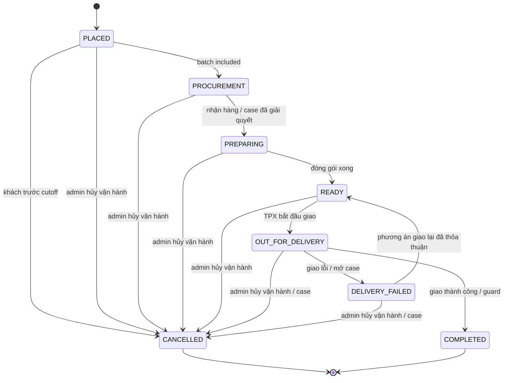
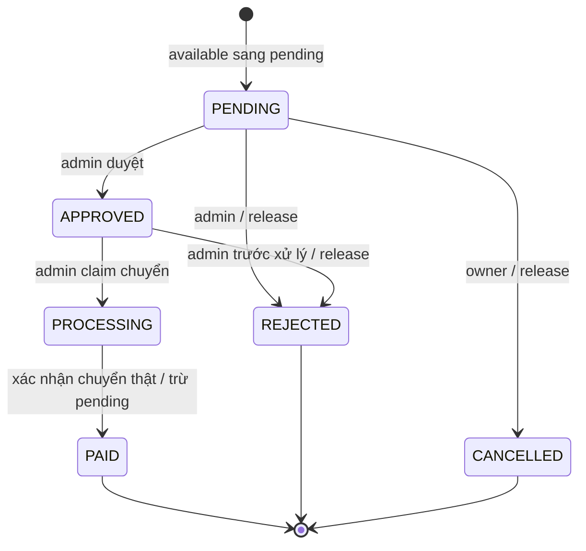

# Trạng thái domain và quyền chuyển bước

> PRD v0.1 — Draft. Tên enum/transition là thiết kế đề xuất, nguồn chính sách theo decision log. P-001/002/003/006/008 cần review trước implementation. Không có một cột status duy nhất thay tất cả các trục.

## 1. Order và fulfillment

| Command | Actor | Guard | Ghi nhận bắt buộc |
| --- | --- | --- | --- |
| place | Customer | quote hợp lệ, khả dụng/vùng/date/slot, đủ nội bộ, server time mới | snapshots + funding + ledger + outbox một transaction |
| customer cancel | Owner customer | current server time < cutoff_at, không terminal; version khớp | CANCELLED event; release/return theo P-001; bank refund plan riêng |
| admin cancel | Admin có orders.cancel | order chưa terminal, không thực hiện được/case và quyết định vận hành có reason; không dùng customer cutoff để chặn | CANCELLED, RELEASE cash/points holds; tiền hoàn theo nghĩa vụ thật, trạng thái refund riêng |
| include procurement | Admin/worker paid [P] | đúng delivery_date/batch, server time ≥ cutoff batch khi chốt mua; không cancelled; unpaid có quyền override/reason | procurement_decision; không đổi PAID |
| start preparation | Admin | included + hàng nhận/case xử lý, checklist | task/version, order event |
| ready | Admin | đủ đóng gói, không thiếu chưa quyết | task check và thời điểm |
| dispatch | Admin | READY, case hàng được giải quyết; admin quyết định giao nếu chưa đủ tiền theo D-095 | actor/reason, remaining due, delivery event; không đổi funding giả |
| fail delivery | Admin | OUT_FOR_DELIVERY | failure reason + case, không tự refund/cancel |
| retry delivery | Admin | case có agreement cho giao lại | event + reason, không hard-code số lần/phí |
| complete | Admin có orders.complete | giao thành công, không terminal/case hàng chưa xử lý; hoàn bank pending không tự chặn; complete-unpaid OQ-050 | COMPLETED, CAPTURE cash/points holds một lần, earned-points calculation/event riêng, referral event |

Khách sau cutoff không có self-cancel. Vận hành thiếu hàng sau cutoff được admin hủy/refund theo D-094, lưu actor/reason riêng; không giả lập khách hủy đúng hạn. COMPLETED/CANCELLED là terminal của order; trạng thái refund riêng. Không mở lại terminal bằng PATCH status tùy ý.

## 2. Payment, procurement và refund là các trục riêng

| Trục | Giá trị | Ý nghĩa/guard |
| --- | --- | --- |
| funding_state | UNFUNDED / PARTIAL / FUNDED | Dựa balance áp + bank matched so với nghĩa vụ sau point discount; không dựa procurement |
| procurement_decision | UNDECIDED / INCLUDED / EXCLUDED | Per batch/order; INCLUDED unpaid cần explicit override; EXCLUDED cần admin quyết định hủy/giải quyết theo D-094, không tự chạy refund hoặc để treo không xử lý |
| refund_state | NONE / PENDING / PARTIAL / REFUNDED | Projection theo các leg đã cam kết/settled và tổng còn lại; không ghi đè state order |
| case_state | OPEN / AGREED / RESOLVING / CLOSED | CLOSED khi actions đã thực hiện hoặc có resolution rõ; không chỉ vì admin đã trao đổi |
| payment_receipt | RECORDED / CONFIRMED / UNMATCHED / REVERSED [P] | Chỉ confirmed matched count vào funding; reversal phải compensating event |
| refund_leg | PENDING / PROCESSING / SETTLED / REJECTED | Source POINTS/BALANCE/BANK; external bank cần reference và trạng thái không rõ |

Receipt đến sau cancel/excluded phải mở case; không tự chuyển order thành được mua/giao. Bằng chứng/chú thích của khách chỉ notice, không đủ confirm. Hoàn tiền đã nhận không tự đặt funding UNFUNDED để yêu cầu khách trả lại đơn đã hoàn.

## 2a. Lifecycle kế hoạch hoàn [P-003]

- Refund parent: `PENDING_APPROVAL → APPROVED → PROCESSING → SETTLED`; có thể `REJECTED` chỉ trước khi bất kỳ leg nào posted hoặc bắt đầu chuyển ngân hàng.
- Tạo refund giữ hạn mức hoàn theo từng nguồn gốc ngay, tạo legs PENDING; chưa hiện đã trả tiền. Reject trước thực hiện giải phóng đúng phần cap đã giữ, không tạo bút toán tiền/điểm giả.
- Approve kiểm tra lại agreement/version/caps và post các legs nội bộ BALANCE/POINTS trong cùng transaction, đánh dấu các legs đó SETTLED. Các BANK legs vẫn PENDING cho tới khi admin claim PROCESSING.
- Claim/mark-bank-settled nhận danh sách leg IDs của cùng refund và payout destination. Nếu chuyển một lần cho nhiều legs thì ghi transfer_group_id/reference và tổng chuyển; trạng thái mỗi leg chỉ settle một lần.
- Sau khi đã có leg posted/processing, không reject toàn parent để làm mất nghĩa vụ còn lại; xử lý các legs chưa xong qua case/revision và giữ audit. Parent SETTLED khi toàn bộ legs trong phương án đã hoàn tất.
- `order.refund_state` là projection khác parent: NONE/PENDING/PARTIAL/REFUNDED. Một phương án hoàn một phần có thể SETTLED nhưng order vẫn PARTIAL; không bắt hoàn cả đơn để đóng case.
- `original_funding_id`/receipt thực nhận mô tả nguồn gốc; `payout_method` BALANCE/BANK/POINTS mô tả nơi trả. Tiền gốc BANK được trả BALANCE hoặc BANK theo thỏa thuận. POINTS chỉ trả POINTS.
- Receipt thừa hoặc đến sau cancel có phần chưa phân bổ: refund EXCESS gắn receipt với cash_excess_vnd, tách tiền hàng/phí giao, không earn/revoke điểm trên tiền thừa. Không tạo funding giả để cho phép hoàn.

## 3. Withdrawal [P-002]

- APPROVED không chuyển tiền, PROCESSING không release. Nếu ngân hàng chưa rõ kết quả thì giữ PROCESSING với reconciliation_required, không có FAILED tự giải phóng.
- Hai admin cùng claim dùng optimistic version/row lock; chỉ một request thắng. Request retry mark-paid cùng key không tạo payout lần hai.
- Bank instruction snapshot không chỉnh trong PROCESSING. Sửa nhầm entry posted cần compensating workflow có reason; không nút xóa withdrawal mất tiền.

## 4. Catalog và recipe [P-007]

- Product: DRAFT / PUBLISHED / ARCHIVED, cộng manual_enabled. Variant/recipe active version được publish sau validation.
- Ingredient: available boolean và đơn vị chuẩn; effective availability của variant/món tính từ manual flags + ingredient dependencies. UI cache phải invalidate nhưng API luôn kiểm tra gốc.
- Tắt ingredient không tạo cancellation/refund ledger cho order cũ. Đơn tương lai bị ảnh hưởng đưa vào bảng case để ops trao đổi.
- BOM/giá/delivery snapshot order không bị đổi khi catalog/recipe/settings thay phiên bản.

## 5. Notification và referral [P-006/010]

- Outbox: PENDING→DISPATCHED; crash trước/sau enqueue cho phép đọc lại và enqueue idempotent.
- Delivery attempt: QUEUED→SENDING→SENT hoặc FAILED_RETRYABLE/FAILED_FINAL/SKIPPED. Provider accepted không đồng nghĩa khách đã đọc; timeout có thể unknown outcome, không hứa exactly-once mạng.
- Referral: ATTRIBUTED→WAITING_FIRST_COMPLETION→QUALIFIED→REWARDED; DISQUALIFIED/REVERSAL_RECORDED khi đủ điều kiện proposal. Unique qualifier chặn hai order đồng thời thưởng lần đầu.
- Review: PENDING→PUBLISHED/HIDDEN với reason. Không để moderation làm sửa rating/text gốc.

## 6. Nguyên tắc command

- Tất cả command có allowed_from, guard, expected_version, idempotency và permission. Chuyển không hợp lệ409, không trả success cho state giả.
- Time guard đọc thời gian server mới sau khi có lock, không tin timestamp client hoặc transaction đã chờ từ trước cutoff; tại22:00 khóa hủy ngay cả worker chậm.
- Mỗi command commit state/event/audit/ledger/outbox cần thiết; gửi mạng sau commit. Retry phát lại kết quả, không lặp tác dụng phụ.
- Hệ thống không cần một state machine cho tất cả module; mỗi domain có state và reference để audit liên kết.

## Cập nhật review vòng1 ngày2026-10-25

- D-094: chọn CANCELLED cho admin hủy vận hành thay NOT_FULFILLED. Khách vẫn cutoff trước22h, admin có command/reason riêng; không hủy order terminal bằng patch tùy ý.
- D-093: points state HELD→CAPTURED khi complete, HELD→RELEASED khi cancel. Partial amendment phải có hold delta và version; không debit available lần hai khi capture.
- D-095: admin quyết dispatch khi chưa thu đủ, giữ funding/remaining due độc lập. Complete chưa thu đủ cần OQ-050; chưa tự assume fully-funded guard hay luôn complete được.
- D-097: fulfillment được giải quyết thì bank refund pending không tự block giao phần còn lại; case financial lifecycle vẫn giữ nghĩa vụ thật.
- D-096: admin update thay đổi đã chốt về capability; apply revision/chênh lệch/fee/points chi tiết còn OQ-042. Payout/receipt correction vẫn chưa chốt toàn P-016.
- D-099/100: cả cash/points hold đến complete, cancel mở hold; refund sau complete được phép và không thu hồi ORDER_EARN. D-100 thay D-085, không debt/offset.

Nguồn: [review vòng1](16-review-round-1.md). [Action gaps](../4-DESIGN/15-action-contract-gaps.md) cần đọc cùng update mới; state/contracts vẫn draft, chưa generate schema/code.
