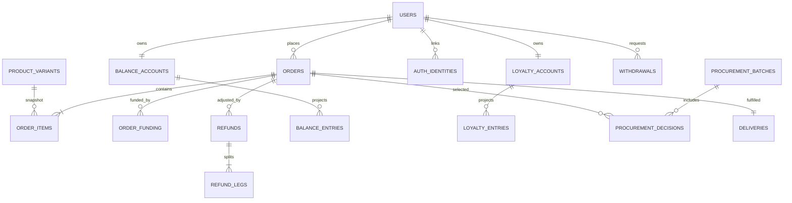

# Mô hình dữ liệu và data dictionary

> PRD v0.1 / Technical appendix — 2026-10-21. Mô hình logic để review, **chưa phải Prisma schema/migration đã freeze**. Công nghệ PostgreSQL/Prisma đã chốt; P-001–P-012 vẫn là proposal. Không tạo DB thật hoặc seed account.

## Quy ước chung

- PK `id` là UUID trừ bảng join/projection ghi PK riêng. Entity mutable có `created_at`, `updated_at`, `version`; event/ledger immutable chỉ có timestamp phát sinh và ID ổn định. FK mặc định RESTRICT cho dữ liệu giao dịch; archive/soft delete catalog, không cascade xóa đơn/tiền/điểm.
- Tiền `BIGINT` đơn vị VND, serialize chuỗi; điểm integer/BIGINT, không phân số, kiểm tra range safe ở API; khối lượng `NUMERIC(18,6)` và unit chuẩn. Số lượng mua là count nguyên các variant/pack đã công bố; gói500g được đặt count1, không tự nhận float cân rồi thu chênh lệch [P-007].
- Timestamp `TIMESTAMPTZ` lưu UTC; `delivery_date DATE` theo Asia/Ho_Chi_Minh; `cutoff_at` snapshot22:00 ngàyD−1. Timezone và giờ server dùng cho business guard.
- FK actor theo type trong audit/event là tham chiếu có kiểm tra service; không tuyên bố PostgreSQL có FK đa hình tự động. Snapshot JSONB có schema/version, không thay quan hệ ledger hoặc ownership bằng JSON tùy ý.
- Cross-row invariants (funding totals/refund remaining/pending/recipe kind/ownership) phải kiểm tra trong transaction có lock và integration tests; CHECK không thể tự đảm bảo tổng nhiều bảng.

## Quan hệ tổng quát

Cardinality wallet/loyalty/delivery có thể0 trước khi lazy-init/order tạo; sơ đồ thể hiện quan hệ sở hữu khi đã khởi tạo. Source of truth là dictionary và constraints, không dựa diagram để auto-generate schema.

## DB-001 — `users`

User TPX ổn định sở hữu đơn/tiền/điểm.

| Thuộc tính | Đặc tả |
| --- | --- |
| Fields | id UUID; firebase_project TEXT; firebase_uid TEXT; display_name TEXT; email TEXT?; contact_phone TEXT?; contact_phone_verified_at TIMESTAMPTZ?; referral_code TEXT; status ENUM; deleted_at TIMESTAMPTZ? |
| Relations | — |
| Constraints | UNIQUE(firebase_project,firebase_uid); UNIQUE(referral_code); email/phone không unique định danh |
| Indexes dự kiến | status,created_at; referral_code |

## DB-002 — `auth_identities`

Phương thức social/phone sau.

| Thuộc tính | Đặc tả |
| --- | --- |
| Fields | id; user_id UUID; issuer TEXT; provider TEXT; subject TEXT; verified_at TIMESTAMPTZ; metadata JSONB redacted |
| Relations | user_id→users |
| Constraints | UNIQUE(issuer,provider,subject); một identity chỉ thuộc một user; link bảo vệ reauth |
| Indexes dự kiến | user_id,provider |

## DB-003 — `customer_sessions`

Phiên TPX web/mobile [P-011].

| Thuộc tính | Đặc tả |
| --- | --- |
| Fields | id; user_id; audience CUSTOMER; refresh_token_hash TEXT; installation_id TEXT?; expires_at TIMESTAMPTZ; revoked_at?; rotated_to_id? |
| Relations | user_id→users; rotated_to_id→customer_sessions |
| Constraints | Chỉ hash refresh; token rotation một lần, không plaintext token trong log |
| Indexes dự kiến | user_id,revoked_at; expires_at |

## DB-004 — `customer_addresses`

Sổ địa chỉ, không thay snapshot đơn.

| Thuộc tính | Đặc tả |
| --- | --- |
| Fields | id; user_id; recipient_name TEXT; contact_phone TEXT; area_id; address_lines TEXT; notes TEXT?; is_default BOOL; archived_at? |
| Relations | user_id→users; area_id→service_areas |
| Constraints | Một default active mỗi user (partial unique); validate liên hệ không tự OTP-verified |
| Indexes dự kiến | user_id,archived_at |

## DB-005 — `admin_accounts`

Account cố định user tạo, không OTP.

| Thuộc tính | Đặc tả |
| --- | --- |
| Fields | id; login TEXT; password_hash TEXT; display_name; status; auth_version INT; last_login_at? |
| Relations | — |
| Constraints | UNIQUE(login normalized); không public signup; hash không serialize ra API |
| Indexes dự kiến | status; login |

## DB-006 — `admin_sessions`

Phiên admin tách khách.

| Thuộc tính | Đặc tả |
| --- | --- |
| Fields | id; admin_id; session_hash; idle_expires_at; absolute_expires_at; revoked_at? |
| Relations | admin_id→admin_accounts |
| Constraints | audience ADMIN riêng; không OTP/TOTP; hash only |
| Indexes dự kiến | admin_id,revoked_at; absolute_expires_at |

## DB-007 — `roles`

Nhóm quyền mở rộng.

| Thuộc tính | Đặc tả |
| --- | --- |
| Fields | id; code TEXT; name; version INT |
| Relations | — |
| Constraints | UNIQUE(code); không suy diễn vai trò nhân sự chưa được yêu cầu |
| Indexes dự kiến | code |

## DB-008 — `permissions`

Permission action/resource.

| Thuộc tính | Đặc tả |
| --- | --- |
| Fields | id; code TEXT; description |
| Relations | — |
| Constraints | UNIQUE(code); registry có các quyền theo permission matrix |
| Indexes dự kiến | code |

## DB-009 — `admin_roles`

Cấp role cho admin.

| Thuộc tính | Đặc tả |
| --- | --- |
| Fields | admin_id; role_id |
| Relations | admin_id→admin_accounts; role_id→roles |
| Constraints | PK(admin_id,role_id) |
| Indexes dự kiến | role_id |

## DB-010 — `role_permissions`

Quyền thuộc role.

| Thuộc tính | Đặc tả |
| --- | --- |
| Fields | role_id; permission_id |
| Relations | role_id→roles; permission_id→permissions |
| Constraints | PK(role_id,permission_id) |
| Indexes dự kiến | permission_id |

## DB-011 — `categories`

Danh mục catalog.

| Thuộc tính | Đặc tả |
| --- | --- |
| Fields | id; slug; name; kind RAW/MEAL_KIT; sort_order; active BOOL |
| Relations | — |
| Constraints | UNIQUE(slug); không xóa category đang dùng |
| Indexes dự kiến | kind,active,sort_order |

## DB-012 — `products`

Nguyên liệu hoặc món.

| Thuộc tính | Đặc tả |
| --- | --- |
| Fields | id; kind RAW/MEAL_KIT; category_id; slug; name; description; publish_status; manual_enabled BOOL; version INT; archived_at? |
| Relations | category_id→categories |
| Constraints | UNIQUE(slug); giá/quy cách ở variants; archive không xóa lịch sử |
| Indexes dự kiến | category_id,publish_status; kind,manual_enabled; name |

## DB-013 — `product_variants`

Quy cách/khẩu phần có giá sẵn.

| Thuộc tính | Đặc tả |
| --- | --- |
| Fields | id; product_id; sku; label; pack_spec JSONB; sale_unit; pack_qty_step INT; price_vnd BIGINT; manual_enabled; recipe_version_id?; version |
| Relations | product_id→products; recipe_version_id→recipe_versions |
| Constraints | UNIQUE(sku); price_vnd≥0, publish bán giá>0 [P]; step>0; mua count nguyên các pack |
| Indexes dự kiến | product_id,manual_enabled; sku |

## DB-014 — `ingredients`

Nguyên liệu thị trường và đơn vị chuẩn.

| Thuộc tính | Đặc tả |
| --- | --- |
| Fields | id; code; name; base_unit g/ml/piece/...; available BOOL; version INT |
| Relations | — |
| Constraints | UNIQUE(code); đổi dimension bị chặn khi có mapping/order snapshot |
| Indexes dự kiến | available; name |

## DB-015 — `variant_ingredients`

Mapping RAW variant sang nhu cầu mua.

| Thuộc tính | Đặc tả |
| --- | --- |
| Fields | id; variant_id; ingredient_id; quantity_base NUMERIC(18,6); base_unit |
| Relations | variant_id→product_variants; ingredient_id→ingredients |
| Constraints | UNIQUE(variant_id,ingredient_id); quantity_base>0; unit cùng ingredient |
| Indexes dự kiến | ingredient_id,variant_id |

## DB-016 — `recipe_versions`

BOM version theo MEAL_KIT variant.

| Thuộc tính | Đặc tả |
| --- | --- |
| Fields | id; variant_id; version_no INT; publish_status; source_reference?; created_by; published_at? |
| Relations | variant_id→product_variants; created_by→admin_accounts |
| Constraints | UNIQUE(variant_id,version_no); published immutable; active pointer ở variant |
| Indexes dự kiến | variant_id,publish_status |

## DB-017 — `recipe_components`

Thành phần gói thực giao.

| Thuộc tính | Đặc tả |
| --- | --- |
| Fields | id; recipe_version_id; ingredient_id; quantity_base NUMERIC(18,6); base_unit; preparation_note? |
| Relations | recipe_version_id→recipe_versions; ingredient_id→ingredients |
| Constraints | UNIQUE(recipe_version_id,ingredient_id); quantity>0; không gia vị/sốt gói R1 |
| Indexes dự kiến | ingredient_id,recipe_version_id |

## DB-018 — `cooking_instructions`

Hướng dẫn có nguồn.

| Thuộc tính | Đặc tả |
| --- | --- |
| Fields | id; product_id; version_no; steps JSONB; source_reference?; published_at? |
| Relations | product_id→products |
| Constraints | UNIQUE(product_id,version_no); steps sanitize/order; phân biệt phần không giao |
| Indexes dự kiến | product_id,published_at |

## DB-019 — `media_assets`

Metadata ảnh S3-compatible.

| Thuộc tính | Đặc tả |
| --- | --- |
| Fields | id; owner_admin_id; storage_key; mime; size_bytes BIGINT; checksum; status; alt_text?; source_reference? |
| Relations | owner_admin_id→admin_accounts |
| Constraints | UNIQUE(storage_key); MIME/size allowlist; chưa finalized không public |
| Indexes dự kiến | status,created_at |

## DB-020 — `product_media`

Ảnh theo sản phẩm.

| Thuộc tính | Đặc tả |
| --- | --- |
| Fields | product_id; media_id; sort_order |
| Relations | product_id→products; media_id→media_assets |
| Constraints | PK(product_id,media_id); media phải READY khi publish |
| Indexes dự kiến | product_id,sort_order |

## DB-021 — `content_pages`

Trang TPX/chính sách public.

| Thuộc tính | Đặc tả |
| --- | --- |
| Fields | id; slug; published_version_id? |
| Relations | published_version_id→content_page_versions |
| Constraints | UNIQUE(slug); public chỉ current published |
| Indexes dự kiến | slug |

## DB-022 — `content_page_versions`

Nội dung draft/published có lịch sử.

| Thuộc tính | Đặc tả |
| --- | --- |
| Fields | id; page_id; version_no; title; body JSONB/TEXT sanitized; status; source_reference?; actor_id |
| Relations | page_id→content_pages; actor_id→admin_accounts |
| Constraints | UNIQUE(page_id,version_no); draft không lộ public |
| Indexes dự kiến | page_id,status |

## DB-023 — `service_areas`

Vùng TPX cấu hình, không hard-code quận.

| Thuộc tính | Đặc tả |
| --- | --- |
| Fields | id; code; label; parent_code?; active; fee_override_vnd?; version |
| Relations | — |
| Constraints | UNIQUE(code); fee≥0 khi có override [P]; không tự giới hạn HCM bằng danh sách chưa cấp |
| Indexes dự kiến | active,parent_code |

## DB-024 — `delivery_slots`

Khung giao không quota.

| Thuộc tính | Đặc tả |
| --- | --- |
| Fields | id; area_id?; label; start_local TIME; end_local TIME; active; version |
| Relations | area_id→service_areas |
| Constraints | start<end cho khung trong ngày [P]; không capacity/quota column |
| Indexes dự kiến | area_id,active |

## DB-025 — `settings_versions`

Chính sách có version.

| Thuộc tính | Đặc tả |
| --- | --- |
| Fields | id; section; version_no; payload JSONB; status; effective_at; actor_id; change_reason |
| Relations | actor_id→admin_accounts |
| Constraints | UNIQUE(section,version_no); một ACTIVE/section; validate JSON theo schema; không secrets |
| Indexes dự kiến | section,status,effective_at |

## DB-026 — `bank_accounts`

Ngân hàng nhận tiền của TPX.

| Thuộc tính | Đặc tả |
| --- | --- |
| Fields | id; bank_code; account_number TEXT; account_name; instruction_template; active; version |
| Relations | — |
| Constraints | Public chỉ account nhận tiền được bật; không phải tài khoản rút của khách |
| Indexes dự kiến | active |

## DB-027 — `carts`

Giỏ chung theo khách.

| Thuộc tính | Đặc tả |
| --- | --- |
| Fields | id; user_id; version INT |
| Relations | user_id→users |
| Constraints | UNIQUE(user_id); guest cart local, merge cần xác nhận |
| Indexes dự kiến | user_id |

## DB-028 — `cart_items`

Lựa chọn variant trong giỏ.

| Thuộc tính | Đặc tả |
| --- | --- |
| Fields | id; cart_id; variant_id; pack_count INT |
| Relations | cart_id→carts; variant_id→product_variants |
| Constraints | UNIQUE(cart_id,variant_id); pack_count>0 và đúng step; không snapshot giá làm giá final |
| Indexes dự kiến | cart_id |

## DB-029 — `checkout_quotes`

Báo giá không giữ tiền.

| Thuộc tính | Đặc tả |
| --- | --- |
| Fields | id; user_id; cart_version; config_versions JSONB; variant_versions JSONB; snapshot JSONB; expires_at; consumed_order_id? |
| Relations | user_id→users; consumed_order_id→orders |
| Constraints | Quote chỉ đọc/tính; TTL đề xuất5 phút P-011; commit vẫn revalidate time/availability/account |
| Indexes dự kiến | user_id,expires_at |

## DB-030 — `orders`

Đơn chung và snapshot tài chính/lịch.

| Thuộc tính | Đặc tả |
| --- | --- |
| Fields | id; public_code; user_id; order_state; funding_state; refund_state; delivery_date DATE; slot_id; cutoff_at TIMESTAMPTZ; recipient_snapshot JSONB; goods_vnd G; fee_vnd F; balance_applied_vnd B; points_used INT; point_discount_vnd D; bank_due_initial_vnd T; settings_snapshot JSONB; financial_version; version; completed_at? |
| Relations | user_id→users; slot_id→delivery_slots |
| Constraints | UNIQUE(public_code); G/F/B/D/T≥0; B+D+T=G+F; D=1000×points_used; snapshot bất biến, adjustment riêng |
| Indexes dự kiến | user_id,created_at DESC,id; delivery_date,order_state; cutoff_at,order_state; funding_state,delivery_date |

## DB-031 — `order_items`

Dòng RAW/MEAL có snapshot.

| Thuộc tính | Đặc tả |
| --- | --- |
| Fields | id; order_id; variant_id; kind; pack_count INT; unit_price_vnd; line_goods_vnd; name/spec_snapshot JSONB; recipe_version_id?; version |
| Relations | order_id→orders; variant_id→product_variants; recipe_version_id→recipe_versions |
| Constraints | pack_count>0; line price integer; nguồn catalog không được cascade xóa order |
| Indexes dự kiến | order_id; variant_id |

## DB-032 — `order_item_ingredients`

Snapshot lượng cần mua từng dòng.

| Thuộc tính | Đặc tả |
| --- | --- |
| Fields | id; order_item_id; ingredient_id; quantity_base_per_pack NUMERIC(18,6); total_quantity_base NUMERIC(18,6); base_unit; recipe_reference? |
| Relations | order_item_id→order_items; ingredient_id→ingredients |
| Constraints | UNIQUE(order_item_id,ingredient_id); lượng>0; dùng snapshot, không BOM live khi gom |
| Indexes dự kiến | ingredient_id; order_item_id |

## DB-033 — `order_funding`

Phân bổ từng nguồn có provenance.

| Thuộc tính | Đặc tả |
| --- | --- |
| Fields | id; order_id; source BALANCE/BANK/POINTS_DISCOUNT; amount_vnd; points?; payment_receipt_id?; balance_entry_id?; loyalty_entry_id?; status HELD/CAPTURED/RELEASED/CONFIRMED theo source; reserved_amount_vnd; captured_amount_vnd; released_amount_vnd; version |
| Relations | order_id→orders; payment_receipt_id→payment_receipts; balance_entry_id→balance_entries; loyalty_entry_id→loyalty_entries |
| Constraints | Không tính POINTS_DISCOUNT là cash-in; amount≥0; reserve/capture/release provenance tách cash-in bank; captured+released≤reserved cho internal holds; sum allocation kiểm tra transaction; linked operation unique |
| Indexes dự kiến | order_id,source,status; payment_receipt_id |

## DB-034 — `payment_receipts`

Tiền bank thực nhận và đối soát.

| Thuộc tính | Đặc tả |
| --- | --- |
| Fields | id; order_id?; bank_account_id; actual_amount_vnd; matched_amount_vnd; excess_refund_reserved_vnd; excess_refunded_vnd; received_at; transaction_reference; dedupe_fingerprint; status; actor_id; reason |
| Relations | order_id→orders; bank_account_id→bank_accounts; actor_id→admin_accounts |
| Constraints | actual>0; 0≤matched+excess_reserved+excess_refunded≤actual; UNIQUE(bank_account_id,dedupe_fingerprint); excess không tự credit |
| Indexes dự kiến | order_id,status; received_at,status |

## DB-035 — `payment_notices`

Khách báo đã chuyển [P].

| Thuộc tính | Đặc tả |
| --- | --- |
| Fields | id; order_id; user_id; claimed_amount_vnd?; reference?; message? |
| Relations | order_id→orders; user_id→users |
| Constraints | Notice không cấp funding; sanitize/reference chỉ hỗ trợ đối soát |
| Indexes dự kiến | order_id,created_at |

## DB-036 — `balance_accounts`

Projection tiền hoàn.

| Thuộc tính | Đặc tả |
| --- | --- |
| Fields | user_id PK; available_vnd BIGINT; held_order_vnd BIGINT; pending_withdrawal_vnd BIGINT; version |
| Relations | user_id→users |
| Constraints | CHECK available≥0 AND held_order≥0 AND pending_withdrawal≥0; total=available+held_order+pending_withdrawal; held_order=sum active order funding holds; không top-up public |
| Indexes dự kiến | user_id |

## DB-037 — `balance_entries`

Ledger tiền append-only.

| Thuộc tính | Đặc tả |
| --- | --- |
| Fields | id; user_id; operation_key; entry_type; delta_available_vnd BIGINT; delta_held_order_vnd BIGINT; delta_pending_vnd BIGINT; available_after; held_order_after; pending_after; order_id?; withdrawal_id?; refund_leg_id?; adjustment_id?; actor_id?; reason; correlation_id |
| Relations | user_id→users; order_id→orders; withdrawal_id→withdrawals; refund_leg_id→refund_legs; adjustment_id→order_adjustments; actor_id→admin_accounts |
| Constraints | UNIQUE(operation_key); after≥0; entry/account cập nhật cùng transaction; không update/delete posted |
| Indexes dự kiến | user_id,created_at DESC,id; withdrawal_id; order_id; refund_leg_id |

## DB-038 — `loyalty_accounts`

Points available/held theo D-093, total_points=available+held. Các fields/enum là schema draft, chưa migration.

| Thuộc tính | Đặc tả |
| --- | --- |
| Fields | user_id PK; available_points BIGINT; held_points BIGINT; version |
| Relations | user_id→users |
| Constraints | available/held≥0; held bằng tổng order holds chưa capture/release; không gồm tiền pending rút |
| Indexes dự kiến | user_id |

D-100: không thu hồi ORDER_EARN khi refund sau complete, không debt_points/offset trong schema cho case này.

## DB-039 — `loyalty_entries`

Ledger HOLD/CAPTURE/RELEASE/earn/return/revoke/reward append-only; point enums là contract draft theo policy hold đã chốt.

| Thuộc tính | Đặc tả |
| --- | --- |
| Fields | id; user_id; operation_key; entry_type; delta_available_points BIGINT; delta_held_points BIGINT; available_after; held_after; order_id?; refund_leg_id?; referral_reward_id?; original_entry_id?; reason |
| Relations | user_id→users; order_id→orders; refund_leg_id→refund_legs; referral_reward_id→referral_rewards; original_entry_id→loyalty_entries |
| Constraints | UNIQUE(operation_key); số nguyên; HOLD(-P,+P), RELEASE(+P,-P), CAPTURE(0,-P); earn riêng(+E,0); không update/delete; capture/release không vượt held gắn order |
| Indexes dự kiến | user_id,created_at DESC,id; order_id; original_entry_id |

## DB-040 — `loyalty_redemptions`

Reservation điểm theo order; trước complete là held, không gọi toàn bộ points là đã tiêu.

| Thuộc tính | Đặc tả |
| --- | --- |
| Fields | id; order_id; user_id; reserved_points_total BIGINT; held_points BIGINT; captured_points BIGINT; released_points BIGINT; returned_points BIGINT; rate_vnd INT; state; hold_entry_id; capture_entry_id?; version |
| Relations | order_id→orders; user_id→users; hold_entry_id/capture_entry_id→loyalty_entries |
| Constraints | UNIQUE(order_id); rate=1000; amounts≥0; reserved_total=held+captured+released; returned≤captured; order-adjustment hold deltas có version/business key; cancel/complete không tác dụng hai lần |
| Indexes dự kiến | user_id; order_id; state |

Capture khi complete không giảm available lần hai. Refund sau capture được phép và RETURN captured points theo nguồn; không thu hồi ORDER_EARN D-100. Cash cùng hold/capture/release D-099, hoàn chưa thu đủ để complete vẫn OQ-050.

## DB-041 — `withdrawals`

Tiền đang rút về bank.

| Thuộc tính | Đặc tả |
| --- | --- |
| Fields | id; user_id; amount_vnd; status; bank_snapshot JSONB; submitted_at; approved_by?; processing_by?; paid_by?; bank_reference?; reconciliation_required BOOL; version |
| Relations | user_id→users; approved_by/processing_by/paid_by→admin_accounts |
| Constraints | amount>0; chỉ tiền hoàn; bank_snapshot cố định khi PROCESSING; paid chỉ qua transition hợp lệ |
| Indexes dự kiến | user_id,submitted_at DESC; status,submitted_at; processing_by,status |

## DB-042 — `withdrawal_events`

Lịch sử rút bất biến.

| Thuộc tính | Đặc tả |
| --- | --- |
| Fields | id; withdrawal_id; from_state; to_state; actor_user_id?; actor_admin_id?; reason; bank_reference?; operation_key |
| Relations | withdrawal_id→withdrawals; actor_user_id→users; actor_admin_id→admin_accounts |
| Constraints | UNIQUE(operation_key); một actor theo loại; retry không event hai lần |
| Indexes dự kiến | withdrawal_id,created_at |

## DB-043 — `operation_cases`

Ngoại lệ theo order.

| Thuộc tính | Đặc tả |
| --- | --- |
| Fields | id; order_id; case_type; state; affected_items JSONB; reason; opened_by; version |
| Relations | order_id→orders; opened_by→admin_accounts |
| Constraints | Không suy diễn case CLOSED thành đã hoàn; không tự thay hàng |
| Indexes dự kiến | order_id,state; state,created_at |

## DB-044 — `case_agreements`

Thỏa thuận xử lý khách có version.

| Thuộc tính | Đặc tả |
| --- | --- |
| Fields | id; case_id; version_no; plan JSONB; customer_agreed_at; communication_reference; actor_id; reason |
| Relations | case_id→operation_cases; actor_id→admin_accounts |
| Constraints | UNIQUE(case_id,version_no); agreed snapshot không sửa sau execute |
| Indexes dự kiến | case_id,version_no |

## DB-045 — `order_adjustments`

Chênh lệch đơn gắn thỏa thuận.

| Thuộc tính | Đặc tả |
| --- | --- |
| Fields | id; order_id; agreement_id; goods_delta_vnd; shipping_delta_vnd; state; snapshot JSONB; actor_id; operation_key |
| Relations | order_id→orders; agreement_id→case_agreements; actor_id→admin_accounts |
| Constraints | UNIQUE(operation_key); tăng cần customer agreement/thu bổ sung; không sửa snapshot gốc |
| Indexes dự kiến | order_id,state |

## DB-046 — `refunds`

Kế hoạch hoàn theo nguồn.

| Thuộc tính | Đặc tả |
| --- | --- |
| Fields | id; order_id; agreement_id; version; status PENDING_APPROVAL/APPROVED/PROCESSING/SETTLED/REJECTED; cash_goods_vnd; cash_shipping_vnd; cash_excess_vnd; points_return; earn_revoke_target; settled_totals JSONB; operation_key |
| Relations | order_id→orders; agreement_id→case_agreements |
| Constraints | UNIQUE(operation_key); giá trị không âm; remaining cap kiểm tra lock theo order; không hoàn chưa thu |
| Indexes dự kiến | order_id,status; status,created_at |

## DB-047 — `refund_legs`

Từng phần tiền/điểm hoàn.

| Thuộc tính | Đặc tả |
| --- | --- |
| Fields | id; refund_id; original_funding_id?; excess_receipt_id?; payout_method BALANCE/BANK/POINTS; amount_vnd; cash_goods_vnd; cash_shipping_vnd; cash_excess_vnd; points?; status; bank_snapshot?; bank_reference?; transfer_group_id?; processing_by?; operation_key |
| Relations | refund_id→refunds; original_funding_id→order_funding; excess_receipt_id→payment_receipts; processing_by→admin_accounts |
| Constraints | UNIQUE(operation_key); POINTS amount=1000×points; cash amount=goods+shipping+excess; đúng một nguồn funding hoặc excess receipt; pending giữ cap; BANK external ref |
| Indexes dự kiến | refund_id,status; original_funding_id; excess_receipt_id; status,created_at |

## DB-048 — `procurement_batches`

Đợt theo ngày giao.

| Thuộc tính | Đặc tả |
| --- | --- |
| Fields | id; delivery_date DATE; cutoff_at; state; build_version; version |
| Relations | — |
| Constraints | UNIQUE(delivery_date) cho một điểm tập kết; cutoff22hD−1 |
| Indexes dự kiến | cutoff_at,state |

## DB-049 — `procurement_decisions`

Đơn được mua/loại trong batch.

| Thuộc tính | Đặc tả |
| --- | --- |
| Fields | id; batch_id; order_id; decision; unpaid_override BOOL; actor_id?; reason?; version |
| Relations | batch_id→procurement_batches; order_id→orders; actor_id→admin_accounts |
| Constraints | UNIQUE(batch_id,order_id); unpaid override cần permission/actor/reason |
| Indexes dự kiến | batch_id,decision; order_id |

## DB-050 — `procurement_lines`

Tổng lượng theo nguyên liệu.

| Thuộc tính | Đặc tả |
| --- | --- |
| Fields | id; batch_id; ingredient_id; base_unit; required_qty NUMERIC(18,6); accepted_qty NUMERIC(18,6); shortage_qty NUMERIC(18,6); build_version |
| Relations | batch_id→procurement_batches; ingredient_id→ingredients |
| Constraints | UNIQUE(batch_id,ingredient_id); qty≥0; không cộng khác dimension |
| Indexes dự kiến | batch_id; ingredient_id |

## DB-051 — `procurement_sources`

Nguồn nhu cầu để trace về đơn.

| Thuộc tính | Đặc tả |
| --- | --- |
| Fields | id; line_id; order_item_ingredient_id; requested_qty NUMERIC(18,6) |
| Relations | line_id→procurement_lines; order_item_ingredient_id→order_item_ingredients |
| Constraints | UNIQUE(line_id,order_item_ingredient_id); qty>0; build retry upsert đúng version |
| Indexes dự kiến | order_item_ingredient_id; line_id |

## DB-052 — `purchase_receipts`

Lần mua thực tế ở chợ.

| Thuộc tính | Đặc tả |
| --- | --- |
| Fields | id; batch_id; actor_id; purchased_at; market_note?; total_cost_vnd; operation_key |
| Relations | batch_id→procurement_batches; actor_id→admin_accounts |
| Constraints | UNIQUE(operation_key); total_cost≥0; không update sales price |
| Indexes dự kiến | batch_id,purchased_at |

## DB-053 — `purchase_receipt_lines`

Lượng/giá vốn/chất lượng thực.

| Thuộc tính | Đặc tả |
| --- | --- |
| Fields | id; purchase_receipt_id; ingredient_id; purchased_qty NUMERIC(18,6); accepted_qty; base_unit; actual_cost_vnd; quality_note? |
| Relations | purchase_receipt_id→purchase_receipts; ingredient_id→ingredients |
| Constraints | 0≤accepted≤purchased; cost≥0; lưu actual total cost VND, không dùng float tính tiền |
| Indexes dự kiến | purchase_receipt_id; ingredient_id |

## DB-054 — `fulfillment_tasks`

Checklist sơ chế/đóng gói đơn.

| Thuộc tính | Đặc tả |
| --- | --- |
| Fields | id; order_id; state; checklist JSONB theo item; started_at?; ready_at?; actor_id; version |
| Relations | order_id→orders; actor_id→admin_accounts |
| Constraints | UNIQUE(order_id); trạng thái theo guard, không chế biến/tẩm ướp |
| Indexes dự kiến | state; order_id |

## DB-055 — `deliveries`

Một delivery cùng đơn, nhiều attempt events.

| Thuộc tính | Đặc tả |
| --- | --- |
| Fields | id; order_id; delivery_date; slot_id; recipient_snapshot JSONB; state; assigned_note?; started_at?; delivered_at?; version |
| Relations | order_id→orders; slot_id→delivery_slots |
| Constraints | UNIQUE(order_id); không quota/GPS/third-party carrier trong R1 |
| Indexes dự kiến | delivery_date,slot_id,state; order_id |

## DB-056 — `delivery_events`

Từng bước/lần giao.

| Thuộc tính | Đặc tả |
| --- | --- |
| Fields | id; delivery_id; attempt_no INT; event_type; outcome?; reason?; actor_id; operation_key |
| Relations | delivery_id→deliveries; actor_id→admin_accounts |
| Constraints | UNIQUE(operation_key); fail không tự refund; attempt counter chỉ khi bắt đầu lại có agreement |
| Indexes dự kiến | delivery_id,created_at |

## DB-057 — `order_status_events`

Timeline domain của order.

| Thuộc tính | Đặc tả |
| --- | --- |
| Fields | id; order_id; from_state?; to_state; event_type; actor_type; actor_id; reason?; operation_key; correlation_id |
| Relations | order_id→orders; actor_id polymorphic theo actor_type |
| Constraints | UNIQUE(operation_key); completed command có key duy nhất; không sửa/xóa |
| Indexes dự kiến | order_id,created_at |

## DB-058 — `referrals`

Attribution giới thiệu.

| Thuộc tính | Đặc tả |
| --- | --- |
| Fields | id; referrer_user_id; referred_user_id; code_snapshot; qualifying_order_id?; state; attributed_at; settings_version_id |
| Relations | referrer_user_id/referred_user_id→users; qualifying_order_id→orders; settings_version_id→settings_versions |
| Constraints | UNIQUE(referred_user_id); referrer≠referred; không tự dedupe theo email/phone |
| Indexes dự kiến | referrer_user_id,state; qualifying_order_id |

## DB-059 — `referral_rewards`

Mỗi bên nhận reward một lần.

| Thuộc tính | Đặc tả |
| --- | --- |
| Fields | id; referral_id; beneficiary_user_id; reward_kind; points; state; settings_snapshot; awarded_entry_id?; operation_key |
| Relations | referral_id→referrals; beneficiary_user_id→users; awarded_entry_id→loyalty_entries |
| Constraints | UNIQUE(referral_id,beneficiary_user_id,reward_kind); UNIQUE(operation_key); reward0 cần config rõ |
| Indexes dự kiến | beneficiary_user_id,state |

## DB-060 — `reviews`

Đánh giá đã mua.

| Thuộc tính | Đặc tả |
| --- | --- |
| Fields | id; user_id; order_item_id; product_id; rating INT; text; moderation_state; moderated_by?; moderation_reason?; version |
| Relations | user_id→users; order_item_id→order_items; product_id→products; moderated_by→admin_accounts |
| Constraints | UNIQUE(order_item_id,user_id); rating1..5; eligibility từ order completed; verified không client set |
| Indexes dự kiến | product_id,moderation_state,created_at; user_id |

## DB-061 — `frequent_items`

Projection thường mua và pin/hide [P].

| Thuộc tính | Đặc tả |
| --- | --- |
| Fields | user_id; variant_id; completed_count; last_completed_at?; pinned BOOL; hidden BOOL; rebuilt_at? |
| Relations | user_id→users; variant_id→product_variants |
| Constraints | PK(user_id,variant_id); source completed events idempotent; rebuild từ orders |
| Indexes dự kiến | user_id,pinned,last_completed_at |

## DB-062 — `notification_preferences`

Consent và lịch nhắc.

| Thuộc tính | Đặc tả |
| --- | --- |
| Fields | id; user_id; channel; purpose TRANSACTIONAL/MARKETING; enabled; consent_at?; revoked_at?; reminder_settings JSONB; version |
| Relations | user_id→users |
| Constraints | UNIQUE(user_id,channel,purpose); OS permission không tự là marketing consent |
| Indexes dự kiến | user_id; purpose,enabled |

## DB-063 — `device_tokens`

Token push theo user/device/env.

| Thuộc tính | Đặc tả |
| --- | --- |
| Fields | id; user_id; installation_id; environment; platform; encrypted_token; token_fingerprint; active; last_seen_at; permission_state |
| Relations | user_id→users |
| Constraints | UNIQUE(environment,token_fingerprint); login/logout rebinding không gửi user cũ |
| Indexes dự kiến | user_id,active; installation_id,environment |

## DB-064 — `notifications`

Thông báo logic theo event/user.

| Thuộc tính | Đặc tả |
| --- | --- |
| Fields | id; event_key; user_id; kind; entity_type/entity_id; payload_minimal JSONB; read_at? |
| Relations | user_id→users |
| Constraints | UNIQUE(event_key,user_id,kind); không token/bank/contact trong public preview |
| Indexes dự kiến | user_id,created_at DESC; read_at |

## DB-065 — `notification_attempts`

Lần gửi từng kênh/đích.

| Thuộc tính | Đặc tả |
| --- | --- |
| Fields | id; notification_id; channel; destination_fingerprint; attempt_no; status; provider_reference?; error_code?; next_attempt_at?; operation_key |
| Relations | notification_id→notifications |
| Constraints | UNIQUE(operation_key); UNIQUE(notification_id,channel,destination_fingerprint,attempt_no); có trạng thái unknown outcome |
| Indexes dự kiến | status,next_attempt_at; notification_id |

## DB-066 — `outbox_events`

Sự kiện sau commit domain.

| Thuộc tính | Đặc tả |
| --- | --- |
| Fields | id; aggregate_type/id/version; event_type; dedupe_key; payload_minimal JSONB; status; attempts; next_attempt_at; dispatched_at? |
| Relations | aggregate_id tham chiếu domain theo type |
| Constraints | UNIQUE(dedupe_key); ghi cùng domain transaction; retry không mất event |
| Indexes dự kiến | status,next_attempt_at; aggregate_type,aggregate_id |

## DB-067 — `idempotency_records`

Kết quả command để retry an toàn.

| Thuộc tính | Đặc tả |
| --- | --- |
| Fields | id; actor_type/id; operation; client_key; request_hash; state; resource_type/id; response_redacted JSONB; expires_at? |
| Relations | actor/resource theo type |
| Constraints | UNIQUE(actor_type,actor_id,operation,client_key); khác payload409; operation refs ledger giữ lâu hơn TTL request |
| Indexes dự kiến | state,created_at; resource_type,resource_id |

## DB-068 — `audit_logs`

Audit thao tác admin/nhạy cảm.

| Thuộc tính | Đặc tả |
| --- | --- |
| Fields | id; actor_type/id; action; resource_type/id; reason; before_redacted JSONB?; after_redacted JSONB?; request_id; operation_key?; occurred_at |
| Relations | actor/resource theo type |
| Constraints | append-only; không password/token/secret/bank đầy đủ; lý do cho money commands |
| Indexes dự kiến | resource_type,resource_id,occurred_at; actor_id,occurred_at |

## Transactions, migrations và khôi phục

1. Place order: lock user balance/loyalty, revalidate quote/cart/variants/settings/time; tạo order/items/ingredient snapshots/funding/ledger/outbox và command result atomic. Không gọi provider trong DB transaction.
2. Withdraw: lock balance account rồi request, move available→pending + ledger/request/event trong cùng transaction; approve không trừ tổng; paid chỉ trừ pending sau external transfer confirmed.
3. Confirm bank: dedupe actual receipt, lock order, matched allocation không vượt actual; ghi unmatched/excess case và outbox; không auto-credit ví.
4. Refund: lock account(s) và order/refund theo thứ tự thống nhất, tính cumulative remaining gồm legs pending; post mỗi internal leg/revoke một lần. External BANK claim→manual transfer→settle, không transaction DB bao trùm thao tác ngân hàng.
5. Complete: lock order, guard state, set completed_at một lần; earned-points event/referral qualifier unique. Hoàn trước complete phải giảm base trước earn.
6. Phải xác định một lock ordering duy nhất khi freeze implementation, ví dụ accounts theo user_id→orders→refund/withdraw→ledgers; mọi command tuân thủ, deadlock retry bounded/idempotent. Không gọi lồng transaction tách biệt có thể commit nửa nghiệp vụ.
7. Prisma migrations theo phiên bản được pin sau Technical review; FK vòng như content published pointer/active recipe/ledger refs tạo theo giai đoạn, không seed dữ liệu violates constraints. SQL bổ sung cho partial indexes/locking nếu ORM version cần.
8. Native PostgreSQL/Redis trong local/CI hoặc services có sẵn, không Testcontainers/Docker. Dry-run migration trên DB disposable và restore backup trước deployment; không chạy migration production lúc soạn PRD.
9. Reconcile account projections từ ledger, pending từ withdrawals active, source limits từ order_funding/refunds; alerts không tự overwrite ledger.

## Bảo vệ dữ liệu và vòng đời

- User có UUID nội bộ ổn định khi link thêm phone/provider; không migrate số dư theo email hoặc phone tự nhập. Identity project/env ràng buộc Firebase config đúng.
- Public chỉ nhận nội dung published và bank nhận tiền TPX được công bố; customer bank withdrawal snapshot chỉ owner/admin có quyền. Che ở list/log; secrets/provider keys nằm env/secret store, không settings payload public.
- Không xóa order/ledger khi xóa account; P-011 định nghĩa request/anonymization và retention cần duyệt. Không đặt số ngày retention tùy ý.
- Index money/event history phân trang keyset(created_at,id); report theo business date/status có indexes dự kiến; xác nhận bằng EXPLAIN/benchmark khi có implementation.

## Nguồn kỹ thuật

- [PostgreSQL constraints](https://www.postgresql.org/docs/current/ddl-constraints.html), [row locking](https://www.postgresql.org/docs/current/explicit-locking.html).
- [Firebase verify ID tokens](https://firebase.google.com/docs/auth/admin/verify-id-tokens), [account linking](https://firebase.google.com/docs/auth/flutter/account-linking).
- Product policy và AC nằm trong [financial rules](../2-PRD/13-financial-rules.md) và [domain states](../2-PRD/12-domain-states.md).
