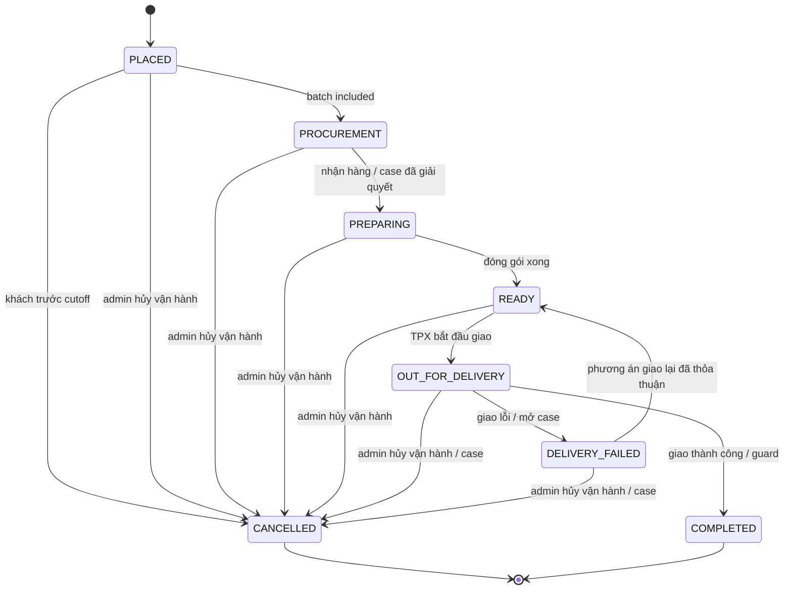
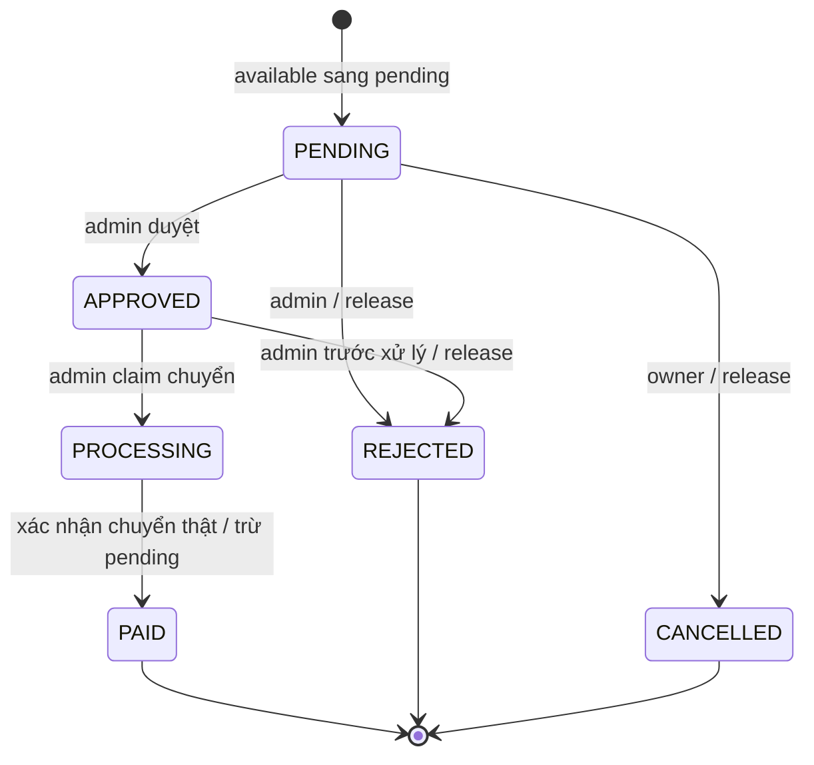

# TPX — Context độc lập cho Claude Design

> Brief v0.4 · 2026-10-25. Đính kèm với prompt01. Nội dung nguồn đã nhúng; link repo chỉ để truy vết, không yêu cầu truy cập máy người dùng. Đây là input, chưa có design output hoặc app implementation.

Tạo Design System Package và UI Workflow Package. Phạm vi21feature groups/63screens/56CMP/25J/100FC/190screen×surface cells; source AC bên dưới là116. D-093–100 và review mới nhất ưu tiên trên proposals cũ. OQ-048/049 đã đóng; OQ-050/OQ-042 còn mở và có yêu cầu branch frames. Các P khác có trạng thái từng phần, không mặc định tất cả pending hoặc approved.

Quyền tự chọn visual typography/layout/tokens trong brand #309953/#F9A01B; không tự chốt business. Copy UI tiếng Việt, annotations tách riêng. Giao actual editable artifacts và evidence theo output contract, không chỉ mô tả chữ.


---

## 0. Review mới nhất — cash/points holds và refund giữ earned points

### Review PRD vòng1 — 2026-10-25

> Nguồn mới nhất **D-093–100**, bao gồm hai câu làm rõ. Các nội dung dưới là phần user đã xác định; không đồng nghĩa duyệt mọi P-001–019. Chưa có implementation.

| Chủ đề | Đã chốt | Còn mở |
| --- | --- | --- |
| Nguồn nội bộ | Cả số dư tiền hoàn và điểm HOLD khi order tạo thành công, không dùng/rút tiếp. Complete mới CAPTURE, cancel RELEASE | Hold delta khi admin sửa đơn: OQ-042 |
| Không thực hiện được | Admin hủy/CANCELLED, mở hold, hoàn tiền thật theo thỏa thuận; không NOT_FULFILLED | Chi tiết partial/refund P-003 |
| Đơn thiếu tiền | Admin quyết định có giao; giữ remaining due và không ghi PAID giả/COD | Complete-unpaid và earn khi đó: OQ-050 |
| Sửa/thay món | Admin có chức năng update thay đổi | Xác nhận/thu thêm, thay hold/fee/caps: OQ-042 |
| Hàng còn lại / tiền hoàn | Phần hàng đã thống nhất có thể giao khi bank refund pending | Không tự bỏ guard hàng/quyền, không settled giả |
| Hoàn sau complete | Được phép; **không thu hồi ORDER_EARN đã thưởng**, dù đã dùng hay chưa. D-100 thay D-085; không debt/offset | Referral reward là nhóm khác, vẫn theo review P-006 |

#### Hai loại hold tiền phải tách

```text
wallet_total = available_vnd + held_order_vnd + pending_withdrawal_vnd
points_total = available_points + held_points
```

Ví200k: rút150k → available50k / pending-rút150k / held-đơn0 / total200k. Dùng50k cho đơn mới → available0 / pending-rút150k / held-đơn50k / total200k. Cancel đơn → available50k / pending-rút150k / held-đơn0 / total200k. Complete đơn → available0 / pending-rút150k / held-đơn0 / total150k trước các sự kiện khác. Chỉavailable mới có thể đặt/rút.

Điểm100/chọn50: place→available50/held50/total100; cancel→100/0/100; complete→50/0/50 trước earn. CAPTURE chỉ giảm held, không trừ available lần hai. Quote chưa tạo đơn không giữ nguồn. Hai nguồn reserve atomically, không hold một nguồn mồ côi nếu place thất bại.

#### Hoàn trước và sau complete

- Trước complete: hủy/giảm đơn release đúng phần cash/points còn hold. Release không phải refund một khoản đã capture, không cộng available thêm lần nữa qua refund leg.
- Complete: capture đúng phần cash/points còn allocated, cộng ORDER_EARN riêng theo nội dung cuối đã thống nhất, một lần.
- Sau complete: hoàn tiền/điểm đã capture theo nguồn/thỏa thuận; giữ nguyên ORDER_EARN đã cấp. Không debt_points, không lấy tiền khách bù điểm, không chạy complete lại để thưởng thêm.
- Partial trước complete cần chốt split/hold delta qua admin update; không tự áp tỷ lệ giảm/thu thêm ngoài thỏa thuận.

#### Trạng thái

OQ-048/049 đã đóng bằng hai câu trả lời rõ. OQ-050 và OQ-042 còn chi tiết; không tự coi quyền giao thiếu tiền là quyết định complete/earn chưa thu đủ hoặc coi admin update là mọi cách settlement đã chốt. Đã unblock đặc tả joint hold/capture/release và refund giữ earned points; chưa freeze gates.


---

## A. Brief sản phẩm và brand

### Design brief — Thực phẩm xanh (TPX)

> v0.4 · 2026-10-25 · Đầu vào thiết kế, chưa phải design output. Nguồn mới nhất D-001–100 và review PRD vòng1. Visual choices ngoài hai màu là đề xuất của designer; business chưa chốt phải có annotation riêng.

#### 1. Kết quả cần có

**Design System Package** và **UI Workflow Package** cho toàn bộ R1. Thiết kế high fidelity, component library tái sử dụng và prototype có thể đi hết hành trình. Bàn giao source/editable artifact, tokens, asset provenance và mapping thực, theo [output contract](07-claude-design-output-contract.md).

Phạm vi: **21 nhóm user story, 116 acceptance criteria, 63 màn logic, 56 components, 25 journeys và 100 cases**. 13 UF/28 UC là flow groups trong PRD; J/FC là chi tiết tương tác bổ sung, không phải màn mới. P1 vẫn thuộc R1. Đếm màn/default frame không thay việc thiết kế success/error/recovery.

#### 2. Sản phẩm và người sử dụng

TPX trực tiếp bán rau củ quả, thịt cá trứng. Khách đặt trước → TPX gom đơn → mua chợ đầu mối → tập kết một điểm → làm sạch/cắt/chia → TPX tự giao. Khách gia đình, người đi làm, nhà hàng dùng chung flow, thử nghiệm nội thành TP.HCM.

Hai lối mua dùng cùng giỏ/đơn/lần giao: RAW theo quy cách và số gói; MEAL là gói nguyên liệu chính theo món/khẩu phần, giá sẵn, có hướng dẫn nấu. Gói không gồm gia vị/nước sốt, không nấu hoặc tẩm ướp, không cho tùy biến từng nguyên liệu. Trình bày rõ TPX giao gì và khách cần tự chuẩn bị gì.

Trải nghiệm khách ưu tiên dễ chọn món/hàng, đọc quy cách/giá/ngày giao và biết tiền nào còn có thể sử dụng. Admin ưu tiên xử lý đúng đơn/tiền/thu mua, tra được quyết định và biết việc gì còn chờ.

#### 3. Hướng thị giác

Giữ primary **#309953**, accent **#F9A01B**, tên Thực phẩm xanh/TPX. Đề xuất light theme, nền trung tính sáng, typography Việt rõ, ảnh thực phẩm tự nhiên; orange nhấn vừa đủ. Consumer ưu tiên ảnh và quyết định mua, admin ưu tiên bảng/form và phân cấp số liệu; cùng ngôn ngữ tokens, khác mật độ/chrome phù hợp tác vụ.

Chưa có logo/ảnh/catalog chính thức: dùng wordmark đơn giản, dữ liệu và asset demo có ghi nguồn. Designer tự chọn font/icon/layout và đề xuất semantic shades đủ contrast. Không gắn claim nông trại/organic/chứng nhận khi chưa có bằng chứng. Không thêm logo redesign, dark theme hoặc animation phức tạp thành điều kiện làm chậm flow chính.

#### 4. Surfaces và mức bao phủ

| Nhóm | Yêu cầu |
| --- | --- |
| 32 màn khách | WEB_DESKTOP, WEB_MOBILE, APP_IOS, APP_ANDROID |
| 31 màn admin | ADMIN_DESKTOP, ADMIN_COMPACT; browser responsive, không app admin/shipper riêng |
| Tổng | 190 cặp screen × surface, tất cả cần evidence default layout |

Web mobile phải có layout của màn đó; app Flutter có native navigation/back/keyboard/safe area. iOS/Android có thể dùng shared frame nếu có source thật và notes khác biệt. Admin compact cần thể hiện thông tin và action trọng yếu, không chỉ thu nhỏ bảng desktop. Chi tiết viewport/adaptive tại [design system requirements](02-design-system-requirements.md).

#### 5. Business đã chốt phải thể hiện đúng

- Chốt mua 22h HCM. Trước 22h sớm nhất ngày mai, từ 22h ngày kia, tối đa ngày đặt+7. Giao ngày D thì khách hủy trước 22h D−1; admin có nhánh hủy vận hành riêng khi không thực hiện được.
- Giá bán công bố, snapshot đơn không đổi theo giá chợ. Hết/không đạt: TPX trao đổi khách và ghi phương án, không tự thay hàng. Giao phần còn lại đã thống nhất không bị chặn chỉ vì bank refund pending.
- Bank transfer, xác nhận thực nhận thủ công; không COD. Client notice hoặc admin duyệt mua/giao không làm PAID. Admin quyết định giao khi chưa thu đủ, số còn phải thu vẫn hiển thị/audit. Complete-unpaid còn OQ-050.
- Thứ tự: tiền hoàn available → điểm nếu khách chọn trong caps → bank remainder. **Cả cash và points HOLD khi tạo đơn thành công; complete mới CAPTURE, hủy RELEASE.** Không dùng hold của đơn khác hoặc pending rút; quote chưa commit không hold. Capture không trừ available lần hai.
- Cash: total=available+held_order+pending_withdrawal. Points: total=available+held. Không top-up/rút điểm/expiry. Duyệt rút không đồng nghĩa đã chuyển tiền; processing unknown chưa được tự giải phóng.
- Tích1điểm/1.000đ tiền hàng đủ điều kiện sau complete, floor; dùng 1điểm giảm1.000đ. Trần% trên hàng sau giảm giá trước cash, không phí giao, đồng thời có trần VND. Phần cash vẫn tích, phần trả points/phí giao không tích.
- **Cho hoàn sau complete, giữ nguyên ORDER_EARN đã thưởng** (D-100 thay D-085). Hoàn points đã thanh toán là RETURN captured points, khác earned points; trước complete chỉ RELEASE holds. Không debt/clawback/offset hoặc lấy cash bù điểm.
- Khách đăng nhập Google/Facebook/Apple; SĐT nhận hàng chưa OTP, phone login sau. Admin fixed accounts/password, không OTP/TOTP, có RBAC/audit. Zalo và push app; consent nhắc đặt khác quyền OS.

#### 6. Phần chưa chốt: thiết kế nhánh có annotation

Đọc trạng thái từng phần [P-001–019](../2-PRD/11-review-decisions.md), không đánh đồng tất cả còn pending. OQ-048/049 đã đóng bằng D-099/100. **OQ-050** (complete/earn khi admin giao chưa đủ tiền) và **OQ-042** (settlement/hold delta khi admin update) chưa có câu trả lời. Các chi tiết P-002/003/005/006/007/009/010/011/013/016/017/019 cũng có phần proposal.

Designer thể hiện branch/variant và assumptions ngoài product UI; không tự chốt policy, fake API hoặc để technical IDs vào copy khách. Hai nhánh ưu tiên có mẫu cụ thể tại [flow requirements](03-screen-flow-requirements.md). Không cần chờ mọi proposal được duyệt để thiết kế các phần đã rõ.

#### 7. Cách dùng bộ brief

Có repo: đọc02/03/04/07, journeys13 và cases14. Không có repo: gửi [prompt](01-claude-design-prompt.md) kèm [context pack độc lập](08-claude-design-context.md), pack đã nhúng nguồn cần thiết. Audit12 là snapshot lịch sử có disposition mới, không phải policy hiện tại.

Ngoài scope: COD, tự nạp, rút điểm, expiry, phone OTP bản đầu, marketplace, gia vị/sốt, GPS, chat/AI/OCR/crawler, voucher/subscription/paywall. Prototype chỉ mô phỏng; không kết nối ngân hàng/OAuth/server thật. Chưa tạo/import design artifacts; actual DS/UI output vẫn Pending.


---

## B. Design system requirements

### Design system requirements — TPX

> v0.4 · 2026-10-25. Đây là yêu cầu đầu vào, chưa có library delivered. Hai brand colors đã chốt; font/scale/shades/layout là phương án designer cụ thể hóa và review.

#### 1. Foundation boards và token architecture

Primitive → semantic → component tokens, alias resolve được, không cycle. Dùng tên ổn định, giá trị có type/unit/description. Mapping web CSS variables/React và Flutter theme cùng semantic intent, không yêu cầu Flutter import CSS.

| Nhóm token | Nội dung phải xuất | Mẫu kiểm tra |
| --- | --- | --- |
| Color | Brand #309953/#F9A01B; neutral/text/surface/border/action/status/focus/disabled/overlay | Default/hover/pressed/focus/disabled và contrast table cho actual pairs |
| Typography | Font Việt/license/fallback, weights, heading/body/label/caption/numeric, line-height/tracking | Tên món nhiều dấu, địa chỉ dài, 1.000.000đ, điểm/qty; đề xuất consumer 16–18px/admin 14–16px |
| Spacing/sizing | Insets/gaps, heights, hit areas, max-width, density | Đề xuất base 4px, scale 4/8/12/16/24/32/48; actual layout constraints |
| Shape/border/elevation | Radius, strokes, shadows, focus rings | Cards/input/dialog/sheet có hierarchy, không dựa shadow để nhận biết state |
| Layout/breakpoints | Columns/gutters/containers, overflow, sticky header/CTA, safe area/keyboard | Nêu layout rule giữa widths, không chỉ liệt kê breakpoints |
| Motion | Timing/easing cho press/transition/loading, reduced-motion | Đề xuất 120–240ms; animation không che số tiền hoặc khẳng định success sớm |
| Assets/icons | Một icon family, sizes/strokes/labels; image ratio/placeholder/source/alt | Product RAW/MEAL, cooking instructions, social identity assets |
| Domain | Cash available/held-order/pending-withdrawal; points available/held; order/payment/refund/procurement | Mỗi bucket/status có label/icon/text, không gom mọi pending thành một màu hoặc một con số |

Gallery phải cho xem foundations và component instances đủ states, không chỉ bảng token chữ. Đề xuất light theme; dark theme ngoài phạm vi bắt buộc. Logo chưa chốt dùng wordmark tạm, không chặn flow design.

#### 2. Color và accessibility

Brand primitive giữ nguyên, semantic action/text có thể dùng shade khác. Phép tính sRGB: trắng trên #309953≈3,62:1; trắng trên #F9A01B≈2,08:1. Ví dụ shade đề xuất #237B3F/trắng≈5,28:1; #F9A01B/chữ #142118≈7,99:1. Designer đo lại tất cả actual foreground/background pairs, không suy ra brand color mặc nhiên phù hợp chữ trắng.

Target text 4,5:1 và large text 3:1 theo [W3C contrast guidance](https://www.w3.org/WAI/WCAG22/Understanding/contrast-minimum.html). TPX đề xuất hit area chính 44CSSpx web và 48logicalpx Flutter; đây là project target, khác minimum 24CSSpx và exceptions của [W3C target size](https://www.w3.org/WAI/WCAG22/Understanding/target-size-minimum.html).

Focus-visible/keyboard/read order, label/help/error/required, screen-reader announcements, text scale 200%, reduced motion và thông tin không chỉ bằng màu. Critical examples: checkout, wallet, withdraw, admin receipt/refund/delivery. Đo actual design, không gắn badge accessibility-pass chỉ vì dùng thư viện.

Social buttons dùng provider assets/branding: [Google guidance](https://developers.google.com/identity/branding-guidelines), [Apple guidance](https://developer.apple.com/design/human-interface-guidelines/sign-in-with-apple). Không recolor logo provider thành xanh TPX; nội dung tiếng Việt và phương án provider unavailable/cancel phải rõ.

#### 3. Layout và interaction theo platform

| Surface | Viewport mẫu đề xuất | Behavior phải bàn giao |
| --- | --- | --- |
| WEB_DESKTOP | 1440CSSpx | Header/search/catalog, grid, checkout summary; keyboard/focus, direct URL/refresh, browser Back/multi-tab |
| WEB_MOBILE | 390CSSpx; check320/360 | Nav mobile, filter sheets, sticky CTA không che tổng/field error, keyboard/scroll, bank-app return |
| APP_IOS | 390logicalpx | Native shell, safe area, keyboard, sheet dismissal/back gesture, cold/warm start, auth/push/deep link |
| APP_ANDROID | 412logicalpx | System Back/activity resume, keyboard, native surfaces, provider/push return; khác biệt có notes |
| ADMIN_DESKTOP | 1440CSSpx | Sidebar, breadcrumbs, filter/table/detail, row actions, unsaved changes và reason confirmations |
| ADMIN_COMPACT | 390CSSpx | Prioritized fields/list-detail, readable totals/destination, sticky action vừa đủ; không thu nhỏ toàn bảng |

Tablet 768–1024 cần adaptive rules; hỗ trợ text dài và desktop zoom. Breakpoints/viewports là đề xuất thiết kế, không phải giới hạn thiết bị production đã chốt. Web không ép cài app để hoàn tất đơn; admin không có app nhân viên riêng.

#### 4. Component contract

56 CMP trong [inventory](04-component-inventory.md), gồm primitives và domain patterns. Mỗi CMP bàn giao purpose/anatomy/properties; variants/sizes/states; semantic tokens; dimensions/constraints; responsive/native behavior; interaction/validation/accessibility; usage/do-don’t; Screens/J/FC refs và actual source/frame.

Default/hover(web)/pressed/focus-visible/selected/disabled/submitting/loading/empty/invalid/network/offline/access/locked/stale/conflict/unknown/success phải được xác định theo loại component. N/A có lý do; không nhân mọi state lên mọi component một cách máy móc. State reused cần instance/context rõ.

Form giữ input khi lỗi, focus field sai, pending không tạo success. Confirmation nêu action/amount/source/destination/reason và hậu quả. Table có filters/sort/pagination/selection/empty/stale, compact drilldown và action permission. Multi-select/bulk chỉ là pattern; không tự thêm bulk financial commands ngoài PRD.

#### 5. Domain patterns ưu tiên

- CMP-020 price allocation: hàng/fee, cash hold, points hold, bank remaining và earn dự kiến; quote khác order đã tạo.
- CMP-021/CMP-027/CMP-028: cash available/held_order/pending_withdrawal/total; points available/held/total. HOLD chuyển bucket, CAPTURE chỉ giảm held, RELEASE mở lại; không dùng cùng nhãn cho tiền và điểm.
- CMP-022: points opt-in/caps, held/captured/released/earned/returned; refund sau complete giữ earned points, không debt/clawback.
- CMP-024/025/026: order, funding, procurement, refund tách trục; absolute cutoff22h D−1, admin cancel khác customer cancel.
- CMP-029/030: request/review/process/unknown/settle, source cash vs payout bank/points, hold-release khác refund captured; pending chưa settled.
- CMP-040/041/042/043: nguồn RAW/BOM, quantity/unit/demand revision, shortage/allocation, agreement, delivery outcome, admin dispatch thiếu tiền và refund pending không tự block phần hàng đã thống nhất.
- CMP-051/052/053/054: provider/session/access, version conflict/recovery/audit; chỉ expose capabilities có contract hoặc annotation proposal.

Thông tin OQ-050 và OQ-042 thể hiện theo branch requirements ở03, không bake một policy chưa chốt vào default component. UI copy không chứa HOLD/CAPTURE/ORDER_EARN/enum/API/P-ID; dùng “Đang giữ cho đơn”, “Đã sử dụng”, “Đã mở giữ”, “Điểm đã tích” phù hợp context.

#### 6. Chất lượng và bàn giao

Font có license/provenance và glyph tiếng Việt; images có actual source/license/demo flag/alt; icon style thống nhất. Không giả ảnh trang trại là nguồn gốc hàng. Bàn giao token JSON thực có đầy đủ giá trị, aliases và unit mapping; component gallery/states/source refs cùng accessibility report theo [output contract](07-claude-design-output-contract.md).


---

## C. Story/screen/flow/state và policy branches

### Screen, user-story và flow requirements — TPX

> Brief v0.4 — Planned, chưa có frame delivered. PRD có 21 feature/user-story groups, 63 Screen IDs, 13 core flows. US IDs là alias traceability trong handoff, không tạo feature/business mới. UC là scenario để designer thể hiện nhánh tương tác.

#### 1. Definition of done cho coverage

- Mỗi Screen ID có default UI và navigation/interaction trên đúng surfaces. 32 screen khách × 4 surfaces + 31 screen admin × 2 surfaces = **190 coverage cells**.
- Default cần actual frame/source reference. iOS/Android có thể dùng shared frame nếu anatomy giống và có notes safe area/back/keyboard/typography/provider; mỗi cell vẫn có mapping và bằng chứng, không ghi trống hoặc chỉ “giống app”.
- Web desktop và mobile có layout cụ thể; admin compact có actual composed view giữ hành động/fields quan trọng, table chuyển list/detail khi cần. Shared component không được làm mất màn/context.
- Required states có thể dùng shared component frame + screen-specific copy/actions/placement nếu không đổi anatomy; state làm đổi quyết định tiền/date/quyền cần frame ví dụ gắn đúng Screen ID.
- Từng user story phải có flow entry→action→success/error/exit, gồm thao tác admin liên quan. P1 cũng phải đủ trong R1.

#### 2. User-story coverage

| Story alias | PRD feature/spec | User story nguồn | Screens | Scenarios cần có |
| --- | --- | --- | --- | --- |
| US-001 | [F-001](../2-PRD/04-detailed-feature-specs/F-001.md) | Là khách, tôi muốn đăng nhập web/app và giữ cùng dữ liệu mua hàng để sử dụng TPX đúng quy tắc đã công bố. | S-009, S-010, S-011, S-032 | UC-004 |
| US-002 | [F-002](../2-PRD/04-detailed-feature-specs/F-002.md) | Là khách và admin, tôi muốn mua theo quy cách TPX công bố để sử dụng TPX đúng quy tắc đã công bố. | S-001, S-002, S-003, S-004, S-035, S-036 | UC-001, UC-017 |
| US-003 | [F-003](../2-PRD/04-detailed-feature-specs/F-003.md) | Là khách và admin, tôi muốn mua gói nguyên liệu chính đủ cho món theo khẩu phần để sử dụng TPX đúng quy tắc đã công bố. | S-001, S-003, S-005, S-006, S-007, S-037, S-038, S-039 | UC-002, UC-018 |
| US-004 | [F-004](../2-PRD/04-detailed-feature-specs/F-004.md) | Là khách, tôi muốn đặt cả hai nhóm trong một đơn và lần giao để sử dụng TPX đúng quy tắc đã công bố. | S-008, S-012, S-013, S-014, S-017, S-018, S-019, S-041, S-042 | UC-001, UC-002, UC-003, UC-005, UC-009, UC-020 |
| US-005 | [F-005](../2-PRD/04-detailed-feature-specs/F-005.md) | Là khách và admin, tôi muốn biết số phải chuyển và xác nhận tiền nhận thực tế để sử dụng TPX đúng quy tắc đã công bố. | S-014, S-016, S-017, S-042, S-043 | UC-006, UC-020 |
| US-006 | [F-006](../2-PRD/04-detailed-feature-specs/F-006.md) | Là admin, tôi muốn gom đúng đơn theo ngày giao và quyết ngoại lệ để sử dụng TPX đúng quy tắc đã công bố. | S-037, S-039, S-044, S-045, S-046 | UC-018, UC-021 |
| US-007 | [F-007](../2-PRD/04-detailed-feature-specs/F-007.md) | Là admin và khách, tôi muốn theo dõi từ nhận hàng đến giao hoàn thành để sử dụng TPX đúng quy tắc đã công bố. | S-019, S-042, S-046, S-047, S-048, S-049 | UC-022 |
| US-008 | [F-008](../2-PRD/04-detailed-feature-specs/F-008.md) | Là khách và admin, tôi muốn chọn lịch đúng cutoff và phạm vi phục vụ để sử dụng TPX đúng quy tắc đã công bố. | S-012, S-013, S-014, S-015, S-048 | UC-005 |
| US-009 | [F-009](../2-PRD/04-detailed-feature-specs/F-009.md) | Là admin cố định, tôi muốn vận hành theo quyền và truy vết từng thao tác để sử dụng TPX đúng quy tắc đã công bố. | S-033, S-034, S-035, S-036, S-038, S-055, S-056, S-057, S-058, S-063 | UC-016, UC-017, UC-020, UC-026 |
| US-010 | [F-010](../2-PRD/04-detailed-feature-specs/F-010.md) | Là khách và admin có quyền, tôi muốn dùng available và đối soát số dư để sử dụng TPX đúng quy tắc đã công bố. | S-022, S-052, S-055, S-056 | UC-003, UC-007, UC-023, UC-026 |
| US-011 | [F-011](../2-PRD/04-detailed-feature-specs/F-011.md) | Là khách và admin, tôi muốn giữ tiền rút và biết kết quả ngân hàng để sử dụng TPX đúng quy tắc đã công bố. | S-023, S-024, S-053, S-054 | UC-007, UC-024 |
| US-012 | [F-012](../2-PRD/04-detailed-feature-specs/F-012.md) | Là khách và admin, tôi muốn tích sau hoàn thành và dùng trong giới hạn để sử dụng TPX đúng quy tắc đã công bố. | S-014, S-021, S-025, S-052, S-055, S-056 | UC-003, UC-008, UC-022, UC-023, UC-026 |
| US-013 | [F-013](../2-PRD/04-detailed-feature-specs/F-013.md) | Là khách và admin, tôi muốn nhận đúng trạng thái và biết khi gửi lỗi để sử dụng TPX đúng quy tắc đã công bố. | S-029, S-030, S-060 | UC-015, UC-028 |
| US-014 | [F-014](../2-PRD/04-detailed-feature-specs/F-014.md) | Là admin, tôi muốn điều chỉnh chính sách có version không sửa đơn cũ để sử dụng TPX đúng quy tắc đã công bố. | S-059, S-063 | UC-025, UC-026 |
| US-015 | [F-015](../2-PRD/04-detailed-feature-specs/F-015.md) | Là khách và admin, tôi muốn xem thông tin hàng hóa/TPX đáng tin và đúng thực tế để sử dụng TPX đúng quy tắc đã công bố. | S-001, S-004, S-006, S-007, S-031, S-040, S-061 | UC-002, UC-019, UC-027 |
| US-016 | [F-016](../2-PRD/04-detailed-feature-specs/F-016.md) | Là khách đã mua và admin, tôi muốn đánh giá hàng đã nhận và quản lý nội dung để sử dụng TPX đúng quy tắc đã công bố. | S-004, S-006, S-028, S-062 | UC-014, UC-027 |
| US-017 | [F-017](../2-PRD/04-detailed-feature-specs/F-017.md) | Là khách mới/người giới thiệu và admin, tôi muốn giới thiệu bạn và nhận điểm theo setting để sử dụng TPX đúng quy tắc đã công bố. | S-026, S-056 | UC-011, UC-022 |
| US-018 | [F-018](../2-PRD/04-detailed-feature-specs/F-018.md) | Là khách, tôi muốn tạo giỏ mới nhanh từ đơn cũ để sử dụng TPX đúng quy tắc đã công bố. | S-018 | UC-012 |
| US-019 | [F-019](../2-PRD/04-detailed-feature-specs/F-019.md) | Là khách, tôi muốn tìm nhanh lựa chọn đã mua thường xuyên để sử dụng TPX đúng quy tắc đã công bố. | S-027 | UC-013 |
| US-020 | [F-020](../2-PRD/04-detailed-feature-specs/F-020.md) | Là khách và admin, tôi muốn nhận nhắc đúng đồng ý và trước cutoff để sử dụng TPX đúng quy tắc đã công bố. | S-030, S-060 | UC-015, UC-028 |
| US-021 | [F-021](../2-PRD/04-detailed-feature-specs/F-021.md) | Là khách và admin, tôi muốn xử lý ngoại lệ theo thỏa thuận và hoàn đúng nguồn để sử dụng TPX đúng quy tắc đã công bố. | S-019, S-020, S-021, S-041, S-042, S-049, S-050, S-051, S-052 | UC-009, UC-010, UC-023 |

#### 3. Core flow map

| Flow ID | Flow nguồn PRD | Screens liên quan | Scenarios |
| --- | --- | --- | --- |
| UF-001 | Đăng nhập và liên kết tài khoản | S-009, S-010, S-011, S-032, S-008, S-014 | UC-004 |
| UF-002 | Chọn nguyên liệu thô | S-001, S-002, S-003, S-004, S-008, S-009, S-014, S-015, S-016, S-017, S-019 | UC-001 |
| UF-003 | Chọn món sơ chế | S-001, S-005, S-006, S-007, S-008, S-014, S-017, S-019 | UC-002 |
| UF-004 | Checkout và đặt đơn | S-001, S-002, S-003, S-004, S-008, S-009, S-014, S-015, S-016, S-017, S-019, S-005, S-006, S-007, S-022, S-025, S-012, S-013, S-021, S-052, S-056 | UC-001, UC-002, UC-003, UC-005, UC-008 |
| UF-005 | Chuyển khoản | S-016, S-017, S-018, S-019, S-042, S-043, S-041, S-050 | UC-006, UC-020 |
| UF-006 | Cutoff và mua hàng | S-037, S-038, S-039, S-045, S-044, S-046, S-042 | UC-018, UC-021 |
| UF-007 | Sơ chế, đóng gói, giao và hoàn thành | S-014, S-019, S-021, S-025, S-052, S-056, S-047, S-048, S-049, S-050, S-042 | UC-008, UC-022 |
| UF-008 | Hủy trước cutoff | S-018, S-019, S-020, S-021 | UC-009 |
| UF-009 | Yêu cầu rút số dư | S-022, S-023, S-024, S-053, S-054, S-056, S-058 | UC-007, UC-024 |
| UF-010 | Thiếu hàng, đổi món và hoàn một phần | S-014, S-019, S-021, S-025, S-052, S-056, S-031, S-050, S-042, S-051 | UC-008, UC-010, UC-023 |
| UF-011 | Referral, mua lại và thường mua | S-010, S-026, S-056, S-059, S-018, S-019, S-008, S-014, S-027, S-004, S-006 | UC-011, UC-012, UC-013 |
| UF-012 | Đánh giá, thông báo và nhắc đặt | S-004, S-006, S-019, S-028, S-062, S-029, S-030, S-024, S-060, S-034 | UC-014, UC-015, UC-027, UC-028 |
| UF-013 | Quản trị và thay settings | S-033, S-034, S-057, S-058, S-035, S-036, S-040, S-037, S-038, S-039, S-045, S-061, S-031, S-007, S-059, S-014, S-042, S-055, S-056, S-063, S-062, S-004, S-006, S-028, S-060, S-029, S-030 | UC-016, UC-017, UC-018, UC-019, UC-025, UC-026, UC-027, UC-028 |

#### 4. Scenarios: paths, success và edge

| Scenario | Nhiệm vụ | Features | PRD flow | Screen path/coverage | Happy-path interaction | Nhánh lỗi/edge |
| --- | --- | --- | --- | --- | --- | --- |
| UC-001 | Mua nguyên liệu thô | F-002, F-004 | UF-002/UF-004 | S-001 → S-002 → S-003 → S-004 → S-008 → S-009 → S-014 → S-015 → S-016 → S-017 → S-019 | Tìm/chọn variant, pack count, giỏ, login, ngày giao, quote, đặt một đơn. | Variant tắt/giá đổi/không đúng qty; quote phải cập nhật trước confirm. |
| UC-002 | Mua nguyên liệu theo món | F-003, F-004, F-015 | UF-003/UF-004 | S-001 → S-005 → S-006 → S-007 → S-008 → S-014 → S-017 → S-019 | Xem thành phần/hướng dẫn, chọn khẩu phần giá sẵn, thêm giỏ và đặt. | Không gia vị/sốt; món thiếu ingredient, không sửa từng nguyên liệu. |
| UC-003 | Giỏ hỗn hợp và ba nguồn thanh toán | F-004, F-010, F-012 | UF-004 | S-008 → S-014 → S-015 → S-016 → S-017 → S-019 → S-022 → S-025 | RAW+MEAL cùng order; balance auto, points opt-in/caps, bank remainder. | T=0 không yêu cầu chuyển0đ; quote/account đổi, đang gửi hoặc response chưa rõ. |
| UC-004 | Social login, hồ sơ và linked identity | F-001 | UF-001 | S-009 → S-010 → S-011 → S-032 → S-008 → S-014 | Google/FB/Apple, trở lại giỏ, cập nhật profile, link provider cùng user. | Provider cancel/fail, email ẩn, identity conflict; contactphone không OTP, phone login chưa có. |
| UC-005 | Sổ địa chỉ và ngày giao tương lai | F-004, F-008 | UF-004 | S-012 → S-013 → S-014 → S-015 → S-019 | Chọn/thêm địa chỉ, SĐT và slot; đặt trước tối đa7 ngày. | Ngoài vùng, trước/sau 22h, quote qua mốc; đơn tương lai giữ deadline trước ngày giao. |
| UC-006 | Chờ xác nhận chuyển khoản | F-005 | UF-005 | S-016 → S-017 → S-018 → S-019 → S-042 → S-043 | Xem bank/amount/reference, báo đã chuyển [P], admin xác nhận thực nhận. | Client notice không PAID; thiếu/thừa/muộn, phần chưa phân bổ, copy lỗi. |
| UC-007 | Ví available/pending và yêu cầu rút | F-010, F-011 | UF-009 | S-022 → S-023 → S-024 → S-053 → S-054 | Xem50k available/150k pending, tạo rút, adminapprove/process/paid. | Vượt available, cancel/reject theo P-002, unknown bank outcome; không nạp/không rút points. |
| UC-008 | Điểm, giới hạn và điều chỉnh | F-012 | UF-004/UF-007/UF-010 | S-014 → S-019 → S-021 → S-025 → S-052 → S-056 | Chọn dùng, đọc cap/earn dự kiến, xem HOLD/CAPTURE/RELEASE/earn/return history. | Chưa complete không cộng; HOLD/CAPTURE/RELEASE theo D-093/094; hoàn sau complete giữ nguyên ORDER_EARN D-100, không tự dựng debt. |
| UC-009 | Xem đơn và hủy hợp lệ | F-004, F-021 | UF-008 | S-018 → S-019 → S-020 → S-021 | Theo dõi order, hạn hủy, preview tác động, hủy trước cutoff. | Đúng22h khóa, state đãđổi/đãhủy, không lặp hoàn nguồn nội bộ. |
| UC-010 | Khách theo dõi hoàn/đổi món | F-021 | UF-010 | S-019 → S-021 → S-031 → S-050 → S-052 | Hiển thị phương án đã thỏa thuận, tiền/points/kênh hoàn, tiến trình. | Partial/full/bank pending; thiếu hàng không tự đổi hoặc tự hủy cảđơn. |
| UC-011 | Giới thiệu và mốc thưởng | F-017 | UF-011 | S-010 → S-026 → S-056 → S-059 | Code/link share, điều kiện và trạng thái reward sau đơn đầu complete. | Mức reward demo settings, self/late attribution, reversal P-006, không cash. |
| UC-012 | Mua lại đơn | F-018 | UF-011 | S-018 → S-019 → S-008 → S-014 | Preview đơn cũ theo giá/quy cách mới, chọn thêm/thay giỏ, checkout mới. | Hàngtắt/giá đổi/giỏ có sẵn, không tự đặt hoặc giữgiá cũ. |
| UC-013 | Món thường mua | F-019 | UF-011 | S-027 → S-004 → S-006 → S-008 | Danh sách/pin-hide [P], chọn sản phẩm, thêm giỏ. | Khách mới empty, sản phẩm tắt bán, order hủy không tính tần suất. |
| UC-014 | Đánh giá từ khách đã mua | F-016 | UF-012 | S-004 → S-006 → S-019 → S-028 → S-062 | Từ itemcompleted viết rating/text, pendingmoderation, xem published. | Chưa mua/chưa complete, submit lặp, hidden; admin không sửa sao/text. |
| UC-015 | Notification/deeplink và consent | F-013, F-020 | UF-012 | S-029 → S-030 → S-019 → S-024 → S-060 | Xem thông báo, mở resource sauauth, bật/tắtnhắc theo kênh. | Pushdenied, token user cũ, unsubscribe sauqueue, jobquacutoff, provider fail/skip. |
| UC-016 | Admin login và access | F-009 | UF-013 | S-033 → S-034 → S-057 → S-058 | Fixedaccount/password, mở màn theo quyền, quản lýrole/status/phiên. | Không OTP; wrongpassword, expired/revoked, forbidden, dirty form. |
| UC-017 | Quản trị RAW/danh mục/variants | F-002, F-009 | UF-013 | S-035 → S-036 → S-040 | Tạo/sửa category/product/variant, giá/pack/mapping nguyên liệu, ảnh, publish. | Missingmapping/unit/price, versionconflict, variant tắt không sửa ordercũ. |
| UC-018 | Quản trị món/BOM/khả dụng | F-003, F-006 | UF-013/UF-006 | S-037 → S-038 → S-039 → S-045 | BOM theo portion và version, hướng dẫn nấu/source, tắt ingredient xem impact. | Món tự tắt, tái bật theo P-007, đơn cũ giữ snapshot, không auto replace. |
| UC-019 | Ảnh/nội dung/chính sách | F-015 | UF-013 | S-040 → S-061 → S-031 → S-007 | Uploadmetadata/source, edit/preview/publish version. | Uploadfail/invalid/unsaved, draft không public; không claimfarm/certification giả. |
| UC-020 | Admin đối soát tiền/đơn | F-004, F-005, F-009 | UF-005 | S-041 → S-042 → S-043 → S-050 | Filter/date/detail, receiptactual/reference, phần còn thu, excesscase. | Duplicate/partial/excess/late money; paid khác included procurement. |
| UC-021 | Chốt thu mua và chất lượng | F-006 | UF-006 | S-044 → S-045 → S-046 → S-037 → S-042 | Batch ngày giao, decideunpaid có reason, nhu cầu unit/source, ghi mua/đạt/thiếu/cost. | Jobchậm không mở hủy, retry không nhân đôi, thiếu/không đạt mởcase, không đổi giá bán. |
| UC-022 | Sơ chế/đóng gói/giao/complete | F-007, F-012, F-017 | UF-007 | S-047 → S-048 → S-049 → S-050 → S-042 | Checklist, sắp delivery date/slot, dispatch, outcome, complete/earn. | Chưa xong case, admin quyết định giao thiếu tiền D-095; complete-unpaid OQ-050, deliveryfailed→agreement, complete lặp không thưởng thêm. |
| UC-023 | Admin agreement và hoàn theo leg | F-021, F-010, F-012 | UF-010 | S-042 → S-050 → S-051 → S-052 → S-056 → S-021 | Agreement, preview split/caps/hold-release/captured-return, approveinternallegs, bankclaim/settle. | Whole/partial/excess, nguồn gốc khác payout method, pendingcap, D-100 giữ ORDER_EARN, không debt, no duplicate. |
| UC-024 | Admin duyệt/chuyển tiền rút | F-011 | UF-009 | S-053 → S-054 → S-056 → S-058 | Reviewbank/amount, approve, claimPROCESSING, markPAIDreference. | Haiadmin/race, unknownbank, cancel/reject chỉ state cho phép, no auto-release. |
| UC-025 | Cấu hình chính sách có version | F-014 | UF-013 | S-059 → S-036 → S-039 → S-014 → S-042 | Fee/minimum/vùng/slot/bank/cappoint/referral/reminder, validate và publish version. | Invalidconfig/missing data, examples không default, đơn cũ không đổi; secrets không UI public. |
| UC-026 | Khách, ledger, audit và reports | F-009, F-010, F-012, F-014 | UF-013 | S-055 → S-056 → S-058 → S-034 → S-063 | Customer detail, các ledger, actor/reason/ref, lọc metric theo basis. | Permission restricted, cash-in khácGMV/liability; pending không cộng 2 lần, costincomplete có label. |
| UC-027 | Admin moderation | F-016, F-015 | UF-012/UF-013 | S-062 → S-004 → S-006 → S-028 | Kiểmtra verifiedpurchase, publish/hide có reason, xemaverage. | Không sửa text/rating, denied/versionconflict, public chỉ published. |
| UC-028 | Admin notification operations | F-013, F-020 | UF-012/UF-013 | S-060 → S-029 → S-030 → S-034 | Queue/attempt/channelstatus/templateerror, retrytheoconsent. | SENT không READ, provider thiếu config/unknown, unsubscribedskip; không rollback order. |

Path trong bảng gồm cả các màn đối chiếu/role transition, không ép người dùng đi qua tất cả màn tuần tự. Designer tách persona swimlanes khách/admin và branch từ cùng entry; annotate cross-role events thay vì link khách trực tiếp vào admin.

#### 5. State pattern library

| Pattern | Nhóm | States cần thể hiện | Lưu ý |
| --- | --- | --- | --- |
| ST-01 | Duyệt catalog | Default; loading; empty/filter-empty; network error/retry; offline cached; unavailable item | Màn public: no-permission N/A có giải thích; không giả số tồn kho |
| ST-02 | Chi tiết nội dung/sản phẩm | Default; loading; missing/not-found; network error; offline cached; variant unavailable | Giá/quy cách/ảnh/cooking dài; CTA cần đủ option |
| ST-03 | Giỏ/quote/checkout | Default; empty; validation; submitting; changed-price/quote; insufficient available/points; cutoff/date changed; offline blocked; unknown outcome; placed | Phân biệt báo giá với đã tạo đơn; giữ context khi login/Back |
| ST-04 | Authentication/identity | Default; provider/credential loading; cancelled; failed; expired; revoked; linked/conflict; return-to-context | Admin password không OTP; social3providers, emailoptional; không phone login baseline |
| ST-05 | Profile/address/settingsforms | Default; loading; empty when applicable; invalid; submitting; dirty; conflict; success; offlineblocked; permission | SĐT contact chưa OTP; validation/help luôn còn nhãn |
| ST-06 | Order/wallet/points/history | Default; loading; empty; error; offline/stale; permission/owner; pending/settled/locked; success | Không chỉ một badge xanh; timeline, đơn vị, deadline rõ |
| ST-07 | Mutation tài chính/approval | Review; validation; submitting; stale/conflict; insufficientsource/cap; unknown outcome; permission; locked; success | Có amount/source/destination; không replay mù khi unknown hoặc PROCESSING |
| ST-08 | Admin lists/boards | Default; loading; empty; filtered empty; error; stale; permission; selectable/sorted; compact overflow | Táchlọc trạng thái/payment/date; row actions có label |
| ST-09 | Admin publish/edit | Draft; dirty; invalid; uploading; preview; published; archived; conflict; permission; error | Version giữđơn cũ; có source/impact; không publish placeholdersecrets |
| ST-10 | Admin operations decisions | Undecided; included/excluded; in-progress; blocked/case; complete; invalidtransition; stale; permission; unknownmoney | Mua unpaid không PAID; no early-cutoff/no complete duplicate |
| ST-11 | Engagement/reviews/consent | Default; first use/empty; ineligible; opt-in/off/denied; submitted/pending; reward/published; error | Mức setting demo, marketingconsent riêngOS, no selfgrant |
| ST-12 | Read/policy/support | Published; loading; missing; error; offline cached; longtext | Không invent claims; screen reader và link navigation rõ |

#### 6. Screen handoff target — đủ 63 IDs

| Screen ID | Màn hình | Features | Surface set | State pattern | Components yêu cầu | Prototype scenarios |
| --- | --- | --- | --- | --- | --- | --- |
| S-001 | Trang chủ | F-002, F-003, F-015 | WEB_DESKTOP/WEB_MOBILE/APP_IOS/APP_ANDROID | ST-01 | CMP-001, CMP-002, CMP-003, CMP-013, CMP-014, CMP-026, CMP-031, CMP-032, CMP-049 | UC-001, UC-002 |
| S-002 | Danh sách nguyên liệu | F-002 | WEB_DESKTOP/WEB_MOBILE/APP_IOS/APP_ANDROID | ST-01 | CMP-001, CMP-002, CMP-003, CMP-007, CMP-011, CMP-013, CMP-014, CMP-031, CMP-032, CMP-034, CMP-035, CMP-037, CMP-049 | UC-001 |
| S-003 | Tìm kiếm | F-002, F-003 | WEB_DESKTOP/WEB_MOBILE/APP_IOS/APP_ANDROID | ST-01 | CMP-001, CMP-002, CMP-003, CMP-004, CMP-007, CMP-011, CMP-013, CMP-014, CMP-031, CMP-032, CMP-034, CMP-035, CMP-037, CMP-049 | UC-001 |
| S-004 | Chi tiết nguyên liệu | F-002, F-015, F-016 | WEB_DESKTOP/WEB_MOBILE/APP_IOS/APP_ANDROID | ST-02 | CMP-001, CMP-002, CMP-003, CMP-006, CMP-012, CMP-013, CMP-015, CMP-016, CMP-031, CMP-032, CMP-034, CMP-046, CMP-049 | UC-001, UC-013, UC-014, UC-027 |
| S-005 | Danh sách món | F-003 | WEB_DESKTOP/WEB_MOBILE/APP_IOS/APP_ANDROID | ST-01 | CMP-001, CMP-003, CMP-011, CMP-013, CMP-014, CMP-031, CMP-032, CMP-035, CMP-037, CMP-049 | UC-002 |
| S-006 | Chi tiết món và khẩu phần | F-003, F-015, F-016 | WEB_DESKTOP/WEB_MOBILE/APP_IOS/APP_ANDROID | ST-02 | CMP-001, CMP-002, CMP-003, CMP-006, CMP-012, CMP-013, CMP-015, CMP-016, CMP-017, CMP-031, CMP-032, CMP-034, CMP-046, CMP-049 | UC-002, UC-013, UC-014, UC-027 |
| S-007 | Hướng dẫn nấu | F-003, F-015 | WEB_DESKTOP/WEB_MOBILE/APP_IOS/APP_ANDROID | ST-02 | CMP-001, CMP-003, CMP-013, CMP-015, CMP-017, CMP-018, CMP-031, CMP-032, CMP-045, CMP-049 | UC-002, UC-019 |
| S-008 | Giỏ hàng chung | F-004 | WEB_DESKTOP/WEB_MOBILE/APP_IOS/APP_ANDROID | ST-03 | CMP-001, CMP-002, CMP-003, CMP-006, CMP-013, CMP-014, CMP-016, CMP-019, CMP-020, CMP-026, CMP-031, CMP-032, CMP-034, CMP-049 | UC-001, UC-002, UC-003, UC-004, UC-012, UC-013 |
| S-009 | Đăng nhập social | F-001 | WEB_DESKTOP/WEB_MOBILE/APP_IOS/APP_ANDROID | ST-04 | CMP-001, CMP-003, CMP-004, CMP-013, CMP-031, CMP-032, CMP-049, CMP-051 | UC-001, UC-004 |
| S-010 | Tài khoản | F-001 | WEB_DESKTOP/WEB_MOBILE/APP_IOS/APP_ANDROID | ST-05 | CMP-001, CMP-002, CMP-003, CMP-004, CMP-008, CMP-010, CMP-013, CMP-031, CMP-032, CMP-047, CMP-048, CMP-049, CMP-051, CMP-052 | UC-004, UC-011 |
| S-011 | Liên kết đăng nhập | F-001 | WEB_DESKTOP/WEB_MOBILE/APP_IOS/APP_ANDROID | ST-04 | CMP-001, CMP-003, CMP-013, CMP-031, CMP-032, CMP-033, CMP-049, CMP-051, CMP-052 | UC-004 |
| S-012 | Sổ địa chỉ | F-004, F-008 | WEB_DESKTOP/WEB_MOBILE/APP_IOS/APP_ANDROID | ST-05 | CMP-001, CMP-002, CMP-003, CMP-013, CMP-031, CMP-032, CMP-034, CMP-049, CMP-055 | UC-005 |
| S-013 | Thêm/sửa địa chỉ | F-004, F-008 | WEB_DESKTOP/WEB_MOBILE/APP_IOS/APP_ANDROID | ST-05 | CMP-001, CMP-003, CMP-004, CMP-007, CMP-009, CMP-010, CMP-013, CMP-031, CMP-032, CMP-034, CMP-049, CMP-055 | UC-005 |
| S-014 | Checkout | F-004, F-005, F-008, F-012 | WEB_DESKTOP/WEB_MOBILE/APP_IOS/APP_ANDROID | ST-03 | CMP-001, CMP-003, CMP-004, CMP-006, CMP-007, CMP-008, CMP-009, CMP-010, CMP-013, CMP-016, CMP-019, CMP-020, CMP-021, CMP-022, CMP-026, CMP-031, CMP-032, CMP-034, CMP-049, CMP-055 | UC-001, UC-002, UC-003, UC-004, UC-005, UC-008, UC-012, UC-025 |
| S-015 | Chọn ngày/khung giao | F-008 | WEB_DESKTOP/WEB_MOBILE/APP_IOS/APP_ANDROID | ST-03 | CMP-001, CMP-003, CMP-009, CMP-013, CMP-026, CMP-031, CMP-032, CMP-034, CMP-049 | UC-001, UC-003, UC-005 |
| S-016 | Hướng dẫn chuyển khoản | F-005 | WEB_DESKTOP/WEB_MOBILE/APP_IOS/APP_ANDROID | ST-06 | CMP-001, CMP-003, CMP-012, CMP-013, CMP-020, CMP-023, CMP-031, CMP-032, CMP-049 | UC-001, UC-003, UC-006 |
| S-017 | Kết quả đặt đơn | F-004, F-005 | WEB_DESKTOP/WEB_MOBILE/APP_IOS/APP_ANDROID | ST-03 | CMP-001, CMP-003, CMP-012, CMP-013, CMP-020, CMP-023, CMP-024, CMP-031, CMP-032, CMP-049 | UC-001, UC-002, UC-003, UC-006 |
| S-018 | Lịch sử đơn | F-004, F-018 | WEB_DESKTOP/WEB_MOBILE/APP_IOS/APP_ANDROID | ST-06 | CMP-001, CMP-002, CMP-003, CMP-011, CMP-012, CMP-013, CMP-019, CMP-024, CMP-031, CMP-032, CMP-034, CMP-035, CMP-037, CMP-049 | UC-006, UC-009, UC-012 |
| S-019 | Chi tiết và tiến trình đơn | F-004, F-007, F-021 | WEB_DESKTOP/WEB_MOBILE/APP_IOS/APP_ANDROID | ST-06 | CMP-001, CMP-002, CMP-003, CMP-012, CMP-013, CMP-019, CMP-020, CMP-021, CMP-022, CMP-023, CMP-024, CMP-025, CMP-026, CMP-031, CMP-032, CMP-034, CMP-049, CMP-055 | UC-001, UC-002, UC-003, UC-005, UC-006, UC-008, UC-009, UC-010, UC-012, UC-014, UC-015 |
| S-020 | Xác nhận hủy | F-021 | WEB_DESKTOP/WEB_MOBILE/APP_IOS/APP_ANDROID | ST-07 | CMP-001, CMP-003, CMP-013, CMP-020, CMP-021, CMP-026, CMP-030, CMP-031, CMP-032, CMP-033, CMP-049 | UC-009 |
| S-021 | Chi tiết điều chỉnh/hoàn | F-021, F-012 | WEB_DESKTOP/WEB_MOBILE/APP_IOS/APP_ANDROID | ST-06 | CMP-001, CMP-003, CMP-012, CMP-013, CMP-020, CMP-022, CMP-025, CMP-028, CMP-030, CMP-031, CMP-032, CMP-049 | UC-008, UC-009, UC-010, UC-023 |
| S-022 | Số dư tiền hoàn | F-010 | WEB_DESKTOP/WEB_MOBILE/APP_IOS/APP_ANDROID | ST-06 | CMP-001, CMP-002, CMP-003, CMP-011, CMP-013, CMP-021, CMP-027, CMP-028, CMP-031, CMP-032, CMP-037, CMP-049 | UC-003, UC-007 |
| S-023 | Tạo yêu cầu rút | F-011 | WEB_DESKTOP/WEB_MOBILE/APP_IOS/APP_ANDROID | ST-07 | CMP-001, CMP-003, CMP-004, CMP-005, CMP-007, CMP-010, CMP-013, CMP-027, CMP-029, CMP-031, CMP-032, CMP-033, CMP-034, CMP-049 | UC-007 |
| S-024 | Theo dõi yêu cầu rút | F-011 | WEB_DESKTOP/WEB_MOBILE/APP_IOS/APP_ANDROID | ST-06 | CMP-001, CMP-003, CMP-012, CMP-013, CMP-025, CMP-027, CMP-028, CMP-029, CMP-031, CMP-032, CMP-033, CMP-049 | UC-007, UC-015 |
| S-025 | Điểm loyalty | F-012 | WEB_DESKTOP/WEB_MOBILE/APP_IOS/APP_ANDROID | ST-06 | CMP-001, CMP-002, CMP-003, CMP-008, CMP-011, CMP-012, CMP-013, CMP-022, CMP-028, CMP-031, CMP-032, CMP-034, CMP-037, CMP-049 | UC-003, UC-008 |
| S-026 | Giới thiệu bạn bè | F-017 | WEB_DESKTOP/WEB_MOBILE/APP_IOS/APP_ANDROID | ST-11 | CMP-001, CMP-002, CMP-003, CMP-013, CMP-022, CMP-031, CMP-032, CMP-047, CMP-049 | UC-011 |
| S-027 | Món thường mua | F-019 | WEB_DESKTOP/WEB_MOBILE/APP_IOS/APP_ANDROID | ST-01 | CMP-001, CMP-003, CMP-006, CMP-011, CMP-013, CMP-014, CMP-019, CMP-031, CMP-032, CMP-035, CMP-037, CMP-049 | UC-013 |
| S-028 | Viết đánh giá | F-016 | WEB_DESKTOP/WEB_MOBILE/APP_IOS/APP_ANDROID | ST-11 | CMP-001, CMP-003, CMP-004, CMP-010, CMP-013, CMP-031, CMP-032, CMP-046, CMP-049 | UC-014, UC-027 |
| S-029 | Thông báo trong tài khoản [P] | F-013 | WEB_DESKTOP/WEB_MOBILE/APP_IOS/APP_ANDROID | ST-06 | CMP-001, CMP-002, CMP-003, CMP-011, CMP-012, CMP-013, CMP-031, CMP-032, CMP-034, CMP-037, CMP-048, CMP-049, CMP-056 | UC-015, UC-028 |
| S-030 | Tùy chọn thông báo/nhắc đặt | F-013, F-020 | WEB_DESKTOP/WEB_MOBILE/APP_IOS/APP_ANDROID | ST-05 | CMP-001, CMP-003, CMP-008, CMP-013, CMP-031, CMP-032, CMP-033, CMP-048, CMP-049, CMP-056 | UC-015, UC-028 |
| S-031 | Thông tin TPX/chính sách/hỗ trợ | F-015 | WEB_DESKTOP/WEB_MOBILE/APP_IOS/APP_ANDROID | ST-12 | CMP-001, CMP-003, CMP-013, CMP-031, CMP-032, CMP-049 | UC-010, UC-019 |
| S-032 | Kết quả xác thực/deep link | F-001 | WEB_DESKTOP/WEB_MOBILE/APP_IOS/APP_ANDROID | ST-04 | CMP-001, CMP-003, CMP-013, CMP-031, CMP-032, CMP-049, CMP-051 | UC-004 |
| S-033 | Đăng nhập admin | F-009 | ADMIN_DESKTOP/ADMIN_COMPACT | ST-04 | CMP-001, CMP-003, CMP-004, CMP-010, CMP-013, CMP-031, CMP-032, CMP-050, CMP-052 | UC-016 |
| S-034 | Dashboard vận hành | F-009 | ADMIN_DESKTOP/ADMIN_COMPACT | ST-08 | CMP-001, CMP-002, CMP-003, CMP-012, CMP-013, CMP-027, CMP-031, CMP-032, CMP-036, CMP-038, CMP-050, CMP-056 | UC-016, UC-026, UC-028 |
| S-035 | Catalog nguyên liệu | F-002, F-009 | ADMIN_DESKTOP/ADMIN_COMPACT | ST-08 | CMP-001, CMP-002, CMP-003, CMP-004, CMP-007, CMP-008, CMP-011, CMP-012, CMP-013, CMP-014, CMP-031, CMP-032, CMP-034, CMP-035, CMP-036, CMP-037, CMP-050 | UC-017 |
| S-036 | Sản phẩm và variants | F-002, F-009 | ADMIN_DESKTOP/ADMIN_COMPACT | ST-09 | CMP-001, CMP-003, CMP-004, CMP-005, CMP-006, CMP-007, CMP-008, CMP-010, CMP-013, CMP-015, CMP-016, CMP-031, CMP-032, CMP-034, CMP-036, CMP-039, CMP-044, CMP-045, CMP-050, CMP-054 | UC-017, UC-025 |
| S-037 | Nguyên liệu thị trường | F-003, F-006 | ADMIN_DESKTOP/ADMIN_COMPACT | ST-08 | CMP-001, CMP-003, CMP-004, CMP-007, CMP-008, CMP-013, CMP-031, CMP-032, CMP-033, CMP-035, CMP-036, CMP-039, CMP-050 | UC-018, UC-021 |
| S-038 | Danh mục món | F-003, F-009 | ADMIN_DESKTOP/ADMIN_COMPACT | ST-08 | CMP-001, CMP-003, CMP-011, CMP-012, CMP-013, CMP-014, CMP-031, CMP-032, CMP-035, CMP-036, CMP-037, CMP-050 | UC-018 |
| S-039 | Món, khẩu phần và công thức giao | F-003, F-006 | ADMIN_DESKTOP/ADMIN_COMPACT | ST-09 | CMP-001, CMP-003, CMP-004, CMP-006, CMP-007, CMP-008, CMP-010, CMP-013, CMP-015, CMP-016, CMP-017, CMP-018, CMP-031, CMP-032, CMP-033, CMP-036, CMP-039, CMP-044, CMP-045, CMP-050, CMP-054 | UC-018, UC-025 |
| S-040 | Thư viện ảnh | F-015 | ADMIN_DESKTOP/ADMIN_COMPACT | ST-08 | CMP-001, CMP-003, CMP-013, CMP-015, CMP-031, CMP-032, CMP-035, CMP-036, CMP-037, CMP-044, CMP-045, CMP-050 | UC-017, UC-019 |
| S-041 | Quản lý đơn | F-004, F-021 | ADMIN_DESKTOP/ADMIN_COMPACT | ST-08 | CMP-001, CMP-002, CMP-003, CMP-007, CMP-009, CMP-011, CMP-012, CMP-013, CMP-024, CMP-031, CMP-032, CMP-034, CMP-035, CMP-036, CMP-037, CMP-050 | UC-020 |
| S-042 | Chi tiết đơn vận hành | F-004, F-005, F-007, F-021 | ADMIN_DESKTOP/ADMIN_COMPACT | ST-10 | CMP-001, CMP-003, CMP-012, CMP-013, CMP-020, CMP-021, CMP-024, CMP-025, CMP-026, CMP-030, CMP-031, CMP-032, CMP-033, CMP-034, CMP-036, CMP-041, CMP-043, CMP-050, CMP-053, CMP-055 | UC-006, UC-020, UC-021, UC-022, UC-023, UC-025 |
| S-043 | Hàng đợi chuyển khoản | F-005 | ADMIN_DESKTOP/ADMIN_COMPACT | ST-07 | CMP-001, CMP-003, CMP-005, CMP-010, CMP-011, CMP-012, CMP-013, CMP-020, CMP-023, CMP-031, CMP-032, CMP-033, CMP-035, CMP-036, CMP-037, CMP-050, CMP-053 | UC-006, UC-020 |
| S-044 | Danh sách đợt thu mua | F-006 | ADMIN_DESKTOP/ADMIN_COMPACT | ST-08 | CMP-001, CMP-003, CMP-009, CMP-011, CMP-012, CMP-013, CMP-026, CMP-031, CMP-032, CMP-035, CMP-036, CMP-037, CMP-038, CMP-040, CMP-050 | UC-021 |
| S-045 | Chi tiết đợt và quyết định mua | F-006 | ADMIN_DESKTOP/ADMIN_COMPACT | ST-10 | CMP-001, CMP-003, CMP-007, CMP-008, CMP-012, CMP-013, CMP-017, CMP-025, CMP-026, CMP-031, CMP-032, CMP-033, CMP-034, CMP-036, CMP-040, CMP-043, CMP-050, CMP-053 | UC-018, UC-021 |
| S-046 | Ghi nhận mua/nhận thực tế | F-006, F-007 | ADMIN_DESKTOP/ADMIN_COMPACT | ST-10 | CMP-001, CMP-003, CMP-005, CMP-007, CMP-010, CMP-013, CMP-031, CMP-032, CMP-036, CMP-040, CMP-041, CMP-043, CMP-050 | UC-021 |
| S-047 | Bảng tập kết/sơ chế/đóng gói | F-007 | ADMIN_DESKTOP/ADMIN_COMPACT | ST-10 | CMP-001, CMP-003, CMP-012, CMP-013, CMP-017, CMP-031, CMP-032, CMP-036, CMP-041, CMP-050 | UC-022 |
| S-048 | Bảng giao hàng | F-007, F-008 | ADMIN_DESKTOP/ADMIN_COMPACT | ST-08 | CMP-001, CMP-002, CMP-003, CMP-007, CMP-009, CMP-011, CMP-012, CMP-013, CMP-031, CMP-032, CMP-034, CMP-035, CMP-036, CMP-037, CMP-038, CMP-042, CMP-050, CMP-055 | UC-022 |
| S-049 | Chi tiết giao/kết quả | F-007, F-021 | ADMIN_DESKTOP/ADMIN_COMPACT | ST-10 | CMP-001, CMP-003, CMP-012, CMP-013, CMP-025, CMP-031, CMP-032, CMP-033, CMP-036, CMP-042, CMP-043, CMP-050, CMP-055 | UC-022 |
| S-050 | Ngoại lệ/thỏa thuận khách | F-021 | ADMIN_DESKTOP/ADMIN_COMPACT | ST-10 | CMP-001, CMP-003, CMP-004, CMP-007, CMP-010, CMP-012, CMP-013, CMP-020, CMP-025, CMP-030, CMP-031, CMP-032, CMP-033, CMP-034, CMP-036, CMP-043, CMP-050, CMP-053 | UC-010, UC-020, UC-022, UC-023 |
| S-051 | Danh sách điều chỉnh/hoàn | F-021 | ADMIN_DESKTOP/ADMIN_COMPACT | ST-08 | CMP-001, CMP-003, CMP-011, CMP-012, CMP-013, CMP-030, CMP-031, CMP-032, CMP-035, CMP-036, CMP-037, CMP-038, CMP-043, CMP-050 | UC-023 |
| S-052 | Lập/duyệt/thực hiện hoàn | F-021, F-010, F-012 | ADMIN_DESKTOP/ADMIN_COMPACT | ST-07 | CMP-001, CMP-003, CMP-004, CMP-005, CMP-007, CMP-010, CMP-012, CMP-013, CMP-020, CMP-021, CMP-022, CMP-025, CMP-028, CMP-030, CMP-031, CMP-032, CMP-033, CMP-034, CMP-036, CMP-043, CMP-050, CMP-053 | UC-008, UC-010, UC-023 |
| S-053 | Danh sách yêu cầu rút | F-011 | ADMIN_DESKTOP/ADMIN_COMPACT | ST-08 | CMP-001, CMP-003, CMP-011, CMP-012, CMP-013, CMP-027, CMP-029, CMP-031, CMP-032, CMP-035, CMP-036, CMP-037, CMP-038, CMP-050 | UC-007, UC-024 |
| S-054 | Duyệt/chuyển hoàn rút | F-011 | ADMIN_DESKTOP/ADMIN_COMPACT | ST-07 | CMP-001, CMP-003, CMP-004, CMP-005, CMP-010, CMP-012, CMP-013, CMP-025, CMP-027, CMP-028, CMP-029, CMP-031, CMP-032, CMP-033, CMP-034, CMP-036, CMP-050, CMP-053 | UC-007, UC-024 |
| S-055 | Danh sách khách | F-009, F-010, F-012 | ADMIN_DESKTOP/ADMIN_COMPACT | ST-08 | CMP-001, CMP-003, CMP-011, CMP-013, CMP-031, CMP-032, CMP-035, CMP-036, CMP-037, CMP-050, CMP-052 | UC-026 |
| S-056 | Chi tiết khách và sổ giao dịch | F-009, F-010, F-012, F-017 | ADMIN_DESKTOP/ADMIN_COMPACT | ST-06 | CMP-001, CMP-003, CMP-012, CMP-013, CMP-021, CMP-022, CMP-025, CMP-027, CMP-028, CMP-030, CMP-031, CMP-032, CMP-036, CMP-047, CMP-050, CMP-052, CMP-055 | UC-008, UC-011, UC-023, UC-024, UC-026 |
| S-057 | Tài khoản admin/quyền | F-009 | ADMIN_DESKTOP/ADMIN_COMPACT | ST-05 | CMP-001, CMP-003, CMP-004, CMP-007, CMP-008, CMP-010, CMP-013, CMP-031, CMP-032, CMP-033, CMP-036, CMP-050, CMP-052, CMP-053, CMP-054 | UC-016 |
| S-058 | Nhật ký thao tác | F-009 | ADMIN_DESKTOP/ADMIN_COMPACT | ST-06 | CMP-001, CMP-002, CMP-003, CMP-011, CMP-013, CMP-025, CMP-028, CMP-031, CMP-032, CMP-035, CMP-036, CMP-037, CMP-050, CMP-052, CMP-053 | UC-016, UC-024, UC-026 |
| S-059 | Settings nghiệp vụ | F-014 | ADMIN_DESKTOP/ADMIN_COMPACT | ST-05 | CMP-001, CMP-002, CMP-003, CMP-004, CMP-005, CMP-007, CMP-008, CMP-009, CMP-010, CMP-013, CMP-022, CMP-031, CMP-032, CMP-033, CMP-034, CMP-036, CMP-045, CMP-047, CMP-050, CMP-053, CMP-054 | UC-011, UC-025 |
| S-060 | Theo dõi gửi thông báo | F-013, F-020 | ADMIN_DESKTOP/ADMIN_COMPACT | ST-08 | CMP-001, CMP-003, CMP-008, CMP-011, CMP-012, CMP-013, CMP-031, CMP-032, CMP-035, CMP-036, CMP-037, CMP-048, CMP-050, CMP-056 | UC-015, UC-028 |
| S-061 | Nội dung/chính sách | F-015 | ADMIN_DESKTOP/ADMIN_COMPACT | ST-09 | CMP-001, CMP-003, CMP-004, CMP-010, CMP-013, CMP-015, CMP-018, CMP-031, CMP-032, CMP-036, CMP-044, CMP-045, CMP-050 | UC-019 |
| S-062 | Duyệt đánh giá | F-016 | ADMIN_DESKTOP/ADMIN_COMPACT | ST-08 | CMP-001, CMP-003, CMP-011, CMP-012, CMP-013, CMP-031, CMP-032, CMP-033, CMP-035, CMP-036, CMP-037, CMP-046, CMP-050 | UC-014, UC-027 |
| S-063 | Báo cáo vận hành/tài chính [P] | F-009, F-014 | ADMIN_DESKTOP/ADMIN_COMPACT | ST-06 | CMP-001, CMP-003, CMP-007, CMP-009, CMP-011, CMP-012, CMP-013, CMP-020, CMP-027, CMP-028, CMP-031, CMP-032, CMP-035, CMP-036, CMP-038, CMP-050, CMP-054 | UC-026 |

#### 7. Critical prototype fixtures và copy

| Fixture | Entry/state | Kết quả cần thể hiện |
| --- | --- | --- |
| F1 — cutoff | Clock21/10/2026 21:59→22:00 HCM | Min22/10→23/10; max vẫn28/10. Giao26/10 khóa self-cancel 22h25/10. UI stale phải yêu cầu chọn lại khi submit. |
| F2 — cash buckets | Wallet200k; rút150k; đặt dùng50k | Trước đặt available50k/pending-rút150k/held0/total200k. Sau đặt available0/held-đơn50k/pending-rút150k/total200k. |
| F3 — release/capture cash | Tiếp F2 | Cancel→available50k/held0/pending150k/total200k. Complete→available0/held0/pending150k/total150k trước sự kiện khác. Không credit/debit lại available. |
| F4 — points buckets | Có100points, dùng50 | Place→available50/held50/total100; cancel→100/0/100; complete→50/0/50 trước earn riêng. |
| F5 — allocation | G1m/cash200k/points50/fee0 hoặc20k | Bank750k hoặc770k; complete capture cash200k+50points, earn950 riêng. Opt-out points với fee20k: bank820k/earn1000. Caps chỉ demo. |
| F6 — refund sau complete | Order đã capture50points và earn950; earned points đã dùng ở B | Refund theo nguồn còn lại; RETURN50captured points khi full refund, giữ950ORDER_EARN, không debt/clawback/earn lại. |
| F7 — bank notice | Client báo đã chuyển hoặc admin duyệt mua/giao unpaid | Trạng thái chờ xác nhận/remaining due; chưa PAID. Admin cancel vận hành có actor/reason, customer cutoff không bị đổi. |
| F8 — financial unknown | Withdraw/refund BANK đang PROCESSING, save timeout | Giữ pending/claim, có hướng đối soát; approve khác settled, không chuyển lại mù hoặc release tiền. |

Dữ liệu demo phải ghi trong handoff; bank account/contact masked, không bịa credentials. Clock/scenario selector ngoài UI, khách không có nút đổi cutoff. Order/cash/points/refund/procurement tách status và timeline.

#### 8. Navigation và behavior notes

Web: topnav danh mục/nguyên liệu/món, search/giỏ/account; mobile browser có nav đúng web, có thể bottomaction cho checkout. Flutter đề xuất bottomnav Trang chủ/Món ăn/Giỏ/Đơn/Tài khoản, appbar và Back theo OS. Admin: sidebar theo nhóm Catalog, Đơn/Thanh toán, Thu mua/Sơ chế/Giao, Tiền/Hoàn/Rút, Khách/Engagement, Nội dung, Cấu hình/Quyền/Audit.

Hiển thị return/login/guest, back/deeplink/reload, filter-retention, form dirty và keyboard/safe area. Modal/sheet không tạo action money khi dismiss; externalbank-appreturn lấy state mới. Offline cho xem cache cũ có nhãn, các money actions bị chặn/chờ on line, không hứa syncqueue.

#### 9. Subviews/variants không được bỏ trong màn logic

| Screen ID | Variants/panels cần thiết kế |
| --- | --- |
| S-010 | Profile view/edit, logout và yêu cầu xóa tài khoản [P-011] |
| S-011 | Liên kết provider; thành công/cancel/conflict; phone tương lai là annotation, không nút baseline |
| S-013 | Add/edit/saved/outside-area, phone validation nhưng không OTP |
| S-014 | Points on/off/no points; available/pending; zero bank due; quote changed/22h crossed |
| S-020 | Preview cancel hợp lệ; blocked deadline; state vừa thay đổi; success/unknown outcome |
| S-021 | Full/partial/excess refund; tiền/điểm và nguồn gốc/kênh hoàn; pending/settled/held-release/captured-return |
| S-024 | Withdrawal PENDING/APPROVED/PROCESSING/PAID/REJECTED/CANCELLED, unknown bank theo P-002 |
| S-025 | Available/held/total; HOLD/CAPTURE/RELEASE/earn; thông tin cap; hoàn sau complete RETURN captured points, giữ ORDER_EARN D-100 |
| S-031 | Thông tin TPX/người bán, giao-hủy-hoàn, quyền riêng tư, hỗ trợ: layout/content variants |
| S-032 | Provider callback/deep link success, loading, cancelled, error, session cần đăng nhập lại |
| S-035 | Category management và RAW product list: create/edit/filter/archive references |
| S-036 | Create/edit RAW; variants/price/pack/ingredient mappings; validate/publish/availability |
| S-039 | Meal variants/portions; BOM units/version; cooking/source; publish/impact/restore proposal |
| S-043 | Receipt entry/confirmation, partial/excess/late/duplicate; đối soát chưa rõ kết quả |
| S-045 | Paid/unpaid/undecided/excluded tabs; quyết định có lý do; ingredient summary và sources |
| S-046 | Lượng mua/đạt/thiếu, chất lượng và actual cost; không sửa sales price snapshot |
| S-049 | Ready/dispatch/failure/retry-agreement/complete; unpaid guard theo P-008 |
| S-050 | Case list/detail, ảnh hưởng dòng hàng, agreement composer/version và trạng thái giải quyết |
| S-052 | Refund preview/approve/internal legs/bank claim/settle; partial/excess; release hold trước complete; sau complete RETURN captured points, giữ ORDER_EARN D-100 |
| S-054 | Approve/reject/claim processing/mark paid, bank reference, two-admin conflict và unknown outcome |
| S-056 | Customer profile/orders, money ledger, points ledger, referral; credit gắn adjustment đúng quyền |
| S-057 | Fixed accounts/status, role-permission matrix, sessions/revocation; không public signup/OTP |
| S-059 | Commerce/fee/minimum; vùng/slot; bank; loyalty caps; referral; reminders; version preview/validation |
| S-060 | Zalo/push/marketing/transactional attempts, missing-config/provider-fail/skip/retry |
| S-062 | Pending/published/hidden reviews; eligible purchase; reason moderation; read-only customer rating/text |
| S-063 | Orders/cash-in/refunds/wallet liability/points/cost-coverage modes, date basis và incomplete-data states |

#### 10. Flow audit v0.2 là phần bắt buộc của handoff

28 UC ở trên là scenario groups, không phải tất cả action/case. Dùng thêm [25 journeys](13-detailed-journeys.md) và [100 FC](14-flow-case-matrix.md); map tới Screen IDs hiện có và actual prototype/frame. Không thêm63 màn mới, không coi190 default cells là đủ edge states. Với [16 action gaps](15-action-contract-gaps.md), dựng nhánh proposal và ghi capability thiếu; không tự biến thành policy/API đã duyệt.

Subviews bổ sung: S-008 merge/cart conflict; S-022/S-024 withdrawal history; S-026 recipient claim entry; S-028 my-review status; S-033/S-057 recovery capability/landing; S-043 unmatched/correction; S-045/S-046 allocation/delta; S-050 case fulfillment-vs-finance; S-056 deletion tracking; S-059 impacted-order/readiness. Các mutation còn thiếu contract phải được ghi rõ trong assumptions/fix-list.

#### 11. Screen → journey/case bindings sau audit

Các FC dưới là case trọng tâm bổ sung; “UC/ST baseline” nghĩa là màn được bao phủ ở03 sections trước, chưa có FC mới riêng. Không suy ra Delivered từ mapping này.

| Screen ID | Journey | FC trọng tâm hoặc baseline |
| --- | --- | --- |
| S-001 | J-001, J-004 | UC/ST baseline; kiểm default/action states theo screen requirements |
| S-002 | J-001, J-004 | UC/ST baseline; kiểm default/action states theo screen requirements |
| S-003 | J-004 | FC-013 |
| S-004 | J-001, J-004, J-015, J-016 | FC-013, FC-014, FC-063 |
| S-005 | J-001, J-004 | UC/ST baseline; kiểm default/action states theo screen requirements |
| S-006 | J-001, J-004, J-015, J-016 | FC-013, FC-014, FC-015, FC-016 |
| S-007 | J-004 | FC-016 |
| S-008 | J-001, J-004, J-005, J-007, J-015 | FC-001, FC-002, FC-003, FC-004, FC-013, FC-015, FC-017, FC-018, FC-019, FC-020, FC-027, FC-057, FC-058, FC-059 |
| S-009 | J-001, J-002, J-014, J-017 | FC-001, FC-003, FC-005, FC-006, FC-008, FC-053 |
| S-010 | J-001, J-002, J-014, J-025 | FC-004, FC-008, FC-099, FC-100 |
| S-011 | J-002, J-025 | FC-007, FC-100 |
| S-012 | J-003 | FC-010 |
| S-013 | J-003 | FC-009, FC-010 |
| S-014 | J-003, J-005, J-006, J-007, J-012, J-013, J-015, J-020 | FC-009, FC-011, FC-019, FC-020, FC-021, FC-023, FC-024, FC-025, FC-026, FC-027, FC-028, FC-045, FC-049, FC-050, FC-077, FC-080 |
| S-015 | J-003, J-006, J-007, J-020 | FC-011, FC-021, FC-023, FC-024 |
| S-016 | J-007, J-008, J-010, J-020 | FC-029, FC-030, FC-031, FC-038, FC-079 |
| S-017 | J-007, J-008 | FC-025, FC-028 |
| S-018 | J-008, J-009, J-015 | FC-029, FC-057 |
| S-019 | J-003, J-006, J-007, J-008, J-009, J-010, J-011, J-013, J-015, J-016, J-017, J-023, J-025 | FC-010, FC-012, FC-022, FC-028, FC-029, FC-030, FC-032, FC-033, FC-034, FC-035, FC-036, FC-037, FC-038, FC-040, FC-057, FC-058, FC-061, FC-062, FC-064, FC-066, FC-090, FC-091, FC-097, FC-098 |
| S-020 | J-006, J-009 | FC-022, FC-033, FC-035 |
| S-021 | J-009, J-010, J-011, J-013, J-017, J-025 | FC-034, FC-041, FC-043, FC-044 |
| S-022 | J-007, J-009, J-011, J-012, J-025 | FC-033, FC-045, FC-099 |
| S-023 | J-012 | FC-045, FC-047 |
| S-024 | J-012, J-017, J-025 | FC-046, FC-047, FC-048, FC-099 |
| S-025 | J-007, J-009, J-011, J-013, J-023 | FC-033, FC-044, FC-049, FC-050, FC-051, FC-052, FC-092 |
| S-026 | J-014 | FC-053, FC-054, FC-055, FC-056 |
| S-027 | J-015 | FC-060 |
| S-028 | J-016 | FC-061, FC-062, FC-063, FC-064 |
| S-029 | J-017 | FC-066 |
| S-030 | J-017 | FC-065, FC-067 |
| S-031 | J-010, J-025 | FC-039, FC-097, FC-098 |
| S-032 | J-001, J-002, J-014, J-017 | FC-001, FC-005, FC-006, FC-053, FC-066 |
| S-033 | J-018 | FC-069, FC-072 |
| S-034 | J-018, J-020, J-021, J-024 | FC-069 |
| S-035 | J-019 | FC-075 |
| S-036 | J-019 | FC-073, FC-075, FC-076 |
| S-037 | J-019 | FC-074 |
| S-038 | J-019 | UC/ST baseline; kiểm default/action states theo screen requirements |
| S-039 | J-019, J-022 | FC-073, FC-076 |
| S-040 | J-019 | FC-073 |
| S-041 | J-021 | UC/ST baseline; kiểm default/action states theo screen requirements |
| S-042 | J-008, J-009, J-010, J-020, J-021, J-022, J-023, J-024 | FC-078, FC-079, FC-082, FC-083, FC-086, FC-089, FC-093 |
| S-043 | J-008, J-009, J-024 | FC-030, FC-031, FC-032, FC-036, FC-093, FC-094 |
| S-044 | J-006, J-021 | FC-081 |
| S-045 | J-006, J-010, J-019, J-021, J-022 | FC-022, FC-037, FC-074, FC-081, FC-082, FC-083, FC-084, FC-085, FC-088 |
| S-046 | J-010, J-021, J-022 | FC-084, FC-085, FC-086, FC-087, FC-088 |
| S-047 | J-022, J-023 | FC-088, FC-089 |
| S-048 | J-023 | UC/ST baseline; kiểm default/action states theo screen requirements |
| S-049 | J-023 | FC-089, FC-090, FC-091, FC-092 |
| S-050 | J-008, J-009, J-010, J-011, J-019, J-021, J-022, J-023, J-024, J-025 | FC-036, FC-037, FC-038, FC-039, FC-040, FC-074, FC-083, FC-086, FC-087, FC-090, FC-091, FC-092, FC-094, FC-097 |
| S-051 | J-011, J-024 | UC/ST baseline; kiểm default/action states theo screen requirements |
| S-052 | J-009, J-010, J-011, J-013, J-024, J-025 | FC-034, FC-040, FC-041, FC-042, FC-043, FC-044, FC-051 |
| S-053 | J-012, J-024 | UC/ST baseline; kiểm default/action states theo screen requirements |
| S-054 | J-012, J-024, J-025 | FC-046, FC-047, FC-048 |
| S-055 | J-025 | UC/ST baseline; kiểm default/action states theo screen requirements |
| S-056 | J-011, J-012, J-013, J-014, J-024, J-025 | FC-052, FC-055, FC-056, FC-095, FC-099, FC-100 |
| S-057 | J-018 | FC-070, FC-071, FC-072 |
| S-058 | J-012, J-018, J-024, J-025 | FC-070, FC-071, FC-093, FC-096 |
| S-059 | J-003, J-014, J-020 | FC-012, FC-056, FC-077, FC-078, FC-079, FC-080 |
| S-060 | J-017 | FC-067, FC-068 |
| S-061 | J-019 | UC/ST baseline; kiểm default/action states theo screen requirements |
| S-062 | J-016 | FC-063, FC-064 |
| S-063 | J-020, J-024 | FC-095, FC-096 |

#### 12. Policy branches cần prototype, không tự duyệt

Quy tắc mới nhất: D-093–100. OQ-048/049 đã đóng: cả cash/points hold và refund sau complete giữ ORDER_EARN. **OQ-050/OQ-042 chưa có trả lời**, yêu cầu các variant dưới để review. A/B là tên branch thiết kế, không phải option user đã chọn hoặc setting tự tạo.

| Câu hỏi / màn | Branch A đề xuất | Branch B đề xuất | Bằng chứng thiết kế |
| --- | --- | --- | --- |
| OQ-050 · S-042/S-049/S-019/S-025 | Admin đã giao thiếu tiền nhưng complete đợi thu đủ; show delivered/remaining due, holds chưa capture và earn chưa cấp | Admin explicit complete khi còn thiếu; show confirm remaining due/audit, capture holds và earn chỉ khi completion được duyệt theo branch này; số phải thu còn giữ | Direct frames cho delivered-unpaid, quyết định complete/blocked, tiền/điểm trước-sau, cancel dialog/back; không auto PAID hoặc tự chọn default policy |
| OQ-042 · S-042/S-050/S-014/S-016/S-021 | Sau phương án khách đồng ý, re-quote nghĩa vụ mới và reserve/release delta cash/points theo nguồn khả dụng/caps/opt-in, bank phần thiếu | Phần tăng thêm chỉ bank transfer, không tự tăng holds nguồn nội bộ; phần giảm release holds/refund captured theo nguồn đã thống nhất | Before/after items/qty/total/fee/hold/due, khách đồng ý, admin preview/apply, quote changed/insufficient available/cancel/unknown; branch annotation ngoài UI |

Không biến việc “admin có chức năng update” thành mọi field/settlement đều đã được duyệt. Partial giảm chưa complete không vừa RELEASE hold vừa credit refund; sau complete không thu hồi ORDER_EARN. Refund bank pending không tự chặn phần hàng đã thống nhất. Nhánh nào công cụ không mô phỏng được phải có frame/state notes và limitation.

Các phần P-002/003/005/006/007/009/010/011/013/016/017/019 còn proposal theo từng phần: lifecycle rút/partial split/fee-first/referral restore/consent/recovery/allocation... cần label assumptions và hiện lý do disabled/error. Không hỏi lại hoặc dựng branch phủ nhận các phần đã chốt.


---

## D.56component requirements

### TPX — Component inventory yêu cầu

> Brief v0.4 — 2026-10-21. **Planned**, chưa có component/frame được Claude Design tạo. CMP IDs được giữ ổn định khi import. P0/P1 là thứ tự ưu tiên, không bỏ feature P1 khỏi bản đầy đủ.

| Component ID | Tên | Nhóm | Priority | Variants cần có | States cần có | Screens dùng | Yêu cầu đặc thù |
| --- | --- | --- | --- | --- | --- | --- | --- |
| CMP-001 | Button | Core | P0 | Primary/secondary/ghost/destructive; inline/full-width; size | Default/hover/pressed/focus/loading/disabled | S-001, S-002, S-003, S-004, S-005, S-006, S-007, S-008, S-009, S-010, S-011, S-012, S-013, S-014, S-015, S-016, S-017, S-018, S-019, S-020, S-021, S-022, S-023, S-024, S-025, S-026, S-027, S-028, S-029, S-030, S-031, S-032, S-033, S-034, S-035, S-036, S-037, S-038, S-039, S-040, S-041, S-042, S-043, S-044, S-045, S-046, S-047, S-048, S-049, S-050, S-051, S-052, S-053, S-054, S-055, S-056, S-057, S-058, S-059, S-060, S-061, S-062, S-063 | CTA thanh toán/hủy/rút giữ chỗ khi loading; label rõ tác dụng; không chỉ đổi màu. |
| CMP-002 | Icon button và text link | Core | P0 | Icon/toolbar/inline link/back | Hover/focus/pressed/disabled | S-001, S-002, S-003, S-004, S-006, S-008, S-010, S-012, S-018, S-019, S-022, S-025, S-026, S-029, S-034, S-035, S-041, S-048, S-058, S-059 | Tooltip desktop, accessible name; icon giỏ không thay chữ số tiền. |
| CMP-003 | Typography và money display | Foundation | P0 | Heading/body/caption/label; VND/points/qty/tabular numerals | Normal/muted/emphasis/error | S-001, S-002, S-003, S-004, S-005, S-006, S-007, S-008, S-009, S-010, S-011, S-012, S-013, S-014, S-015, S-016, S-017, S-018, S-019, S-020, S-021, S-022, S-023, S-024, S-025, S-026, S-027, S-028, S-029, S-030, S-031, S-032, S-033, S-034, S-035, S-036, S-037, S-038, S-039, S-040, S-041, S-042, S-043, S-044, S-045, S-046, S-047, S-048, S-049, S-050, S-051, S-052, S-053, S-054, S-055, S-056, S-057, S-058, S-059, S-060, S-061, S-062, S-063 | Chữ tiếng Việt đủ dấu; phân biệt 50 điểm với 50.000đ; không cắt số tiền. |
| CMP-004 | Text field / phone / password | Forms | P0 | Single/multiline/search/phone/password | Default/focus/error/disabled/read-only/loading | S-003, S-009, S-010, S-013, S-014, S-023, S-028, S-033, S-035, S-036, S-037, S-039, S-050, S-052, S-054, S-057, S-059, S-061 | Label luôn đọc được, error theo field; admin không OTP. |
| CMP-005 | Money input | Forms | P0 | VND amount/price/cap | Focus/error/out-of-range/read-only | S-023, S-036, S-043, S-046, S-052, S-054, S-059 | Không nhận điểm như VND; minh họa 150.000đ và giới hạn available. |
| CMP-006 | Pack quantity stepper | Commerce | P0 | Pack count/compact cart/desktop | Selected/min/max/error/disabled | S-004, S-006, S-008, S-014, S-027, S-036, S-039 | Đếm variant/gói đã định nghĩa, không tự cân lại giá theo kg thực tế. |
| CMP-007 | Select / entity picker | Forms | P0 | Single/searchable/multi khi đúng PRD | Open/loading/empty/error/selected/disabled | S-002, S-003, S-013, S-014, S-023, S-035, S-036, S-037, S-039, S-041, S-045, S-046, S-048, S-050, S-052, S-057, S-059, S-063 | Picker vùng/variant/ingredient/bank/role có label, long-list và reset. |
| CMP-008 | Checkbox / radio / switch | Forms | P0 | Opt-in points/consent/boolean/radio choice | On/off/focus/loading/disabled/error | S-010, S-014, S-025, S-030, S-035, S-036, S-037, S-039, S-045, S-057, S-059, S-060 | Points opt-in khác auto-used balance; consent khác quyền push OS. |
| CMP-009 | Delivery date và time slot picker | Commerce | P0 | Calendar/date-list/slot chips/range filter | Selected/unavailable/boundary-crossed/loading/error | S-013, S-014, S-015, S-041, S-044, S-048, S-059, S-063 | Hiển thị ngày sớm nhất, tối đa +7 ngày và cutoff của đơn; không quota giả. |
| CMP-010 | Form section và validation summary | Forms | P0 | Simple/grouped/long form | Dirty/invalid/submitting/success/conflict | S-010, S-013, S-014, S-023, S-028, S-033, S-036, S-039, S-043, S-046, S-050, S-052, S-054, S-057, S-059, S-061 | Không mất dữ liệu nhập khi lỗi; error summary dẫn đúng field. |
| CMP-011 | Filter chip / tabs / segmentation | Navigation | P0 | Category/filter removable/status tabs | Active/focus/disabled/empty-result | S-002, S-003, S-005, S-018, S-022, S-025, S-027, S-029, S-035, S-038, S-041, S-043, S-044, S-048, S-051, S-053, S-055, S-058, S-060, S-062, S-063 | Filter có reset; tabs không trộn payment và procurement. |
| CMP-012 | Status stack / badge | Status | P0 | Order/payment/procurement/refund/withdraw/content | Neutral/pending/success/attention/failure/locked | S-004, S-006, S-016, S-017, S-018, S-019, S-021, S-024, S-025, S-029, S-034, S-035, S-038, S-041, S-042, S-043, S-044, S-045, S-047, S-048, S-049, S-050, S-051, S-052, S-053, S-054, S-056, S-060, S-062, S-063 | Label và icon ngoài màu; duyệt mua chưa trả khác đã nhận tiền. |
| CMP-013 | Card / section / list row | Core | P0 | Consumer visual card/admin compact panel/list row | Default/hover/selected/disabled/empty | S-001, S-002, S-003, S-004, S-005, S-006, S-007, S-008, S-009, S-010, S-011, S-012, S-013, S-014, S-015, S-016, S-017, S-018, S-019, S-020, S-021, S-022, S-023, S-024, S-025, S-026, S-027, S-028, S-029, S-030, S-031, S-032, S-033, S-034, S-035, S-036, S-037, S-038, S-039, S-040, S-041, S-042, S-043, S-044, S-045, S-046, S-047, S-048, S-049, S-050, S-051, S-052, S-053, S-054, S-055, S-056, S-057, S-058, S-059, S-060, S-061, S-062, S-063 | Độ đậm nét/spacing khác theo consumer và admin nhưng chung token. |
| CMP-014 | Product / meal card | Commerce | P0 | RAW/MEAL; grid/list/compact | Available/unavailable/loading/price-updated | S-001, S-002, S-003, S-005, S-008, S-027, S-035, S-038 | Ảnh/quy cách/giá/CTA rõ; không bịa tồn kho số lượng hoặc chứng nhận. |
| CMP-015 | Product media và details header | Commerce | P0 | Raw gallery/meal hero/admin preview | Loaded/missing/failed/zoom khi phù hợp | S-004, S-006, S-007, S-036, S-039, S-040, S-061 | Ảnh thực phẩm tự nhiên; placeholder ghi rõ, alt text, không logo/chứng nhận giả. |
| CMP-016 | Variant / portion selector | Commerce | P0 | Pack/weight option/portion | Default/selected/unavailable/error | S-004, S-006, S-008, S-014, S-036, S-039 | 500g là một variant mẫu, không mọi món đều cùng trọng lượng. |
| CMP-017 | Meal ingredient breakdown | Commerce | P0 | Customer supplied list/admin ingredient detail | Available/missing/not-supplied | S-006, S-007, S-039, S-045, S-047 | Tách nguyên liệu giao với gia vị/nước sốt khách tự chuẩn bị; món không tẩm ướp. |
| CMP-018 | Cooking steps | Content | P0 | Step list/image optional/source label | Expanded/loading/content-missing | S-007, S-039, S-061 | Hướng dẫn có nguồn; không biến món thành dịch vụ nấu sẵn. |
| CMP-019 | Cart line / reorder preview | Commerce | P0 | Mixed RAW/MEAL/cart/reorder diff | Editable/unavailable/price-change/removed/empty | S-008, S-014, S-018, S-019, S-027 | Mua lại không tự tạo đơn; preview khi giá/hàng đổi, xử lý giỏ đang có dữ liệu. |
| CMP-020 | Price / allocation breakdown | Finance | P0 | Quote/order/refund/admin reconcile | Estimate/confirmed/changed/zero-bank-due | S-008, S-014, S-016, S-017, S-019, S-020, S-021, S-042, S-043, S-050, S-052, S-063 | Thứ tự tiền hàng/phí/balance/points/bank; ghi dấu trừ và đơn vị đúng. |
| CMP-021 | Auto balance allocation | Finance | P0 | Available/held-order/pending-withdrawal/points/zero-due | Default/held/captured/released/stale/unknown | S-014, S-019, S-020, S-022, S-042, S-052, S-056 | Tách tiền/điểm và HOLD/CAPTURE/RELEASE, không xem order hold là đã nhận bank hoặc dùng pending rút. |
| CMP-022 | Points redemption / accrual control | Finance | P0 | Opt-in/caps/available-held-total/earned/returned | Off/on/max-limited/no-points/held/captured/released/after-complete | S-014, S-019, S-021, S-025, S-026, S-052, S-056, S-059 | D-100: hoàn sau complete giữ ORDER_EARN; RETURN captured points khác RELEASE hold. Không debt/clawback. |
| CMP-023 | Bank transfer instructions | Finance | P0 | Bank details/copy/remaining due/manual confirmation | Awaiting/report-sent/confirmed/partial/excess/unavailable | S-016, S-017, S-019, S-043 | Nút báo đã chuyển không hiển thị đã thu; không QR hoặc API ngân hàng giả. |
| CMP-024 | Order summary card | Orders | P0 | List/detail/compact | Placed/preparing/delivering/completed/cancelled | S-017, S-018, S-019, S-041, S-042 | Một đơn một lần giao hỗn hợp; cutoff tuyệt đối dễ đọc. |
| CMP-025 | Order / audit timeline | Status | P0 | Order/delivery/refund/withdraw/audit | Current/done/failed/needs-action | S-019, S-021, S-024, S-042, S-045, S-049, S-050, S-052, S-054, S-056, S-058 | Mốc thời gian + actor phù hợp; không quay complete để cộng điểm lại. |
| CMP-026 | Cutoff và eligibility notice | Orders | P0 | Absolute deadline/countdown optional/locked | Before22/after22/future-delivery/stale | S-001, S-008, S-014, S-015, S-019, S-020, S-042, S-044, S-045 | Ngày giao D → chốt22h D−1; không dựa cảm giác hôm nay trong UI. |
| CMP-027 | Wallet summary | Finance | P0 | Available/held-order/pending-withdrawal/total; consumer/admin | Normal/order-held/withdraw-pending/combined/empty/loading | S-022, S-023, S-024, S-034, S-053, S-054, S-056, S-063 | Total=available+held_order+pending_withdrawal; chỉ available được tiêu/rút; held_order không cộng vào pending rút. |
| CMP-028 | Money / points ledger | Finance | P0 | Money ledger/point ledger/cumulative refund | Credit/debit/HOLD/CAPTURE/RELEASE/return/revoke/pending/empty | S-021, S-022, S-024, S-025, S-052, S-054, S-056, S-058, S-063 | Dòng có nguồn và thời gian, tiền/điểm không cùng cột đơn vị gây nhầm. |
| CMP-029 | Withdrawal bank form và review | Finance | P0 | Customer request/admin review | Validation/PENDING/APPROVED/PROCESSING/PAID/REJECTED/CANCELLED | S-023, S-024, S-053, S-054 | Chỉ available được rút; PROCESSING/unknown không tự giải phóng, lifecycle P-002. |
| CMP-030 | Refund plan / leg breakdown | Finance | P0 | Whole/partial/internal/bank/excess | Preview/pending/processing/settled/conflict | S-020, S-021, S-042, S-050, S-051, S-052, S-056 | Source/captured vs payout; RELEASE trước complete khác RETURN sau capture; bank pending chưa settled, giữ ORDER_EARN D-100. |
| CMP-031 | Loading / empty / error / offline / access states | Feedback | P0 | List/card/form/detail/permission/not-found | Loading/empty/validation/network/offline/forbidden/stale/unknown-outcome | S-001, S-002, S-003, S-004, S-005, S-006, S-007, S-008, S-009, S-010, S-011, S-012, S-013, S-014, S-015, S-016, S-017, S-018, S-019, S-020, S-021, S-022, S-023, S-024, S-025, S-026, S-027, S-028, S-029, S-030, S-031, S-032, S-033, S-034, S-035, S-036, S-037, S-038, S-039, S-040, S-041, S-042, S-043, S-044, S-045, S-046, S-047, S-048, S-049, S-050, S-051, S-052, S-053, S-054, S-055, S-056, S-057, S-058, S-059, S-060, S-061, S-062, S-063 | Tái dùng anatomy nhưng copy/CTA đúng màn; offline không tự queue tiền. |
| CMP-032 | Toast / banner / inline feedback | Feedback | P0 | Info/success/warning/error/persistent | Dismissible/loading/retry/success | S-001, S-002, S-003, S-004, S-005, S-006, S-007, S-008, S-009, S-010, S-011, S-012, S-013, S-014, S-015, S-016, S-017, S-018, S-019, S-020, S-021, S-022, S-023, S-024, S-025, S-026, S-027, S-028, S-029, S-030, S-031, S-032, S-033, S-034, S-035, S-036, S-037, S-038, S-039, S-040, S-041, S-042, S-043, S-044, S-045, S-046, S-047, S-048, S-049, S-050, S-051, S-052, S-053, S-054, S-055, S-056, S-057, S-058, S-059, S-060, S-061, S-062, S-063 | Không toast success trước server-confirm; thông tin tiền quan trọng ở nội dung chính. |
| CMP-033 | Sensitive confirmation / reason dialog | Overlay | P0 | Cancel/withdraw/refund/confirm-bank/permission | Review/submitting/error/conflict/success | S-011, S-020, S-023, S-024, S-030, S-037, S-039, S-042, S-043, S-045, S-049, S-050, S-052, S-054, S-057, S-059, S-062 | Tiêu đề nêu tác dụng, amount/source/destination/reason; không confirm mơ hồ. |
| CMP-034 | Bottom sheet / drawer / popover | Overlay | P0 | Mobile sheet/desktop side panel/action menu | Open/dirty/loading/keyboard/focus-trapped | S-002, S-003, S-004, S-006, S-008, S-012, S-013, S-014, S-015, S-018, S-019, S-023, S-025, S-029, S-035, S-036, S-041, S-042, S-045, S-048, S-050, S-052, S-054, S-059 | Responsive có thứ tự đọc, back/dismiss giữ form và không submit lại. |
| CMP-035 | Search và filter toolbar | Navigation | P0 | Public search/admin table filters | Typing/active/empty/reset/loading | S-002, S-003, S-005, S-018, S-027, S-035, S-037, S-038, S-040, S-041, S-043, S-044, S-048, S-051, S-053, S-055, S-058, S-060, S-062, S-063 | Filter dates ghi date basis; không cắt mã đơn/số tiền. |
| CMP-036 | Data table / dense record list | Admin | P0 | Dense/standard/selectable/read-only | Loading/empty/error/sorted/filtered/sticky/column-overflow | S-034, S-035, S-036, S-037, S-038, S-039, S-040, S-041, S-042, S-043, S-044, S-045, S-046, S-047, S-048, S-049, S-050, S-051, S-052, S-053, S-054, S-055, S-056, S-057, S-058, S-059, S-060, S-061, S-062, S-063 | Compact chuyển cards/prioritized columns có detail; không dồn cả bảng vào màn hẹp. |
| CMP-037 | Pagination / load more | Core | P0 | Cursor/load-more/table | Loading/end/empty/error | S-002, S-003, S-005, S-018, S-022, S-025, S-027, S-029, S-035, S-038, S-040, S-041, S-043, S-044, S-048, S-051, S-053, S-055, S-058, S-060, S-062 | Giữ filter/scroll khi về từ detail; không page number giả cho cursor. |
| CMP-038 | Operational metric / report tile | Admin | P0 | Count/cash-in/liability/cost incomplete | Current/stale/loading/no-data/incomplete-cost | S-034, S-044, S-048, S-051, S-053, S-063 | Giá trị đơn khác tiền bank thu; cost chưa đủ không gọi lợi nhuận ròng. |
| CMP-039 | Recipe/BOM editor | Admin | P0 | RAW mapping/MEAL by portion/recipe version | Draft/invalid/published/missing-unit/impacted | S-036, S-037, S-039 | Publish validation, unit chuẩn, cảnh báo ảnh hưởng món; đơn cũ giữ snapshot. |
| CMP-040 | Procurement decision / quantity table | Admin | P0 | Order decision/ingredient aggregate/received quality | Undecided/included/excluded/unpaid-override/shortage | S-044, S-045, S-046 | Lượng/đơn vị/nguồn order; không auto duyệt unpaid hoặc đổi giá bán theo cost. |
| CMP-041 | Prep/packing checklist | Admin | P0 | By order/by item/stage | Todo/in-progress/ready/missing/blocked | S-042, S-046, S-047 | Thiếu hàng phải tạo case, không tự tick đạt hoặc thêm bước nấu/tẩm ướp. |
| CMP-042 | Delivery board / outcome panel | Admin | P0 | By date/slot/list/detail | Ready/out-for-delivery/failed/completed | S-048, S-049 | TPX tự sắp; không GPS/map theo dõi hoặc app shipper chưa có scope. |
| CMP-043 | Exception / customer agreement | Admin | P0 | Shortage/substitution/failed-delivery/late-money | Open/agreed/resolving/closed | S-042, S-045, S-046, S-049, S-050, S-051, S-052 | Ghi phương án khách đã đồng ý; không tự thay món/hoàn tỷ lệ cứng. |
| CMP-044 | Image upload / asset manager | Content | P0 | Upload/grid/preview/reorder | Uploading/failed/ready/missing/invalid | S-036, S-039, S-040, S-061 | Size/MIME/progress/source; không biến upload thành OCR ảnh thanh toán. |
| CMP-045 | Content editor / version / preview | Content | P0 | Structured content/publish preview/version diff | Draft/dirty/invalid/published/archived | S-007, S-036, S-039, S-040, S-059, S-061 | Metadata nguồn, chữ Việt; không dùng chứng nhận/claim nông trại giả. |
| CMP-046 | Verified review / rating / moderation | Content | P0 | Public review/customer form/admin queue | Not-eligible/pending/published/hidden/error | S-004, S-006, S-028, S-062 | Verified từ đơn hoàn thành; admin không sửa sao/nội dung khách. |
| CMP-047 | Referral link / reward status | Growth | P0 | Code/link/copy-share/reward terms | Not-qualified/waiting/rewarded/reversal-proposal | S-010, S-026, S-056, S-059 | Mức điểm là demo setting, không tiền rút; không bịa mã giảm giá/voucher engine. |
| CMP-048 | Notification consent / permission explainer | Notifications | P0 | Transactional/marketing/reminder/OS permission | Enabled/disabled/denied/unsubscribed/skipped | S-010, S-029, S-030, S-060 | Google/Apple auth khác quyền push; Zalo/push errors không chặn order đã commit. |
| CMP-049 | Customer web/app shell | Layout | P0 | Desktop web/mobile web/Flutter iOS/Android/minimal auth callback | Guest/signed-in/offline/keyboard/scroll | S-001, S-002, S-003, S-004, S-005, S-006, S-007, S-008, S-009, S-010, S-011, S-012, S-013, S-014, S-015, S-016, S-017, S-018, S-019, S-020, S-021, S-022, S-023, S-024, S-025, S-026, S-027, S-028, S-029, S-030, S-031, S-032 | Cùng brand, chrome/navigation riêng web và native; safe areas và back rõ. |
| CMP-050 | Admin shell / sidebar / breadcrumbs | Layout | P0 | Centered auth shell/desktop sidebar/compact navigation | Expanded/collapsed/active/forbidden/session-expired | S-033, S-034, S-035, S-036, S-037, S-038, S-039, S-040, S-041, S-042, S-043, S-044, S-045, S-046, S-047, S-048, S-049, S-050, S-051, S-052, S-053, S-054, S-055, S-056, S-057, S-058, S-059, S-060, S-061, S-062, S-063 | Điều hướng theo nhiệm vụ, không giả app nhân viên; action money giữ context; login không hiển thị menu nội bộ khi chưa xác thực. |
| CMP-051 | Social sign-in / linked identity | Identity | P0 | Google/Facebook/Apple/link-provider | Idle/provider-loading/cancelled/error/linked/conflict | S-009, S-010, S-011, S-032 | Theo provider branding; không phone OTP baseline; return context và email ẩn. |
| CMP-052 | Account / role / session access panel | Identity | P0 | Customer profile/admin account/permissions/session | Active/disabled/expired/revoked/no-permission | S-010, S-011, S-033, S-055, S-056, S-057, S-058 | Admin cố định/password, không tự thêm OTP; giữ audit từng account. |
| CMP-053 | Audit record / version difference | Admin | P0 | Timeline/redacted before-after/version | Default/empty/filtered/permission-restricted | S-042, S-043, S-045, S-050, S-052, S-054, S-057, S-058, S-059 | Actor/reason/reference đủ đọc, không lộ token/password/bank đầy đủ. |
| CMP-054 | Settings version / policy form | Admin | P0 | Commerce/loyalty/referral/reminder/regions/bank | Dirty/invalid/review/published/conflict | S-036, S-039, S-057, S-059, S-063 | Thay settings không đổi đơn cũ; ví dụ5%/10%/100k không phải default. |
| CMP-055 | Address / recipient contact | Commerce | P0 | Saved/select/edit/contact summary | Empty/selected/outside-area/invalid/read-only | S-012, S-013, S-014, S-019, S-042, S-048, S-049, S-056 | SĐT nhận hàng chưa cần OTP; không bắt quyền định vị/map để mua. |
| CMP-056 | Notification attempt / retry row | Admin | P0 | Push/Zalo/transactional/reminder | Queued/sending/sent/failed/skipped/unknown | S-029, S-030, S-034, S-060 | Đã gửi khác đã đọc; retry kiểm tra consent, không fake success. |

#### Quy tắc bàn giao mỗi component

Ghi purpose, anatomy, variants/states, semantic tokens, spacing/type, responsive/native behavior, keyboard/screen-reader/focus, usage/do/don’t, screen IDs và frame/source link thực tế. Chỉ ghi Delivered khi có frame/source, không coi danh sách yêu cầu này là thư viện đã thiết kế.

#### Từ component sang implementation

- Web/admin: đặt tên rõ để map sang React/Next/shadcn, không coi mọi default shadcn đã phù hợp brand.
- Flutter: cùng semantic intent và token, anatomy/interaction phù hợp native; không yêu cầu import CSS hoặc component React.
- Token source độc lập renderer; notes nêu khác biệt CSS px, Flutter logical px, typography/font fallback và safe area.
- Tables/financial controls cần interaction và guard states, không chỉ ảnh default.

Policy hiện tại và branches theo03 section12: D-093–100, OQ-050/OQ-042 vẫn cần review. Không bake unknown policy vào component default.


---

## E. Hai output packages và evidence contract

### Output contract — Design System và UI Workflow TPX

> v0.4 · 2026-10-25. Các file/path dưới là định dạng cần giao và vị trí import dự kiến; chưa phải artifacts đã tạo. Source thực có thể là công cụ thiết kế/prototype/editorial export; không tạo fake links hoặc tự đánh dấu Delivered.

#### 1. Hai packages

**Design System Package** và **UI Workflow Package** cùng brand/token/CMP IDs. Mỗi package phải có actual editable/source artifacts, visual gallery/frames và tài liệu handoff. Chỉ một bản mô tả chữ chưa đủ. Nếu công cụ thiếu export format, giữ actual artifact hiện có và ghi limitation/Missing phần còn thiếu; không giả đã export.

Có thể chia artifacts: foundations/components → customer commerce → account/engagement → admin catalog → admin operations → admin finance/settings. Mọi phần dùng một manifest chung, không bỏ các nhóm sau vì công cụ có giới hạn.

#### 2. Design System Package

Import vào `doc/4-DESIGN/system/` khi có output thật:

| Output | Nội dung bắt buộc |
| --- | --- |
| README / source refs | Project/brief version, source tool, editable artifact, gallery links, capabilities/limitations |
| tokens.json | color, typography, spacing, sizing, radius, border, shadow, motion, zIndex, breakpoint, asset, status/domain; type/unit/value/description, alias resolution |
| design-system / component inventory |56 CMP IDs, purpose/anatomy/properties/variants, platforms, token refs, Screen/J/FC usage, actual source/frame và status |
| component-state-matrix | CMP/variant/state, visual/behavior/a11y, actual frame/source hoặc inheritance proof; N/A có lý do |
| accessibility | Actual contrast pairs, focus/keyboard/labels/text scale/targets/safe area/reduced motion; unresolved findings |
| implementation notes | Semantic tokens→CSS/React/Flutter, units/font bundle/density, interaction/state contracts; không yêu cầu backend |
| asset manifest | AST ID, actual asset/source/license/demo flag, dimensions/ratio, alt text, Screen/CMP usage |

Token library thật phải có values đầy đủ; không giao các nhóm rỗng hoặc một brand palette thay cả hệ thống. Primitives #309953/#F9A01B giữ nguyên, semantic actions có shade đủ contrast. Designer chọn schema JSON nhất quán và ghi mapping, không cần theo một token standard mới chưa chốt.

#### 3. UI Workflow Package

Import vào `doc/4-DESIGN/mockups/` khi có output thật:

| Output | Fields/content bắt buộc |
| --- | --- |
| README / prototype hub | Source/editable artifact, entry customer/admin và scenario selector ngoài product UI |
| screen-map | Screen ID/name, Feature/US/UC/J, required surfaces, default actual frames, states, CMP IDs, status |
| surface-coverage |190required Screen×Surface rows, viewport, actual default/source, Delivered/Shared-with-proof/Missing/Needs-fix, shared_from và platform notes |
| state-coverage | Screen/surface/state, Required hoặc N/A-with-reason, actual frame/CMP inheritance+copy/action/placement, status |
| user-story-map | US/Feature, source story/AC IDs, relevant J/FC/UC, entry→steps→exit, platform evidence/missing |
| flow-map | UF/UC/J, actor lanes, entry/trigger, success/failure/recovery/return/exit, actual prototype links |
| journey-case-map | J/FC, source Feature/AC, actor, Screen/Surface, precondition/action/result/recovery, actual frame/prototype, evidence status |
| design-assumptions | DA ID, source P/OQ/AG, policy state, branch/variant, proposal/confirmed scope, impact/review status |
| fix-list | DF ID, Screen/CMP/J/FC/Surface/State, issue/severity, Missing/Needs-fix/Resolved, evidence |
| manifest.json | Brief/source versions, actual artifacts/links/files, counts expected/delivered/missing, tool/export capabilities, limitations and asset refs |

Default layout phải được composed cho mỗi required cell, không thay bằng tên màn hoặc “same as desktop”. Shared iOS/Android được khi có actual frame và notes; web mobile/admin compact cần layout cụ thể.190 cells là coverage, không nhất thiết190 layout khác nhau.

State inherited chỉ hợp lệ nếu có actual CMP state và screen-specific copy/action/placement. Financial holds/refund/unknown/cutoff và các decision branches cần frame trực tiếp gắn Screen ID; không dùng generic error toast để bỏ nhánh. J/FC là planned cases, hiện chưa Delivered hoặc test passed.

#### 4. Naming và prototype behavior

```text
<ScreenID>__<Surface>__<State-or-Variant>__v01
S-014__WEB_MOBILE__holds-created__v01
S-022__APP_IOS__available-order-hold-withdraw-pending__v01
S-052__ADMIN_DESKTOP__refund-keeps-earned-points__v01
S-042__ADMIN_COMPACT__oq050-option-a__v01
CMP-027__wallet-summary__states
```

Surface enums: WEB_DESKTOP, WEB_MOBILE, APP_IOS, APP_ANDROID, ADMIN_DESKTOP, ADMIN_COMPACT. Source tool stable IDs khác naming thì map đầy đủ, không giả filename đã export. Giữ US/UF/UC/J/FC/S/CMP nghĩa cũ.

Navigation/CTA/back có destination hoặc transition; lists/forms/dialogs có tương tác theo khả năng công cụ. Khách/admin tách lane, không link khách vào admin. Scenario selector mô phỏng clock/caps/balance/permission/unknown, đặt ngoài product UI. Không dùng OAuth/ngân hàng/API thật; mark demo trong handoff. Permission/version/cutoff guard có state alternative và limitation nếu prototype engine không thực hiện được.

#### 5. Policy chưa chốt và tính trung thực của evidence

D-093–100 đã xác định joint holds và refund giữ ORDER_EARN; không dùng giả định debit ngay/clawback/debt cũ. OQ-048/049 đã đóng. OQ-050/OQ-042 vẫn pending: dựng các branches theo03, label assumption ngoài product UI, không chọn một branch thành chính sách đã được duyệt. Các P khác giữ trạng thái từng phần trong review register.

Thiết kế branch không đóng AG/backend gap, không chứng minh production integration. Không gắn Imported/Ready khi mới có prompt. Chỉ actual output mới được review bằng [checklist](05-design-review-checklist.md), import raw/reference và update maps/traceability/fix-list. Task implementation và gate không tự freeze bởi design brief.


---

## F.21source user stories và toàn bộ feature acceptance criteria

[C] là phần đã chốt; [P] đọc trạng thái tại review register. Một feature có nhiều action; không chỉ thiết kế câu user story đầu tiên.

### US-001 / F-001 — Định danh, social login và hồ sơ khách

Là khách, tôi muốn đăng nhập web/app và giữ cùng dữ liệu mua hàng để sử dụng TPX đúng quy tắc đã công bố.

Hành vi:

1. Cho duyệt catalog chưa login; chỉ tạo đơn khi đã có user TPX. Đăng nhập xong quay lại giỏ/route nội bộ.
2. Backend verify ID token, tra firebase_uid duy nhất rồi tạo/map user_id. Phiên khách khác audience với admin.
3. Link provider chỉ trong phiên đã xác thực và sau xác thực provider mới. Không tự merge hai user theo email/phone.
4. Logout current/all sessions, khóa account, cập nhật hồ sơ; xóa/anonymize theo P-011. Phone login chưa có trong R1.

Input/validation:

- Google/Facebook/Apple ID token qua Firebase; token phải hợp lệ với project cấu hình
- Tên hiển thị, email provider có thể thiếu/ẩn; không dùng email làm khóa chính
- SĐT liên hệ và địa chỉ nhập checkout; contact_phone_verified_at để trống khi chưa OTP

Acceptance criteria:

- **AC-F-001-01** [C] Login ba provider trên web/iOS/Android tạo hoặc trả cùng user TPX khi đã link, không tạo ví/điểm mới.
- **AC-F-001-02** [C] Token giả/hết hạn/sai project không được truy cập đơn/tiền/điểm.
- **AC-F-001-03** [C] Hủy provider flow không tạo đơn hoặc mất giỏ.
- **AC-F-001-04** [C] SĐT checkout lưu chưa OTP-verified; không tự cho login bằng số đó.
- **AC-F-001-05** [P] Không unlink phương thức cuối, identity thuộc user khác báo conflict; không gộp số dư.

### US-002 / F-002 — Catalog nguyên liệu thô

Là khách và admin, tôi muốn mua theo quy cách TPX công bố để sử dụng TPX đúng quy tắc đã công bố.

Hành vi:

1. Tìm/lọc, xem chi tiết, chọn variant và số lượng theo catalog. Không nhập yêu cầu mua ngoài catalog.
2. Admin quản trị danh mục (tên/slug/thứ tự), giá/quy cách/ảnh, mapping phục vụ gom mua; giá thay đổi chỉ ảnh hưởng quote mới.
3. Không tự thu/hoàn chênh lệch cân; ghi nhận thực tế không đổi giá bán snapshot.

Input/validation:

- Tên/slug, category, mô tả, ảnh, giá VND nguyên ≥0; giá bán >0 cho variant bán được [P]
- Variant: mã duy nhất, đơn vị/khối lượng/pack, bước số lượng bán, mapping nguyên liệu chuẩn
- Trạng thái manual_enabled và khả dụng nguyên liệu; không xóa vật lý sản phẩm đã có đơn

Acceptance criteria:

- **AC-F-002-01** [C] Khách chỉ đặt variant TPX cung cấp; không gửi giá tùy ý lên API.
- **AC-F-002-02** [C] Giá thị trường/giá vốn thay đổi không sửa đơn đã tạo.
- **AC-F-002-03** [C] Sản phẩm tắt không thêm/đặt mới; giỏ cũ hiển thị lỗi cần xử lý.
- **AC-F-002-04** [P] Mapping nguyên liệu/đơn vị thiếu làm variant chưa publish; admin thấy trường thiếu.
- **AC-F-002-05** [P] Qty không đúng step hoặc ≤0 bị từ chối.

### US-003 / F-003 — Món sơ chế, khẩu phần và công thức

Là khách và admin, tôi muốn mua gói nguyên liệu chính đủ cho món theo khẩu phần để sử dụng TPX đúng quy tắc đã công bố.

Hành vi:

1. Menu cố định, không customize từng nguyên liệu; gói làm sạch/cắt/chia, không gia vị/sốt.
2. Tắt ingredient làm món liên quan không mua mới được ngay tại API, không chỉ chờ job UI.
3. P-007: khả dụng hiệu lực = manual_enabled AND các nguyên liệu cần đều bật; bật nguyên liệu không vượt tắt tay của món.
4. Admin nhập/sửa nội dung và nguồn thủ công; không có crawler tự chạy. BOM raw và meal dùng cùng đơn vị chuẩn.

Input/validation:

- Variant khẩu phần có giá bán riêng; BOM gồm ingredient_id, quantity, unit
- Hướng dẫn nấu có bước/thứ tự, ảnh tùy chọn và nguồn; nguyên liệu không giao phải được ghi rõ
- Recipe version bất biến khi đơn đã snapshot; món có manual_enabled riêng

Acceptance criteria:

- **AC-F-003-01** [C] Chọn khẩu phần hiển thị đúng giá gói, thành phần chính và không gia vị/sốt.
- **AC-F-003-02** [C] Tắt một nguyên liệu khiến mọi món phụ thuộc không checkout được.
- **AC-F-003-03** [C] Tắt món/nguyên liệu không tự hủy đơn tương lai đã trả.
- **AC-F-003-04** [P] Sửa BOM không thay nhu cầu/giá snapshot đơn cũ.
- **AC-F-003-05** [P] Nguyên liệu bật lại chỉ khôi phục nếu món không bị tắt tay.

### US-004 / F-004 — Giỏ chung, báo giá và đặt đơn

Là khách, tôi muốn đặt cả hai nhóm trong một đơn và lần giao để sử dụng TPX đúng quy tắc đã công bố.

Hành vi:

1. Đăng nhập trước đặt, nhập đủ liên hệ/vùng/ngày/khung; revalidate cả giỏ tại quote và commit.
2. Available tự dùng tối đa theo công thức; points opt-in và không vượt phần còn phải trả, không phí giao theo P-005.
3. Một transaction tạo đơn/item snapshots, phân bổ tiền/điểm và outbox. P-001 ghi trừ phần nội bộ ngay khi đặt thành công.
4. Nếu tiền thật còn 0, hiển thị không cần chuyển khoản; không tạo yêu cầu chuyển 0đ. Mạng mất sau commit: đọc lại bằng key.

Input/validation:

- Dòng giỏ: variant_id/qty; checkout: quote_id, address/SĐT, delivery_date/slot, use_points, idempotency key
- Quote trả hàng, phí, trần điểm, số dư dùng, điểm, chuyển khoản, cutoff và config version
- Không nhận client totals làm nguồn sự thật; giá tiền/qty theo kiểu chuẩn API

Acceptance criteria:

- **AC-F-004-01** [C] Giỏ RAW+MEAL tạo một order và một delivery, snapshot đúng từng variant.
- **AC-F-004-02** [C] Pending rút không được checkout sử dụng.
- **AC-F-004-03** [C] Ví dụ 1 triệu, available 200k, đủ điểm, trần5% → 50 điểm, chuyển 750k; complete tích950.
- **AC-F-004-04** [P] Hai request cùng key trả cùng order; key khác payload báo conflict.
- **AC-F-004-05** [P] Hai checkout/rút đồng thời không dùng trùng available/points; thiếu tiền hoàn quote mới, không âm.
- **AC-F-004-06** [P] Đơn chưa trả ngoài nội bộ không tự hủy bằng timeout chưa chốt.
- **AC-F-004-07** [C] Order commit giữ điểm theo D-093; thất bại tạo đơn không để hold mồ côi. D-099 cash cũng HOLD đến complete, cancel RELEASE.
- **AC-F-004-08** [C] Place reserve cash/points atomically theo available mới nhất. Không có order commit thì không để hold mồ côi một nguồn; checkout/rút đồng thời không tiêu hold hoặc pending.

### US-005 / F-005 — Chuyển khoản và xác nhận thủ công

Là khách và admin, tôi muốn biết số phải chuyển và xác nhận tiền nhận thực tế để sử dụng TPX đúng quy tắc đã công bố.

Hành vi:

1. Không COD; khách phải chuyển ngay khi đặt kể cả ngày giao xa.
2. Admin xác nhận một/một số receipt, tổng thực nhận cập nhật số còn thiếu; không làm PAID khi chưa đủ nguồn đã phân bổ.
3. Tiền thiếu/thừa hoặc tiền đến sau cancel/exclude thành case cần xử lý, không tự top-up ví hoặc khôi phục mua.
4. Quyết định mua unpaid là trạng thái procurement riêng, không phải payment confirmation.

Input/validation:

- Tài khoản nhận tiền TPX, nội dung/mã đơn và số còn phải thu theo snapshot
- Admin nhập tiền thực nhận >0, thời điểm nhận, tham chiếu ngân hàng, ghi chú
- Khách có thể báo đã chuyển [P], không sửa trạng thái PAID

Acceptance criteria:

- **AC-F-005-01** [C] Khách bấm đã chuyển vẫn thấy đang chờ admin xác nhận.
- **AC-F-005-02** [C] Duyệt mua unpaid không làm payment=PAID.
- **AC-F-005-03** [P] Receipt được confirm lại cùng key/reference không cộng tiền lần hai.
- **AC-F-005-04** [P] Nhận thiếu hiển thị phần còn thiếu; nhận thừa ghi unmatched/excess và case thỏa thuận.
- **AC-F-005-05** [P] Số phải chuyển0 không yêu cầu receipt; internal allocation hoàn tất là đủ nguồn.

### US-006 / F-006 — Đợt thu mua và tổng hợp nhu cầu

Là admin, tôi muốn gom đúng đơn theo ngày giao và quyết ngoại lệ để sử dụng TPX đúng quy tắc đã công bố.

Hành vi:

1. Worker lập batch idempotent; cutoff API có hiệu lực dù scheduler chậm hoặc server vừa restart. Trước cutoff chỉ xem nhu cầu dự kiến; chốt batch mua/thay state sang PROCUREMENT không được làm sớm để vô hiệu quyền hủy trước22h.
2. Đơn đủ tiền hợp lệ được đề xuất đưa batch [P]; unpaid cần quyết tay, không có auto-approve risk.
3. Gom RAW mapping + MEAL BOM theo unit; lưu nguồn từng dòng để truy từ nhu cầu về đơn. Không cộng kg với g.
4. Thiếu/không đạt tạo case; CSV/in theo batch là tiện ích [P]. Sửa giá vốn không đổi doanh thu snapshot.

Input/validation:

- Batch theo delivery_date, cutoff22h ngày trước giao; order nguồn và recipe snapshots
- Mỗi order quyết định INCLUDED/EXCLUDED, unpaid cần actor/reason cho override
- Lượng mua/đạt/thiếu, unit chuẩn, giá vốn thực tế, ghi chú nơi mua

Acceptance criteria:

- **AC-F-006-01** [C] Đơn đặt trước5 ngày không đi mua ngay ngày tạo, chỉ đợt trước ngày giao.
- **AC-F-006-02** [C] Từ22h không hủy dù job chưa chạy.
- **AC-F-006-03** [C] Admin lựa chọn unpaid mua/loại riêng, có lịch sử.
- **AC-F-006-04** [P] Retry tổng hợp không nhân đôi nhu cầu/order trong batch.
- **AC-F-006-05** [P] Chạy lại batch giữ quyết định tay, báo delta nếu admin thay đổi kế hoạch được phép.

### US-007 / F-007 — Tập kết, sơ chế và giao hàng

Là admin và khách, tôi muốn theo dõi từ nhận hàng đến giao hoàn thành để sử dụng TPX đúng quy tắc đã công bố.

Hành vi:

1. TPX tự tập kết/sơ chế/giao; một điểm, không thiết kế multiwarehouse.
2. Bảng theo ngày/slot; admin chuyển các bước được phép. Thiếu hàng tách case trước khi đóng gói.
3. Giao thất bại chỉ ghi kết quả và case, không tự charge/cancel/refund hay áp số lần giao lại.
4. Complete là command duy nhất capture held points và tạo accrual/referral event một lần. D-095 admin quyết định giao khi còn thiếu tiền; complete chưa thu đủ cần OQ-050, không hard-code đủ tiền trước dispatch.
5. D-097: hàng còn lại đã thống nhất có thể giao khi refund bank còn pending; theo dõi financial settlement riêng, không fake settled.

Input/validation:

- Checklist theo order/item: nhận/đạt/thiếu, làm sạch/cắt/chia, packed
- Delivery gồm ngày/slot/contact snapshot, người phụ trách ghi tay [P], trạng thái/kết quả
- Thành công/thất bại, thời điểm, lý do; không yêu cầu GPS/tracking realtime

Acceptance criteria:

- **AC-F-007-01** [C] Khách thấy tiến trình từ cùng một đơn, chưa cần app shipper riêng.
- **AC-F-007-02** [C] Giao lỗi chuyển sang xử lý thủ công, không tự trừ/hoàn tiền.
- **AC-F-007-03** [C] Chỉ complete mới tích loyalty.
- **AC-F-007-04** [P] Complete lặp không cộng điểm/thưởng referral hai lần.
- **AC-F-007-05** [P] Không complete order CANCELLED hoặc còn case hàng chưa giải quyết; xuất lỗi guard.
- **AC-F-007-06** [C] Khi funding PARTIAL/UNFUNDED, admin được quyết định giao với actor/reason và số còn phải thu; dispatch không tự confirm receipt hoặc đổi FUNDED/PAID.
- **AC-F-007-07** [C] Refund bank pending không tự chặn phần hàng còn lại đã thống nhất; fulfillment resolution và finance status thể hiện riêng, không falsely settled.

### US-008 / F-008 — Ngày giao, vùng giao và khung giờ

Là khách và admin, tôi muốn chọn lịch đúng cutoff và phạm vi phục vụ để sử dụng TPX đúng quy tắc đã công bố.

Hành vi:

1. Timezone Asia/Ho_Chi_Minh; trước22h sớm nhất ngày mai, từ22h ngày kia; xa nhất ngày đặt+7.
2. Cutoff của mỗi đơn là22h ngày trước giao, snapshot lúc đặt. Không quota theo slot.
3. Địa bàn/slot do TPX cấu hình; không hard-code tên quận/danh sách địa bàn chưa cung cấp.
4. P-009: thay vùng/slot ảnh hưởng đơn mới, đơn cũ thành exception nếu không phục vụ được.

Input/validation:

- delivery_date kiểu business date; slot_id thuộc vùng/ngày theo config
- Người nhận, SĐT và địa chỉ cụ thể; vùng phải đang phục vụ
- server_time, earliest_date, latest_date, cutoff_at trả từ backend

Acceptance criteria:

- **AC-F-008-01** [C] Ngày21/10 trước22h chọn22..28/10; từ22h chọn23..28/10, không29/10.
- **AC-F-008-02** [C] Giao26/10 được hủy trước 22h 25/10, đúng22h bị khóa.
- **AC-F-008-03** [C] Không áp số đơn tối đa theo slot.
- **AC-F-008-04** [P] Tắt vùng/slot không tự xóa/hủy đơn cũ.
- **AC-F-008-05** [C] SĐT nhận hàng không bắt OTP trong R1.

### US-009 / F-009 — Admin, RBAC, audit và dashboard

Là admin cố định, tôi muốn vận hành theo quyền và truy vết từng thao tác để sử dụng TPX đúng quy tắc đã công bố.

Hành vi:

1. Không OTP/TOTP, không đăng ký admin công khai. Nhiều account riêng, không dùng một actor chung.
2. Nền RBAC có permission catalog chuẩn; ban đầu user có thể cấp full permissions, không tự tạo ma trận nhân sự mới.
3. API guard từng action; che dữ liệu nhạy cảm khi không có quyền tương ứng. Account disabled/revoked mất quyền phiên.
4. Dashboard/reports [P] theo định nghĩa metrics; gross margin chỉ tham khảo nếu thiếu giá vốn/phân bổ.

Input/validation:

- Account cố định user tạo; login + password, status, role assignments
- Quyền action/resource, ownership khách, actor_id và lý do thao tác tài chính
- Dashboard ngày tạo/ngày giao riêng; tiền nhận/giá trị đơn khác nhau

Acceptance criteria:

- **AC-F-009-01** [C] Các account user tạo login không cần OTP và có quyền phù hợp.
- **AC-F-009-02** [C] Customer token không truy cập /admin dù biết URL.
- **AC-F-009-03** [P] Disable account/role update có hiệu lực ở API, action cũ không được dùng tiếp qua cache lâu.
- **AC-F-009-04** [P] Audit xác nhận tiền/withdraw/refund lưu actor+reason+reference, không secret.
- **AC-F-009-05** [P] Báo cáo tách tiền nhận thực, tiền hoàn và giá trị đơn, không gọi GMV là tiền thu.

### US-010 / F-010 — Số dư tiền hoàn và lịch sử

Là khách và admin có quyền, tôi muốn dùng available và đối soát số dư để sử dụng TPX đúng quy tắc đã công bố.

Hành vi:

1. Chỉ available được tiêu hoặc tạo yêu cầu rút; pending là tiền rút chưa xử lý xong.
2. Admin credit adjustment tạo entry không sửa trực tiếp số account. Lịch sử append-only, sai dùng bút toán bù có quyền.
3. D-099: cash dùng cho order chuyển available→held_order, vẫn thuộc total. Complete CAPTURE held_order mới giảm total; cancel RELEASE về available. Không dùng hold của đơn cho đơn khác/rút, không ghi PAID nếu còn thiếu bank.
4. Không hết hạn; quyền cộng gắn điều chỉnh đơn, không thêm quyền trừ/credit ngoài scope tùy ý.

Input/validation:

- available_vnd, held_order_vnd, pending_withdrawal_vnd, total_vnd=tổngba phần, version
- Entry: loại, delta available/held_order/pending, resulting balance, ref đơn/refund/withdraw, actor/reason
- Admin credit phải gắn order_adjustment; không mở chức năng nạp

Acceptance criteria:

- **AC-F-010-01** [C] 200k tạo rút150k → pending150k, available50k, total200k.
- **AC-F-010-02** [C] Checkout chỉ dùng tối đa50k trong ví dụ, không pending150k.
- **AC-F-010-03** [C] Không có API/CTA tự nạp tiền hoặc expiry.
- **AC-F-010-04** [P] Hai admin retry credit cùng adjustment chỉ cộng một lần.
- **AC-F-010-05** [P] Tổng ledger theo user đối soát bằng projection; không xóa entry để sửa số.
- **AC-F-010-06** [C] Ví200k, place dùng50k: available150k/held_order50k/total200k; không cash capture ngay, held_order không được dùng/rút.
- **AC-F-010-07** [C] Ví200k đã pending rút150k, place dùng50k: available0/held_order50k/pending150k/total200k; không gom hai loại giữ tiền vào cùng trạng thái.
- **AC-F-010-08** [C] Cancel release held_order một lần; complete capture chỉ giảm held_order/total, không trừ available lại. Retry không tác dụng hai lần.

### US-011 / F-011 — Yêu cầu rút và chuyển hoàn ngân hàng

Là khách và admin, tôi muốn giữ tiền rút và biết kết quả ngân hàng để sử dụng TPX đúng quy tắc đã công bố.

Hành vi:

1. Tạo request và available→pending trong một DB transaction. Không giữ points.
2. P-002: khách cancel chỉ PENDING; reject/cancel trả pending→available đúng một lần.
3. APPROVED vẫn pending; PROCESSING khóa thao tác hủy/reject vì có thể đã chuyển ngoài hệ thống. Chỉ PAID khi admin ghi nhận đã chuyển có reference.
4. Không auto-release khi không rõ kết quả chuyển; giữ pending và yêu cầu đối soát. Chưa hard-code SLA/minimum chưa được user chốt.

Input/validation:

- amount_vnd>0 và ≤ available; ngân hàng, số tài khoản, chủ tài khoản; snapshot khi tạo
- Trạng thái PENDING/APPROVED/PROCESSING/PAID/REJECTED/CANCELLED [P]
- Actor xét duyệt/chuyển, thời điểm, reference, lý do, expected_version

Acceptance criteria:

- **AC-F-011-01** [C] Tạo rút150k trong ví200k giữ150k ngay; không trừ tổng cho tới khi chuyển.
- **AC-F-011-02** [P] Duyệt không làm tiền ra khỏi pending và không hiện đã chuyển.
- **AC-F-011-03** [P] PAID trừ pending150k, total còn50k; retry không trừ lại.
- **AC-F-011-04** [P] REJECTED/CANCELLED trả available150k, tổng vẫn200k.
- **AC-F-011-05** [P] Hai admin cùng claim/chuyển chỉ một tiến trình; unknown bank outcome không được trả tiền available tự động.

### US-012 / F-012 — Tích, giữ, sử dụng và hoàn điểm loyalty

Là khách và admin, tôi muốn tích sau hoàn thành và dùng trong giới hạn để sử dụng TPX đúng quy tắc đã công bố.

Hành vi:

1. Cơ sở trần là tiền hàng sau giảm giá trước balance, không phí giao; áp mức thấp hơn giữa % và VND.
2. Tích floor((tiền hàng sau giảm giá−điểm dùng*1000)/1000), không phí giao, có tính tiền trả bằng balance.
3. Không expiry/withdraw; dùng points không tạo thêm earn trên chính phần đó. Không tính payment_source cash-only.
4. D-093: tạo đơn thành công HOLD điểm đã chọn; available giảm/held tăng. Complete mới CAPTURE; hủy RELEASE hold theo D-094.
5. D-100: cho hoàn sau complete, giữ nguyên ORDER_EARN đã cấp, không debt/clawback. Hoàn phần đã trả bằng points là RETURN captured points riêng.

Input/validation:

- 1 điểm tích mỗi1.000đ làm tròn xuống; 1 điểm dùng=1.000đ; integer points
- Setting trần basis_points và max_vnd; option use_points do khách chọn
- Ledger nguồn HOLD/CAPTURE/RELEASE/ORDER_EARN/RETURN/REVOKE/REFERRAL, order/refund refs

Acceptance criteria:

- **AC-F-012-01** [C] Đơn1m, balance200k, point50 → earn950 khi complete.
- **AC-F-012-02** [C] Phí giao20k không thay earn950 hoặc trần point50 trong ví dụ.
- **AC-F-012-03** [C] Điểm không đổi thành tiền rút và không hết hạn bản đầu.
- **AC-F-012-04** [P] Dùng điểm không vượt phần hàng còn sau balance và hạn mức, không chi trả phí giao.
- **AC-F-012-05** [C] Đơn chọn50điểm đang hold bị hủy: release50 về available đúng một lần, không capture hoặc earn; sau complete RETURN captured points theo nguồn, không thu hồi ORDER_EARN D-100.
- **AC-F-012-06** [C] Refund sau complete không thu hồi ORDER_EARN dù đã tiêu ở đơn khác; không tạo debt, không trừ cash để bù điểm. RETURN redeemed points giữ ledger riêng.
- **AC-F-012-07** [C] Có100points, chọn50: place thành công available50/held50/total100; đơn khác chỉ dùng available50.
- **AC-F-012-08** [C] Complete capture50held đúng một lần, available không giảm thêm; earned points là entry riêng chỉ phát sinh khi complete.
- **AC-F-012-09** [C] Place/cancel/complete retry không hold/capture/release hai lần; quote chưa commit không hold, hold không thể rút thành tiền.

### US-013 / F-013 — Thông báo giao dịch Zalo/push

Là khách và admin, tôi muốn nhận đúng trạng thái và biết khi gửi lỗi để sử dụng TPX đúng quy tắc đã công bố.

Hành vi:

1. Outbox sau commit domain, worker retry có giới hạn; gửi lỗi không rollback đơn/tiền.
2. Sự kiện: đặt đơn, nhận tiền, chuẩn bị/giao, hoàn, rút và điểm; phân biệt notification center [P] với delivery attempt.
3. Không gửi payload nhạy cảm lên lock screen. Deeplink kiểm tra auth/ownership khi mở.
4. Provider credentials chưa có là cấu hình release, không thay bằng mock success hoặc âm thầm bỏ Zalo/push.

Input/validation:

- Event/recipient/channel/template/idempotency key, entity route, payload tối thiểu
- Device token theo user/device/platform/environment; token inactive khi logout/invalid
- Template Zalo và khả năng gửi tùy cấu hình dịch vụ, không coi SĐT chưa OTP là Zalo đã xác minh

Acceptance criteria:

- **AC-F-013-01** [C] Thiết kế có cả Zalo và push app; phone login chưa có không bỏ yêu cầu thông báo.
- **AC-F-013-02** [P] Cùng event retry không tạo hai notification logic; gửi trùng do provider timeout được đánh dấu không khẳng định exactly-once mạng.
- **AC-F-013-03** [P] Push denied/invalid token không chặn đặt đơn; cập nhật trạng thái gửi.
- **AC-F-013-04** [P] Logout không để thiết bị nhận thông báo nhạy cảm user trước.
- **AC-F-013-05** [P] Sửa/gửi lại notification không sửa trạng thái payment/order.

### US-014 / F-014 — Settings và báo cáo cấu hình

Là admin, tôi muốn điều chỉnh chính sách có version không sửa đơn cũ để sử dụng TPX đúng quy tắc đã công bố.

Hành vi:

1. Validate trần0..100%, tiền không âm, bank active, vùng/slot có đủ cấu hình trước mở checkout.
2. P-009: tạo version cho đơn mới, quote phải kiểm tra version khi commit; đơn cũ giữ snapshot.
3. Referral amount chưa nhập không tự dùng số mặc định tùy ý. Không coi ví dụ5%/10%/100k là default.
4. Dashboard/reports dùng ngày và metric definition, export dữ liệu chỉ theo quyền.

Input/validation:

- Phí giao, đơn tối thiểu, vùng/slot; loyalty max basis_points/max_vnd; referral rewards, reminder schedule
- Timezone/cutoff22h/max7 ngày hiển thị là chính sách đã chốt, không tự cho đổi tùy ý [P]
- Version/effective_at/change_reason; secrets tích hợp không lưu vào settings client-readable

Acceptance criteria:

- **AC-F-014-01** [C] Admin đổi trần % và VND cùng lúc; checkout áp mức thấp hơn.
- **AC-F-014-02** [C] Giá trị ví dụ không tự trở thành production settings.
- **AC-F-014-03** [P] Publish config invalid bị từ chối, có message từng field.
- **AC-F-014-04** [P] Config update không thay shipping/pricing/points của order đã tạo.
- **AC-F-014-05** [P] Không mở bán khi vùng/khung/ngân hàng và loyalty caps bắt buộc chưa được thiết lập.

### US-015 / F-015 — Nội dung minh bạch và ảnh

Là khách và admin, tôi muốn xem thông tin hàng hóa/TPX đáng tin và đúng thực tế để sử dụng TPX đúng quy tắc đã công bố.

Hành vi:

1. Admin quản trị ảnh/nội dung và preview/publish [P]; upload file theo MIME/size allowlist.
2. Ảnh đưa object storage, database giữ metadata; không nhét binary ảnh catalog vào PostgreSQL.
3. Hướng dẫn món có nguồn; nhập tay trong R1. Crawl nguồn chưa giao thực hiện.

Input/validation:

- Ảnh, alt text, source/credit, tiêu đề/nội dung có sanitize, publish status
- Thông tin người bán/liên hệ/chính sách, mô tả quy trình và món
- Không tự tạo tuyên bố nguồn gốc nông trại chưa có bằng chứng

Acceptance criteria:

- **AC-F-015-01** [C] Trang bán phân biệt nguyên liệu cung cấp và gia vị khách tự chuẩn bị.
- **AC-F-015-02** [C] Không yêu cầu module truy xuất nông trại trong R1.
- **AC-F-015-03** [P] Nội dung nhúng script/file không hợp lệ bị từ chối hoặc sanitize.
- **AC-F-015-04** [P] Ảnh thiếu không làm crash catalog, có placeholder và alt.
- **AC-F-015-05** [P] Draft không lộ public, publish được kiểm tra quyền.

### US-016 / F-016 — Đánh giá verified purchase

Là khách đã mua và admin, tôi muốn đánh giá hàng đã nhận và quản lý nội dung để sử dụng TPX đúng quy tắc đã công bố.

Hành vi:

1. P-010: chỉ order COMPLETED của mình được review; nhận moderation PENDING rồi publish/ẩn có reason.
2. Admin không sửa rating/text của khách; ẩn nội dung vi phạm có audit.
3. Rating tổng hợp chỉ review published, không tính draft/hidden; retry submit không tạo bản sao.

Input/validation:

- order_item_id thuộc user, rating1..5, nội dung có giới hạn [P], trạng thái moderation
- Một review mỗi order_item [P]; edit thời hạn/cho phép sửa cần P-010
- verified_purchase lấy từ dữ liệu hoàn thành, không nhận boolean client

Acceptance criteria:

- **AC-F-016-01** [C] Người chưa mua không tự gắn nhãn verified purchase.
- **AC-F-016-02** [P] Dòng chưa complete hoặc của người khác bị từ chối review.
- **AC-F-016-03** [P] Rating ngoài1..5 báo validation, output nội dung không chạy HTML/script.
- **AC-F-016-04** [P] Review hidden không tính vào average công khai; lịch sử moderation còn audit.

### US-017 / F-017 — Referral và thưởng điểm

Là khách mới/người giới thiệu và admin, tôi muốn giới thiệu bạn và nhận điểm theo setting để sử dụng TPX đúng quy tắc đã công bố.

Hành vi:

1. P-006: áp attribution đầu tiên hợp lệ trước đơn đầu, không self-referral, không đổi referrer sau thưởng.
2. Thưởng ledger chỉ một lần; số lượng điểm đọc setting version, không hard-code.
3. Ưu đãi khách mới là điểm hoặc cấu hình được review; chưa tự tạo voucher engine.
4. Hoàn toàn bộ qualifying order đề xuất xử lý thưởng tương ứng P-006; partial không tự invent tỷ lệ.

Input/validation:

- Mã referrer, referred_user, attribution_at, qualifying_order, reward snapshot
- Mức thưởng từng bên và ưu đãi khách mới thuộc setting, không tự đặt số
- Mốc thưởng sau đơn đầu hoàn thành; một referred user/qualifier duy nhất [P]

Acceptance criteria:

- **AC-F-017-01** [C] Không thưởng chỉ vì đăng ký/đặt chưa complete.
- **AC-F-017-02** [C] Mức thưởng admin set và loại thưởng loyalty, không tiền rút.
- **AC-F-017-03** [P] Complete retry hoặc hai job cùng chạy không thưởng hai lần cho một referred user.
- **AC-F-017-04** [P] Self-referral bị từ chối; trùng email/phone không đủ để tự gộp/chặn khách hợp lệ.
- **AC-F-017-05** [P] Reward preview cho cả hai bên rõ mức/điều kiện trước khi enable chiến dịch.

### US-018 / F-018 — Mua lại đơn

Là khách, tôi muốn tạo giỏ mới nhanh từ đơn cũ để sử dụng TPX đúng quy tắc đã công bố.

Hành vi:

1. P-010: preview trước, cho chọn thay giỏ/thêm vào giỏ, hiển thị các dòng thiếu/đổi giá.
2. Không sao chép order_id, funding, receipt, cutoff/ngày giao hoặc điểm đã dùng.
3. Giỏ mới vẫn chọn ngày/slot và checkout bình thường, không tự tạo đơn trả tiền.

Input/validation:

- order_id của user, mode giỏ thay/thêm cần xác nhận [P]
- Dòng cũ tham chiếu variant, snapshot để so sánh; quote dùng giá/khả dụng hiện tại

Acceptance criteria:

- **AC-F-018-01** [C] Mua lại dùng thao tác mới, không sửa đơn cũ.
- **AC-F-018-02** [P] Variant tắt/không còn có cảnh báo, không tự thay sản phẩm.
- **AC-F-018-03** [P] Giá mới hiển thị và khách xác nhận; không giữ giá cũ trái catalog mới.
- **AC-F-018-04** [P] Giỏ có sẵn không bị xóa âm thầm.

### US-019 / F-019 — Danh sách món thường mua

Là khách, tôi muốn tìm nhanh lựa chọn đã mua thường xuyên để sử dụng TPX đúng quy tắc đã công bố.

Hành vi:

1. P-010: danh sách tự gợi ý từ order completed và cho ghim/bỏ; không tính order hủy vào tần suất.
2. Hiển thị trạng thái tắt/đổi quy cách, thêm giỏ không tự checkout.
3. Không dùng dữ liệu mua của người khác để hiển thị tài khoản hiện tại.

Input/validation:

- Danh sách theo user; variant, last_completed_at, completed_count; nguồn manual/derived [P]
- Giá/availability lấy hiện tại; số lượng mới do khách chọn

Acceptance criteria:

- **AC-F-019-01** [C] Có lối vào món thường mua ở web/app.
- **AC-F-019-02** [P] Khách mới thấy empty state dẫn catalog.
- **AC-F-019-03** [P] Đơn hủy không làm tăng completed_count.
- **AC-F-019-04** [P] Variant thay giá/hết bán cập nhật thông tin trước thêm giỏ.

### US-020 / F-020 — Nhắc đặt trước giờ chốt

Là khách và admin, tôi muốn nhận nhắc đúng đồng ý và trước cutoff để sử dụng TPX đúng quy tắc đã công bố.

Hành vi:

1. P-010: admin set lịch trước22h, khách bật/tắt trên từng kênh; không có giờ mặc định đã chốt.
2. Unsubscribe kiểm tra lại lúc gửi, không chỉ lúc enqueue; không gửi bù sau cutoff nếu job trễ.
3. Provider không cho gửi nội dung nhắc/không có consent thì SKIPPED có reason, không tự fallback SMS.

Input/validation:

- Opt-in theo channel, ngày/giờ nhắc, timezone; nội dung và template có khả năng được gửi
- Dedupe user/day/channel/schedule version; không dùng push permission làm consent marketing

Acceptance criteria:

- **AC-F-020-01** [C] Chỉ nhắc qua kênh khách đồng ý nhận.
- **AC-F-020-02** [P] Tắt consent sau enqueue nhưng trước gửi thì không gửi.
- **AC-F-020-03** [P] Retry scheduler không tạo nhắc logic trùng cùng ngày/kênh.
- **AC-F-020-04** [P] Job chạy sau22h bỏ nhắc của đợt đó, không đổi ngày giao hoặc trạng thái đơn.

### US-021 / F-021 — Hủy, thiếu hàng, điều chỉnh và hoàn

Là khách và admin, tôi muốn xử lý ngoại lệ theo thỏa thuận và hoàn đúng nguồn để sử dụng TPX đúng quy tắc đã công bố.

Hành vi:

1. Khách chỉ hủy trước22h ngày trước giao; từ cutoff customer API từ chối dù UI cũ. D-094 admin được hủy vận hành khi không thực hiện được, kể cả sau cutoff, có actor/reason; không đổi clock/cutoff của khách.
2. Thiếu/không đạt/giao lỗi tạo case; D-096 có chức năng admin update thay đổi/thay món, giữ snapshot/audit. Phần thu/hoàn chênh lệch OQ-042 vẫn chưa tự coi duyệt đầy đủ.
3. Hoàn phần điểm bằng điểm, tiền theo thỏa thuận; ngân hàng trả thủ công không tự coi APPROVED là SETTLED.
4. Hủy đơn RELEASE held points theo D-094. P-003 split partial còn review; D-100 cho hoàn sau complete và giữ nguyên ORDER_EARN; không debt/clawback.
5. Khoản chưa thu không thể hoàn tiền giả; nhận bank muộn sau hủy mở đối soát, không auto-reactivate đơn.

Input/validation:

- Case reason/affected items, agreed plan và ghi nhận trao đổi khách
- Refund breakdown cash_goods/cash_shipping/cash_excess/points_return, nguồn gốc và payout_method BALANCE/BANK/POINTS riêng, điều kiện P-003
- Expected version/idempotency; cumulative refundable/earned amounts từ ledger

Acceptance criteria:

- **AC-F-021-01** [C] Cancel ngay trước cutoff được, đúng cutoff bị khóa.
- **AC-F-021-02** [C] Thiếu nguyên liệu ngày mua không tự thay/hủy toàn bộ khi chưa thỏa thuận.
- **AC-F-021-03** [C] Full refund đã dùng 50 point trả 50 point, không đổi thành50k withdrawable.
- **AC-F-021-04** [P] Tổng cash/points hoàn nhiều lần không vượt nguồn thật đã thu/dùng; excess receipt hoàn riêng, không vừa hoàn vừa match lại.
- **AC-F-021-05** [P] Bank refund pending không hiện settled; retry settle không double-credit/debit.
- **AC-F-021-06** [C] Partial/full sau complete giữ nguyên ORDER_EARN đã cấp theo D-100; tiền/điểm thanh toán hoàn theo nguồn, preview/audit không tạo clawback.
- **AC-F-021-07** [C] Admin hủy vận hành đơn không thực hiện được: CANCELLED có actor/reason, release held points một lần, hoàn tiền thực đã nhận/áp theo thỏa thuận, không earn. Customer cutoff guard vẫn nguyên.
- **AC-F-021-08** [C] Before complete RELEASE cash/points còn hold, không duplicate credit bằng refund leg; after complete chỉ hoàn nguồn đã capture/thực thu, giữ nguyên ORDER_EARN đã cấp.


---

## G. Review register — confirmed/mixed/proposal theo nguồn

### Các phương án cần review

> PRD v0.1 — 2026-10-21. P-001–P-019 là19chủ đề review; trạng thái từng phần cập nhật ngày2026-10-25 theo D-093–100, **không còn đồng loạt chưa duyệt**. Quy tắc [C] trong decision log không được thay bởi bảng này. PRD đã đưa phương án cụ thể để review theo luồng; không yêu cầu mở lại các quyết định đã chốt.

| ID | Chủ đề | Open question nguồn | Phương án đề xuất | Ảnh hưởng/lưu ý |
| --- | --- | --- | --- | --- |
| P-001 | Hold nguồn nội bộ | OQ-017/023/048 | TIMING RESOLVED — D-093/099: cash và points HOLD khi place thành công, CAPTURE khi complete, RELEASE khi cancel; quote không hold. Hai nguồn reserve atomically. Chưa tự auto-expire unpaid. | Order hold khác pending rút; total ví chỉ giảm khi capture. Điều chỉnh hold còn OQ-042. |
| P-002 | Lifecycle rút | OQ-022 | PENDING→APPROVED→PROCESSING→PAID. Khách chỉ cancel PENDING; admin reject PENDING/APPROVED trước processing. Cancel/reject trả pending→available. Processing/unknown bank outcome giữ pending tới khi đối soát; PAID chỉ khi đã chuyển thật có reference. Không đặt SLA/min/max ngoài available khi user chưa cấu hình. | Hai admin, timeout khi đã chuyển, hủy lúc đang chuyển; không release tiền thiếu căn cứ. |
| P-003 | Hoàn một phần theo split thỏa thuận | OQ-028/037 | Admin ghi từng dòng/phí, cash_goods/cash_shipping/points_return và kênh BALANCE/BANK theo thỏa thuận. Preview hiển thị nguồn còn hoàn, tổng giá trị, phần tiền hàng đủ tích còn lại. Points nguyên; không tự quy đổi điểm trả lại thành tiền hoặc làm tròn âm thầm. Full refund trả đủ nguồn đã dùng/đã thu trừ các lần hoàn trước. | Không tự áp cùng % cho mọi nguồn khi thỏa thuận khác; không hoàn tiền chưa thu; giới hạn cumulative. |
| P-004 | Earn khi hoàn sau complete | OQ-028/049 | RESOLVED — D-100: vẫn cho hoàn sau complete, không thu hồi ORDER_EARN đã thưởng. Không debt/offset, không lấy cash bù điểm. Thay D-085. | Hoàn điểm đã dùng là RETURN captured points, khác earned points giữ nguyên; referral policy còn P-006. |
| P-005 | Giới hạn points sau số dư và phí giao | OQ-026/023 | Available được áp vào phí giao trước, phần dư vào hàng. Điểm chỉ giảm phần hàng còn phải trả, không phí giao; % vẫn dựa G trước số dư. Dùng tối đa số điểm nguyên cho phép khi opt-in, không có bộ chọn số điểm tùy ý ở R1. | Ví dụ số dư trả hết đơn không tiêu thêm points; các giá trị caps vẫn admin set. |
| P-006 | Referral và quyết định batch | OQ-032/017 | Referral first valid attribution trước đơn đầu, không tự giới thiệu, reward sau qualifying completed một lần; mức cho từng bên config, hoàn toàn bộ qualifying order đề xuất thu hồi reward. Paid orders hợp lệ vào batch; unpaid phải có quyết định tay. Đơn EXCLUDED trả tiền muộn tạo case, không tự quay lại batch. | Phân bổ thưởng khách mới/người giới thiệu, qualifying hoàn một phần và hành vi tiền muộn cần review. |
| P-007 | Khả dụng, recipe và gom đơn vị | OQ-036/014 | effective_available = manual_enabled AND mọi ingredient cần đều available. Bật ingredient chỉ khôi phục món đang manual_enabled; giữ tắt tay. Publish cần mapping raw/BOM về đơn vị cơ sở, snapshot recipe theo order. Không đặt tồn kho số lượng hoặc tự cân lại đơn. | Tái bật món hiện chỉ đã chốt auto-off; quy tắc phục hồi cần duyệt. |
| P-008 | Giao thiếu thanh toán và complete | OQ-010/017/050 | PARTIAL — D-095: admin quyết có giao khi chưa thu đủ. Không hard-block dispatch chỉ vì thiếu tiền; quyết định phải tách funding, PAID chỉ theo tiền thật. Complete khi chưa thu đủ chờ OQ-050. | Không tự COD/cho rằng đã thu; theo dõi số còn phải thu. D-097: bank refund pending không tự chặn phần hàng đã thống nhất. |
| P-009 | Version settings và sửa đơn | OQ-011 | Order snapshot phí/trần/giá/BOM/vùng/slot/cutoff; settings mới chỉ cho đơn mới. Đơn tối thiểu tính G trước balance/points, không gồm phí. Khách không tự sửa order đã tạo: hủy trước cutoff và đặt lại; admin chỉnh qua agreement/version, tăng giá phải ghi phải thu thêm, không tự debit tiền/điểm. | User chưa chốt cách sửa/đơn tối thiểu; mẫu số minimum và fee override cần review; không giả định số mặc định. Date-aware slots/ngày nghỉ/tạm ngừng cần cấu hình và contract, không mặc định mở7ngày hoặc tự dời đơn cũ. |
| P-010 | Các hành vi UX/nội dung/consent | OQ-035/032 | Admin responsive, dashboard/export; notification center; reviews từ order completed, pending moderation; frequent gợi ý từ completed + pin/hide; reorder preview append/replace. Reminder lịch admin set trước 22h, opt-in từng kênh. Nội dung/hướng dẫn nhập tay có source, chưa crawl. | Đây là chi tiết hỗ trợ trong phạm vi feature đã đồng ý, chưa phải chốt chính sách moderation/giờ nhắc. |
| P-011 | Session và dữ liệu tài khoản | OQ-019 | Firebase social exchange lấy phiên TPX; web cookie HttpOnly/Secure/CSRF, mobile bearer trong secure storage. Đề xuất access15 phút, refresh30 ngày có rotation; admin idle30 phút/max8giờ, không OTP/TOTP. Xóa tài khoản là request cần xử lý nghĩa vụ pending trước anonymize dữ liệu được phép; retention cấu hình trước release. | Không tự gộp theo email; không xóa sổ giao dịch hoặc hard-code retention chưa duyệt. |
| P-012 | NFR và readiness release | OQ-012/033 | Mục tiêu load/latency/backup tại 14-non-functional-requirements.md là target để benchmark, không phải kết quả đã đo hoặc SLA cam kết. Provider accounts, config vùng/giá/loyalty, ngân hàng và app credentials phải sẵn sàng trước release. Dùng server user có sẵn, không khảo sát mua máy. | Thiếu provider không được mock thành success; product code chưa được triển khai/test. |
| P-013 | Giỏ guest, merge, multi-device và recovery | OQ-040 | Guest cart lưu tạm theo browser/installation, không lưu PII hay tiền. Sau login lấy server cart và preview khi có xung đột trước gộp/thay; không tự chuyển giỏ riêng giữa hai user. Mutations có cart version; commit order chỉ clear các dòng/version đã mua, không xóa dòng mới thêm đồng thời. Operation key được giữ đủ để recover POST order sau cold start. | Cần chốt merge strategy và atomic contract; không coi local cart là order/funding hoặc tự replay mutation sau login. |
| P-014 | Hủy đơn không thể thực hiện | OQ-041 | BUSINESS RESOLVED — D-094: admin hủy đơn, hoàn tiền theo thỏa thuận, mở hold điểm. Dùng CANCELLED có actor/reason; không dùng đề xuất NOT_FULFILLED. Khách vẫn chỉ tự hủy trước cutoff. | State/API/AC phải phân biệt customer cancel và admin operation cancel; không fake complete, refund pending là trục riêng. |
| P-015 | Admin update đơn / thực thi điều chỉnh | OQ-042 | PARTIAL — D-096: có chức năng admin cập nhật thay đổi/thay món. Giữ snapshot/audit và preview phiên bản. Chưa coi cách thu thêm chỉ bằng bank, tự áp lại balance/points, fee/minimum/caps hay sửa mọi field đều đã được duyệt. | Nghĩa vụ chênh lệch và hold delta cần chốt/đặc tả; chức năng update không đồng nghĩa nhận tiền thật. |
| P-016 | Sửa sai receipt, unmatched và bank payout failed | OQ-043 | Receipt chưa biết order vào unmatched; phân bổ/correction có preview, quyền/reason/reference và compensating events, không sửa/xóa ledger posted. Sửa receipt đã dùng cho delivery/refund cần downstream guards, không tạo funding âm hoặc tự thu lại. Bank receipt cũ còn nhận được phải truy theo order/bank snapshot. Payout unknown giữ processing/pending/cap. Chỉ khi có bằng chứng bank thất bại mới review correction/retry với linked attempt; chưa cho auto release hoặc chuyển lại mù. | Baseline chưa có đủ commands; chi tiết chuyển lại/release sau known failure phải duyệt trước implementation. Không nhầm customer refund với sửa xác nhận tiền sai. |
| P-017 | Phân bổ hàng nhận/shortage và revision nhu cầu | OQ-044 | Ops chọn phân bổ lượng đạt theo từng nguồn order/item RAW/BOM, tổng không vượt accepted qty. Không tự áp FIFO, chia đều hay ưu tiên nhóm khách khi chưa chốt. Nhập nhiều lần phân biệt delta và cumulative. Substitution/điều chỉnh làm demand revision có reason; preserve quyết định tay và audit kế hoạch đã đi mua, show delta export. Tắt ingredient có query các order tương lai theo snapshot để mở case. | Giữ quy cách/giá bán công bố, không tự cân thu chênh; không mở multiwarehouse/ERP tồn kho ngoài scope. |
| P-018 | Hàng đã thống nhất / hoàn pending / support | OQ-045 | PARTIAL — D-097: được giao phần hàng còn lại đã thống nhất khi refund đang pending; tách fulfillment resolution khỏi financial settlement. D-095 admin quyết định giao còn thiếu. Support/evidence/no-contact chi tiết vẫn cần review. | Không block hàng chỉ do refund bank chưa xong, không báo settled giả, không tự bỏ các guard hàng/quyền. |
| P-019 | Fixed admin recovery, quyền cuối và deletion tracking | OQ-046 | Đề xuất provision/reset fixed admin bằng runbook có audit hoặc contract được duyệt, không public signup/OTP/TOTP; chỉ expose session controls có capability thật. Landing đầu được phép, guard self/last access để tránh mất quản trị. Customer deletion có readback/status/owner và outstanding obligations; giải quyết đơn/tiền/rút/hoàn trước anonymize phần được phép, không hard-delete ledger/forfeit balance. Recovery identity phải xác minh đúng user, không merge email hoặc dùng contact phone chưa OTP làm login. | Các controls hiện có trong brief nhưng chưa đủ endpoints/runbook. Cần chốt lifecycle/retention/capabilities trước triển khai; chưa bổ sung feature/account thật. |

P-013–019 bổ sung từ [flow audit](12-flow-audit.md) ngày 2026-10-21; đây là kết quả phân tích, **không phải user đã duyệt**. Trạng thái mới nhất theo [review vòng1](../2-PRD/16-review-round-1.md); phần chưa được trả lời vẫn review.

#### Cách đóng review

- Khi user chốt một phương án hoặc chỉnh sửa: thêm decision log mới, cập nhật trạng thái P tương ứng và các AC liên quan. Không xóa lịch sử quyết định trước.
- Các P ảnh hưởng tiền/điểm/quyền/cutoff phải được review trước implementation module đó. Chuẩn bị design/mockup có thể tiếp tục với nhãn proposal.
- Dữ liệu cấu hình triển khai khác với quyết định business: danh sách địa bàn, khung giờ cụ thể, ngân hàng nhận tiền, caps loyalty, điểm referral, giờ nhắc, ảnh/menu, OAuth credentials. Không tự đặt số production để lấp tài liệu.
- Hồ sơ không có mục nào được coi freeze chỉ vì file đã soạn xong.


---

## H. Tiền/điểm và source invariants

### Tiền, điểm và holds — review2026-10-25

> Nguồn D-093–100. Cash và points HOLD khi order tạo thành công, CAPTURE khi complete, RELEASE khi cancel. Hoàn sau complete được phép và giữ nguyên ORDER_EARN; D-100 thay D-085. Split partial/fee allocation P-003/005 và complete-unpaid OQ-050 còn review; chưa có implementation.

#### 1. Quote và phân bổ

G là tiền hàng sau giảm giá trước số dư/points; F là phí giao; A là cash available (không held_order hoặc pending rút); L là available points (không held). r_bp và M là trần %/VND admin cấu hình, không tự lấy số ví dụ làm mặc định.

```text
B = min(A, G + F)
B_fee = min(B, F)                         # fee-first là P-005 còn review
B_goods = B - B_fee
cap_percent_vnd = floor(G * r_bp / 10000)
max_point_value = min(cap_percent_vnd, M, max(0, G - B_goods))
P = use_points ? min(L, floor(max_point_value / 1000)) : 0
D = 1000 * P
T = G + F - B - D
Earn_target = floor(max(0, G_final - D_final) / 1000)
```

Trần % vẫn dựa G trước số dư, không phí giao. Điểm không trả phí theo P-005, không vượt phần hàng còn lại/caps/available. Cash vẫn được tính tích điểm; D và F không tích. Quote không hold; submit lấy available/config/date/price mới và reserve atomically. G_final/D_final là nội dung cuối đã thống nhất trước complete; không tự sửa giá snapshot. Không thêm voucher engine từ trường discount.

Ví dụ G1m/F0/cash200k/points50: hold200k+50points, bank750k; complete capture holds rồi earn950. F20k→bank770k, vẫn earn950. Opt-outpoints khi F20k→bank820k, earn1000. T0 không yêu cầu receipt0đ. Những cấu hình trần5%/10%/100k là demo.

#### 2. Cash wallet và points

```text
wallet_total = available_vnd + held_order_vnd + pending_withdrawal_vnd
points_total = available_points + held_points
place:    cash(available -= B; held_order += B), points(available -= P; held += P)
cancel:   cash(held_order -= B_rem; available += B_rem), points(held -= P_rem; available += P_rem)
complete: cash(held_order -= B_rem), points(held -= P_rem)  # không trừ available lần hai
```

HOLD chưa giảm tổng, CAPTURE mới tiêu chính thức. Số held gắn đúng order, unavailable cho order khác hoặc withdraw. Complete/cancel/retry không capture/release trùng; cancel không tạo earn. Không có order commit thì không để hold một nguồn mồ côi. Pending rút là trục khác, không gộp vào held_order.

Ví200k, rút150k→available50k/pending150k/held0/total200k. Place dùng50k→available0/pending150k/held50k/total200k. Cancel→available50k/pending150k/held0/total200k. Complete→available0/pending150k/held0/total150k trước sự kiện khác.

Points100/chọn50→place available50/held50/total100; cancel100/0/100; complete50/0/50 trước earn riêng. Không nạp cash, không rút points, không hết hạn bản đầu.

#### 3. Funding và quyền vận hành

Holds bảo đảm phần B/D trên quote; phần T vẫn cần chuyển khoản. FUNDED phải đọc nguồn đã bảo đảm/đã xác nhận, không đồng nghĩa cash wallet đã capture hoặc mọi nguồn đều là tiền bank nhận mới. Report cash-in chỉ đếm receipt bank thực; order hold chưa giảm liability ví. Customer notice hoặc admin approve mua/giao không thay receipt/funding giả.

D-095: admin quyết định giao khi còn thiếu tiền, phải giữ remaining due và audit decision. Không tự thêm COD. Quyền complete khi còn thiếu và lúc earn của trường hợp đó còn OQ-050; không tự hard-code đủ tiền trước dispatch hoặc tự complete mọi order thiếu tiền.

D-094: admin cancel vận hành dùng CANCELLED với reason/actor, release cả cash/points hold còn lại; khách vẫn chỉ tự cancel trước22h. Tiền bank đến sau hủy/EXCLUDED vào đối soát, không tự khôi phục mua.

#### 4. Rút tiền

Create(x): available−=x, pending_withdrawal+=x atomically, không dùng held_order. Duyệt chưa chuyển thật. Theo P-002: cancel/reject khi trạng thái cho phép trả pending về available; PAID khi đã chuyển có reference mới giảm pending/tổng. PROCESSING/unknown giữ pending tới đối soát, không auto-release hoặc chuyển lại vì HTTP timeout. Lifecycle/known-failed correction P-002/016 còn phần review.

#### 5. Hoàn và điều chỉnh

Trước complete, hủy/giảm đơn RELEASE phần cash/points còn hold theo nội dung đã thống nhất. Không vừa release hold vừa credit refund cùng khoản. Order update phải preview hold delta/caps/nguồn/fee và agreement/version; không tự tăng hold hoặc thu thêm. Split và settlement update còn P-003/OQ-042.

Sau complete, return cash/points đã capture hoặc bank đã thực nhận theo nguồn/thỏa thuận. **Giữ nguyên ORDER_EARN đã cấp**, kể cả khách đã dùng ở đơn khác; không debt/offset/clawback, không lấy tiền bù điểm. RETURN points thanh toán không phải thưởng mới, không earn lần hai. Order đã complete không mở lại hoặc chạy completion lần nữa vì refund. Referral rewards vẫn là topic P-006 riêng, không tự quyết từ câu hỏi ORDER_EARN.

Mỗi refund ghi affected items/qty, cash_goods/shipping/excess, captured_points_return, original source và payout_method. Cash có thể hoàn BALANCE/BANK theo thỏa thuận, points chỉ POINTS. Tổng các lần đã hoàn+còn reserved không vượt nguồn đã capture/thực nhận; không hoàn tiền chưa thu hoặc points chưa capture bằng RETURN. Before-complete bank refund vẫn được theo thực nhận, trong khi held sources release riêng.

BANK leg pending/processing chưa settled; giữ remaining cap, unknown không chuyển lại mù. Internal legs posted once; các khoản tiền chưa rõ order/thừa/đến muộn không tự nạp ví. Receipt matched+excess_reserved+excess_refunded không vượt actual_received, không vừa hoàn excess vừa match vào order. Tiền thừa không tạo earn.

D-097: phần hàng đã thống nhất có thể giao khi hoàn bank pending; fulfillment resolution và financial settlement riêng, không báo settled giả hoặc bỏ guard hàng/quyền. Full/partial refund sau complete không tính lại hoặc thu hồi ORDER_EARN. Hoàn trước complete điều chỉnh eligible base trước lần earn đầu tiên.

#### 6. Bất biến triển khai cần kiểm thử

Các bucket available/held_order/pending và available_points/held_points không âm; projections khớp ledger. Reserve/capture/release có unique operation references, transaction/lock/version, không gọi bank/provider trong DB transaction. Snapshot và bút toán bù giữ lịch sử; không sửa/xóa posted entry. Đây là đặc tả kiểm thử, chưa phải kết quả sản phẩm.


---

## I. Domain states và guards draft

### Trạng thái domain và quyền chuyển bước

> PRD v0.1 — Draft. Tên enum/transition là thiết kế đề xuất, nguồn chính sách theo decision log. P-001/002/003/006/008 cần review trước implementation. Không có một cột status duy nhất thay tất cả các trục.

#### 1. Order và fulfillment



| Command | Actor | Guard | Ghi nhận bắt buộc |
| --- | --- | --- | --- |
| place | Customer | quote hợp lệ, khả dụng/vùng/date/slot, đủ nội bộ, server time mới | snapshots + funding + ledger + outbox một transaction |
| customer cancel | Owner customer | current server time < cutoff_at, không terminal; version khớp | CANCELLED event; release/return theo P-001; bank refund plan riêng |
| admin cancel | Admin có orders.cancel | order chưa terminal, không thực hiện được/case và quyết định vận hành có reason; không dùng customer cutoff để chặn | CANCELLED, RELEASE cash/points holds; tiền hoàn theo nghĩa vụ thật, trạng thái refund riêng |
| include procurement | Admin/worker paid [P] | đúng delivery_date/batch, server time ≥ cutoff batch khi chốt mua; không cancelled; unpaid có quyền override/reason | procurement_decision; không đổi PAID |
| start preparation | Admin | included + hàng nhận/case xử lý, checklist | task/version, order event |
| ready | Admin | đủ đóng gói, không thiếu chưa quyết | task check và thời điểm |
| dispatch | Admin | READY, case hàng được giải quyết; admin quyết định giao nếu chưa đủ tiền theo D-095 | actor/reason, remaining due, delivery event; không đổi funding giả |
| fail delivery | Admin | OUT_FOR_DELIVERY | failure reason + case, không tự refund/cancel |
| retry delivery | Admin | case có agreement cho giao lại | event + reason, không hard-code số lần/phí |
| complete | Admin có orders.complete | giao thành công, không terminal/case hàng chưa xử lý; hoàn bank pending không tự chặn; complete-unpaid OQ-050 | COMPLETED, CAPTURE cash/points holds một lần, earned-points calculation/event riêng, referral event |

Khách sau cutoff không có self-cancel. Vận hành thiếu hàng sau cutoff được admin hủy/refund theo D-094, lưu actor/reason riêng; không giả lập khách hủy đúng hạn. COMPLETED/CANCELLED là terminal của order; trạng thái refund riêng. Không mở lại terminal bằng PATCH status tùy ý.

#### 2. Payment, procurement và refund là các trục riêng

| Trục | Giá trị | Ý nghĩa/guard |
| --- | --- | --- |
| funding_state | UNFUNDED / PARTIAL / FUNDED | Dựa balance áp + bank matched so với nghĩa vụ sau point discount; không dựa procurement |
| procurement_decision | UNDECIDED / INCLUDED / EXCLUDED | Per batch/order; INCLUDED unpaid cần explicit override; EXCLUDED cần admin quyết định hủy/giải quyết theo D-094, không tự chạy refund hoặc để treo không xử lý |
| refund_state | NONE / PENDING / PARTIAL / REFUNDED | Projection theo các leg đã cam kết/settled và tổng còn lại; không ghi đè state order |
| case_state | OPEN / AGREED / RESOLVING / CLOSED | CLOSED khi actions đã thực hiện hoặc có resolution rõ; không chỉ vì admin đã trao đổi |
| payment_receipt | RECORDED / CONFIRMED / UNMATCHED / REVERSED [P] | Chỉ confirmed matched count vào funding; reversal phải compensating event |
| refund_leg | PENDING / PROCESSING / SETTLED / REJECTED | Source POINTS/BALANCE/BANK; external bank cần reference và trạng thái không rõ |

Receipt đến sau cancel/excluded phải mở case; không tự chuyển order thành được mua/giao. Bằng chứng/chú thích của khách chỉ notice, không đủ confirm. Hoàn tiền đã nhận không tự đặt funding UNFUNDED để yêu cầu khách trả lại đơn đã hoàn.

#### 2a. Lifecycle kế hoạch hoàn [P-003]

- Refund parent: `PENDING_APPROVAL → APPROVED → PROCESSING → SETTLED`; có thể `REJECTED` chỉ trước khi bất kỳ leg nào posted hoặc bắt đầu chuyển ngân hàng.
- Tạo refund giữ hạn mức hoàn theo từng nguồn gốc ngay, tạo legs PENDING; chưa hiện đã trả tiền. Reject trước thực hiện giải phóng đúng phần cap đã giữ, không tạo bút toán tiền/điểm giả.
- Approve kiểm tra lại agreement/version/caps và post các legs nội bộ BALANCE/POINTS trong cùng transaction, đánh dấu các legs đó SETTLED. Các BANK legs vẫn PENDING cho tới khi admin claim PROCESSING.
- Claim/mark-bank-settled nhận danh sách leg IDs của cùng refund và payout destination. Nếu chuyển một lần cho nhiều legs thì ghi transfer_group_id/reference và tổng chuyển; trạng thái mỗi leg chỉ settle một lần.
- Sau khi đã có leg posted/processing, không reject toàn parent để làm mất nghĩa vụ còn lại; xử lý các legs chưa xong qua case/revision và giữ audit. Parent SETTLED khi toàn bộ legs trong phương án đã hoàn tất.
- `order.refund_state` là projection khác parent: NONE/PENDING/PARTIAL/REFUNDED. Một phương án hoàn một phần có thể SETTLED nhưng order vẫn PARTIAL; không bắt hoàn cả đơn để đóng case.
- `original_funding_id`/receipt thực nhận mô tả nguồn gốc; `payout_method` BALANCE/BANK/POINTS mô tả nơi trả. Tiền gốc BANK được trả BALANCE hoặc BANK theo thỏa thuận. POINTS chỉ trả POINTS.
- Receipt thừa hoặc đến sau cancel có phần chưa phân bổ: refund EXCESS gắn receipt với cash_excess_vnd, tách tiền hàng/phí giao, không earn/revoke điểm trên tiền thừa. Không tạo funding giả để cho phép hoàn.

#### 3. Withdrawal [P-002]



- APPROVED không chuyển tiền, PROCESSING không release. Nếu ngân hàng chưa rõ kết quả thì giữ PROCESSING với reconciliation_required, không có FAILED tự giải phóng.
- Hai admin cùng claim dùng optimistic version/row lock; chỉ một request thắng. Request retry mark-paid cùng key không tạo payout lần hai.
- Bank instruction snapshot không chỉnh trong PROCESSING. Sửa nhầm entry posted cần compensating workflow có reason; không nút xóa withdrawal mất tiền.

#### 4. Catalog và recipe [P-007]

- Product: DRAFT / PUBLISHED / ARCHIVED, cộng manual_enabled. Variant/recipe active version được publish sau validation.
- Ingredient: available boolean và đơn vị chuẩn; effective availability của variant/món tính từ manual flags + ingredient dependencies. UI cache phải invalidate nhưng API luôn kiểm tra gốc.
- Tắt ingredient không tạo cancellation/refund ledger cho order cũ. Đơn tương lai bị ảnh hưởng đưa vào bảng case để ops trao đổi.
- BOM/giá/delivery snapshot order không bị đổi khi catalog/recipe/settings thay phiên bản.

#### 5. Notification và referral [P-006/010]

- Outbox: PENDING→DISPATCHED; crash trước/sau enqueue cho phép đọc lại và enqueue idempotent.
- Delivery attempt: QUEUED→SENDING→SENT hoặc FAILED_RETRYABLE/FAILED_FINAL/SKIPPED. Provider accepted không đồng nghĩa khách đã đọc; timeout có thể unknown outcome, không hứa exactly-once mạng.
- Referral: ATTRIBUTED→WAITING_FIRST_COMPLETION→QUALIFIED→REWARDED; DISQUALIFIED/REVERSAL_RECORDED khi đủ điều kiện proposal. Unique qualifier chặn hai order đồng thời thưởng lần đầu.
- Review: PENDING→PUBLISHED/HIDDEN với reason. Không để moderation làm sửa rating/text gốc.

#### 6. Nguyên tắc command

- Tất cả command có allowed_from, guard, expected_version, idempotency và permission. Chuyển không hợp lệ409, không trả success cho state giả.
- Time guard đọc thời gian server mới sau khi có lock, không tin timestamp client hoặc transaction đã chờ từ trước cutoff; tại22:00 khóa hủy ngay cả worker chậm.
- Mỗi command commit state/event/audit/ledger/outbox cần thiết; gửi mạng sau commit. Retry phát lại kết quả, không lặp tác dụng phụ.
- Hệ thống không cần một state machine cho tất cả module; mỗi domain có state và reference để audit liên kết.

#### Cập nhật review vòng1 ngày2026-10-25

- D-094: chọn CANCELLED cho admin hủy vận hành thay NOT_FULFILLED. Khách vẫn cutoff trước22h, admin có command/reason riêng; không hủy order terminal bằng patch tùy ý.
- D-093: points state HELD→CAPTURED khi complete, HELD→RELEASED khi cancel. Partial amendment phải có hold delta và version; không debit available lần hai khi capture.
- D-095: admin quyết dispatch khi chưa thu đủ, giữ funding/remaining due độc lập. Complete chưa thu đủ cần OQ-050; chưa tự assume fully-funded guard hay luôn complete được.
- D-097: fulfillment được giải quyết thì bank refund pending không tự block giao phần còn lại; case financial lifecycle vẫn giữ nghĩa vụ thật.
- D-096: admin update thay đổi đã chốt về capability; apply revision/chênh lệch/fee/points chi tiết còn OQ-042. Payout/receipt correction vẫn chưa chốt toàn P-016.
- D-099/100: cả cash/points hold đến complete, cancel mở hold; refund sau complete được phép và không thu hồi ORDER_EARN. D-100 thay D-085, không debt/offset.

Nguồn: [review vòng1](../2-PRD/16-review-round-1.md). [Action gaps](15-action-contract-gaps.md) cần đọc cùng update mới; state/contracts vẫn draft, chưa generate schema/code.


---

## J.25detailed journeys

### Hành trình chi tiết web, app và admin — TPX

> Design brief v0.4 — 2026-10-25. Cập nhật theo D-093–100. J là hành trình xuyên vai trò, FC là tình huống cần thiết kế; không thay ID US/UF/UC/S hiện có. P-xxx đọc theo trạng thái từng phần trong review register; chỉ phần còn mở dựng branch có annotation, không coi backend đã hỗ trợ.

Mỗi bước ghi rõ khách/admin/hệ thống; sự kiện giữa hai vai trò không phải link điều hướng từ khách vào admin. Các hành trình dùng màn/subview hiện có; số màn logic vẫn63. Bao phủ màn không chứng minh đã bao phủ từng action/state.

#### Index

| Journey | Mục tiêu | Feature nguồn | UC liên quan | Cases |
| --- | --- | --- | --- | --- |
| J-001 | Duyệt chưa đăng nhập → đăng nhập → giữ giỏ | F-001, F-002, F-003, F-004 | UC-001, UC-002, UC-004 | FC-001, FC-002, FC-003, FC-004 |
| J-002 | Khởi động app, phiên đăng nhập và liên kết identity | F-001 | UC-004 | FC-005, FC-006, FC-007, FC-008 |
| J-003 | Địa chỉ, người nhận và thay vùng giao | F-004, F-008 | UC-005, UC-025 | FC-009, FC-010, FC-011, FC-012 |
| J-004 | Chọn RAW/MEAL, quy cách và nội dung món | F-002, F-003, F-015 | UC-001, UC-002 | FC-013, FC-014, FC-015, FC-016 |
| J-005 | Giỏ hàng, sửa số lượng và đồng bộ nhiều thiết bị | F-004 | UC-003 | FC-017, FC-018, FC-019, FC-020 |
| J-006 | Ngày giao, 22h và đơn đặt xa | F-004, F-008 | UC-005, UC-009, UC-021 | FC-021, FC-022, FC-023, FC-024 |
| J-007 | Checkout tiền/điểm, quote và kết quả chưa rõ | F-004, F-010, F-012 | UC-003, UC-008 | FC-025, FC-026, FC-027, FC-028 |
| J-008 | Chuyển khoản và quay lại web/app | F-005 | UC-006, UC-020 | FC-029, FC-030, FC-031, FC-032 |
| J-009 | Theo dõi đơn và hủy trước cutoff | F-004, F-021 | UC-009, UC-010 | FC-033, FC-034, FC-035, FC-036 |
| J-010 | Thiếu hàng → liên hệ → đổi món/giảm đơn/tăng phải thu | F-006, F-007, F-021, F-005 | UC-010, UC-021, UC-023 | FC-037, FC-038, FC-039, FC-040 |
| J-011 | Hoàn hỗn hợp tiền/điểm và đối soát từng phần | F-021, F-010, F-012 | UC-008, UC-010, UC-023 | FC-041, FC-042, FC-043, FC-044 |
| J-012 | Ví → rút tiền → duyệt/chuyển/reject/cancel | F-010, F-011 | UC-007, UC-024 | FC-045, FC-046, FC-047, FC-048 |
| J-013 | Loyalty: tích, dùng, hoàn và thu hồi đã tiêu | F-012, F-017, F-021 | UC-008, UC-011, UC-023 | FC-049, FC-050, FC-051, FC-052 |
| J-014 | Referral từ link/mã đến đơn đủ điều kiện | F-001, F-017, F-012 | UC-004, UC-011 | FC-053, FC-054, FC-055, FC-056 |
| J-015 | Mua lại và thường mua → giỏ mới | F-018, F-019, F-004 | UC-012, UC-013 | FC-057, FC-058, FC-059, FC-060 |
| J-016 | Đánh giá của tôi và kiểm duyệt | F-016, F-015 | UC-014, UC-027 | FC-061, FC-062, FC-063, FC-064 |
| J-017 | Thông báo, quyền OS, consent và deep link | F-013, F-020 | UC-015, UC-028 | FC-065, FC-066, FC-067, FC-068 |
| J-018 | Admin: login, quyền, mất phiên và tài khoản cố định | F-009 | UC-016 | FC-069, FC-070, FC-071, FC-072 |
| J-019 | Admin catalog, ảnh, BOM và tác động đơn tương lai | F-002, F-003, F-015 | UC-017, UC-018, UC-019 | FC-073, FC-074, FC-075, FC-076 |
| J-020 | Settings readiness, hiệu lực và thay cấu hình | F-014, F-008, F-005, F-012, F-017, F-020 | UC-025 | FC-077, FC-078, FC-079, FC-080 |
| J-021 | Cutoff → batch → quyết unpaid → loại/mua | F-006, F-004, F-005 | UC-020, UC-021 | FC-081, FC-082, FC-083, FC-084 |
| J-022 | Mua/nhận thực tế → phân bổ shortage → nhu cầu sửa | F-006, F-007, F-021 | UC-018, UC-021, UC-023 | FC-085, FC-086, FC-087, FC-088 |
| J-023 | Sơ chế/đóng gói → giao thành công/thất bại → kết thúc | F-007, F-012, F-017, F-021 | UC-022, UC-023 | FC-089, FC-090, FC-091, FC-092 |
| J-024 | Đối soát, xác nhận nhầm và báo cáo tiền thật | F-005, F-009, F-010, F-011, F-012, F-014, F-021 | UC-020, UC-024, UC-026 | FC-093, FC-094, FC-095, FC-096 |
| J-025 | Hỗ trợ, agreement evidence và xóa tài khoản còn nghĩa vụ | F-001, F-009, F-021 | UC-004, UC-010, UC-016, UC-023, UC-026 | FC-097, FC-098, FC-099, FC-100 |

#### J-001 — Duyệt chưa đăng nhập → đăng nhập → giữ giỏ

Màn: S-001, S-002, S-004, S-005, S-006, S-008, S-009, S-032, S-010. Scenario nguồn: UC-001, UC-002, UC-004.

1. Khách duyệt public; thêm RAW/MEAL vào giỏ tạm [P-013], chưa tạo đơn hoặc giữ tiền.
2. Từ giỏ chọn thanh toán → đăng nhập; lưu route nội bộ và lựa chọn trước khi mở provider.
3. Callback thành công → lấy giỏ tài khoản; nếu đã có giỏ khác, cho xem chênh lệch trước gộp/thay [P-013].
4. Sau xác nhận giỏ, tính lại giá/khả dụng; quay lại giỏ hoặc checkout, không tự đặt đơn.

Điểm kết thúc / recovery: Có một giỏ tài khoản được khách hiểu và xác nhận; cancel/fail provider vẫn giữ giỏ tạm, không ghi tiền.

Cases cần thể hiện: FC-001, FC-002, FC-003, FC-004.

#### J-002 — Khởi động app, phiên đăng nhập và liên kết identity

Màn: S-009, S-010, S-011, S-032. Scenario nguồn: UC-004.

1. Web refresh hoặc app cold start → kiểm tra phiên trước khi hiển thị dữ liệu riêng.
2. Refresh thành công → lấy user/current state; thất bại → đăng nhập rồi trở lại route được phép.
3. Trong tài khoản chọn link provider → xác thực lại → link qua provider → đồng bộ identities cùng user.
4. Logout current/all theo P-011; gỡ binding thiết bị và dữ liệu riêng được cache; không tự gộp theo email.

Điểm kết thúc / recovery: User ID không đổi khi link; phiên mất hiệu lực không để action cũ thực hiện; thao tác tiền không tự replay sau login.

Cases cần thể hiện: FC-005, FC-006, FC-007, FC-008.

#### J-003 — Địa chỉ, người nhận và thay vùng giao

Màn: S-012, S-013, S-014, S-015, S-019, S-059. Scenario nguồn: UC-005, UC-025.

1. Khách chọn địa chỉ lưu hoặc nhập người nhận/SĐT/địa chỉ tại checkout; không cần OTP/định vị.
2. Lưu/sửa/xóa/default address có xác nhận và validation; địa chỉ chỉ là nguồn cho đơn mới.
3. Đổi vùng → lấy lại slots/fee/minimum/quote; xóa lựa chọn không còn hợp lệ và yêu cầu chọn lại.
4. Đơn đã đặt hiển thị contact snapshot; sửa sổ địa chỉ không đổi nơi giao của đơn cũ.

Điểm kết thúc / recovery: Checkout có địa chỉ hợp lệ trong vùng đang mở; đơn cũ chỉ đổi qua agreement P-009/P-015.

Cases cần thể hiện: FC-009, FC-010, FC-011, FC-012.

#### J-004 — Chọn RAW/MEAL, quy cách và nội dung món

Màn: S-001, S-002, S-003, S-004, S-005, S-006, S-007, S-008. Scenario nguồn: UC-001, UC-002.

1. Tìm/lọc riêng RAW/MEAL hoặc kết quả phân nhóm; chọn sản phẩm published.
2. RAW chọn pack/step qty; MEAL chọn khẩu phần/giá và xem nguyên liệu được giao, phần tự chuẩn bị.
3. Mở hướng dẫn rồi Back về đúng khẩu phần/scroll; thêm giỏ với phản hồi variant/qty cụ thể.
4. Khả dụng thay đổi giữa xem và thêm → báo dòng bị ảnh hưởng, giữ các lựa chọn khác, không tự thay hàng.

Điểm kết thúc / recovery: Giỏ chỉ có lựa chọn TPX cung cấp; ảnh/hướng dẫn không có không được thành lời khẳng định sai.

Cases cần thể hiện: FC-013, FC-014, FC-015, FC-016.

#### J-005 — Giỏ hàng, sửa số lượng và đồng bộ nhiều thiết bị

Màn: S-008, S-014. Scenario nguồn: UC-003.

1. Xem giỏ mixed; tăng/giảm/xóa variant, xác nhận xóa cả giỏ nếu có [P-013].
2. Mỗi thay đổi cập nhật cart version; đang gửi thì không cộng nhiều lần từ một lần chạm.
3. Giỏ server thay đổi từ thiết bị khác → hiển thị trạng thái hiện tại/diff và cho tiếp tục với version mới.
4. Checkout chỉ dùng giỏ được xác nhận; khi đã tạo đơn, chỉ loại các dòng đã mua, không làm mất dòng thêm từ phiên khác [P-013].

Điểm kết thúc / recovery: Qty và tiền khớp server; lỗi cập nhật giữ dữ liệu gần nhất và hành động retry có chủ đích.

Cases cần thể hiện: FC-017, FC-018, FC-019, FC-020.

#### J-006 — Ngày giao, 22h và đơn đặt xa

Màn: S-014, S-015, S-019, S-020, S-044, S-045. Scenario nguồn: UC-005, UC-009, UC-021.

1. Lấy clock/date range từ server theo HCM; hiển thị ngày cụ thể, một ngày/slot cho toàn đơn.
2. Ngày 21/10 trước 22h chọn 22..28/10; từ 22h chọn 23..28/10; không trượt max thành 29/10.
3. Khách giữ checkout qua 22h hoặc qua ngày → lấy range/quote mới trước commit, không tự chuyển ngày đã chọn.
4. Đơn giao 26/10 hiển thị khóa hủy lúc 22h 25/10; chỉ vào batch ngày 26/10.

Điểm kết thúc / recovery: Ngày hợp lệ tại commit; cùng một order có một lần giao; không tạo quota slot hoặc tự chuyển ngày.

Cases cần thể hiện: FC-021, FC-022, FC-023, FC-024.

#### J-007 — Checkout tiền/điểm, quote và kết quả chưa rõ

Màn: S-008, S-014, S-015, S-016, S-017, S-019, S-022, S-025. Scenario nguồn: UC-003, UC-008.

1. Review hàng/địa chỉ/ngày/fee/minimum; server tự áp available, points opt-in trong caps, bank remainder.
2. Quote hiển thị nguồn tiền, điểm dùng và earn dự kiến; điểm chưa tích khi tạo đơn.
3. Đổi giỏ/slot/settings hoặc ví bị dùng ở phiên khác → invalid quote, trình bày diff và yêu cầu review lại.
4. Submit một lần; transaction tạo order và HOLD points D-093. Timeout → tra order/key; complete mới CAPTURE points, không trừ available lần nữa. D-099: cash cũng HOLD/CAPTURE/RELEASE; held_order tách pending rút.

Điểm kết thúc / recovery: Một order hoặc không order; không giữ tiền một nửa, không gửi lại tự động, zero bank due bỏ bước chuyển khoản.

Cases cần thể hiện: FC-025, FC-026, FC-027, FC-028.

#### J-008 — Chuyển khoản và quay lại web/app

Màn: S-016, S-017, S-018, S-019, S-042, S-043, S-050. Scenario nguồn: UC-006, UC-020.

1. Khách thấy đúng bank/amount/reference của order, copy từng trường; QR hoặc mở app bank chỉ là tiện ích nếu có cấu hình, không giả tích hợp.
2. Khách rời TPX để chuyển; quay lại hoặc cold start → mở lại order và lấy funding mới.
3. Báo đã chuyển [P] chỉ tạo notice; admin kiểm tra actual receipt/reference và confirm phần thực nhận.
4. Thiếu → còn phải trả; đủ → funded; thừa/muộn/sai nội dung → queue case đối soát, không tự nạp ví.

Điểm kết thúc / recovery: Hướng dẫn và trạng thái tiền thật không mâu thuẫn; thông báo gửi lỗi không làm đổi funding.

Cases cần thể hiện: FC-029, FC-030, FC-031, FC-032.

#### J-009 — Theo dõi đơn và hủy trước cutoff

Màn: S-018, S-019, S-020, S-021, S-022, S-025, S-042, S-050, S-052, S-043. Scenario nguồn: UC-009, UC-010.

1. Danh sách đơn phân biệt tiến trình giao, funding và refund; vào detail xem deadline và allowed actions.
2. Hủy hợp lệ → preview order/dòng và tác động nội bộ/bank đã nhận; xác nhận với version.
3. Commit CANCELLED → RELEASE cash/points holds một lần; tiền đã thực nhận/áp hoàn theo agreement, chưa hoàn thì vẫn pending. Admin cancel vận hành được dùng sau cutoff, không giả khách hủy trước hạn.
4. Race cancel/receipt/cutoff → lấy lại trạng thái; tiền tới muộn vào case, không khôi phục mua.

Điểm kết thúc / recovery: Đơn hủy không vào thu mua; lịch sử hoàn còn truy cập được; không hủy/hoàn hai lần.

Cases cần thể hiện: FC-033, FC-034, FC-035, FC-036.

#### J-010 — Thiếu hàng → liên hệ → đổi món/giảm đơn/tăng phải thu

Màn: S-019, S-021, S-031, S-042, S-045, S-046, S-050, S-052, S-016. Scenario nguồn: UC-010, UC-021, UC-023.

1. Từ đơn tương lai bị ảnh hưởng hoặc nhận hàng không đạt → admin mở case gắn order item/qty cụ thể.
2. Liên hệ khách theo kênh cấu hình → ghi phương án và bằng chứng đã đồng ý; chưa liên hệ được giữ OPEN/blocked.
3. Preview thay hàng/giảm hàng: before/after, quantity, net obligation, refund hoặc tiền cần thu thêm; không ghi sửa snapshot gốc.
4. Admin dùng chức năng update theo D-096; execution/repricing/chênh lệch OQ-042 còn cần chốt. Nếu không thực hiện được thì admin CANCELLED, hoàn tiền và release held points; case financial theo dõi riêng.

Điểm kết thúc / recovery: Hàng giao khớp phương án khách đồng ý; không còn action tài chính treo bị che sau case CLOSED.

Cases cần thể hiện: FC-037, FC-038, FC-039, FC-040.

#### J-011 — Hoàn hỗn hợp tiền/điểm và đối soát từng phần

Màn: S-019, S-021, S-022, S-025, S-050, S-051, S-052, S-056. Scenario nguồn: UC-008, UC-010, UC-023.

1. Admin chọn agreement/affected items; refund preview lấy nguồn còn hoàn trừ các plan đang giữ cap.
2. Review cash_goods/shipping/excess và points; original source khác payout method; hiển thị ORDER_EARN được giữ nguyên D-100.
3. Approve → internal legs settle theo P-003; BANK legs chờ chuyển; nhóm chuyển phải cùng destination và tổng bằng legs được claim.
4. Xác nhận bank thật → legs settled; parent settled khi đủ; order refund projection có thể vẫn PARTIAL dù case đã xong.

Điểm kết thúc / recovery: Không hoàn vượt tiền đã thu hoặc cap còn lại; tiền/points không bị lặp; khách thấy từng phần đã nhận và còn chờ.

Cases cần thể hiện: FC-041, FC-042, FC-043, FC-044.

#### J-012 — Ví → rút tiền → duyệt/chuyển/reject/cancel

Màn: S-022, S-023, S-024, S-053, S-054, S-056, S-058, S-014. Scenario nguồn: UC-007, UC-024.

1. Khách xem available/pending/total và lịch sử các yêu cầu; chọn tạo rút, nhập bank/name/account/amount.
2. Review masked destination → tạo: chuyển available sang pending trong cùng operation; details/withdrawal history có entry quay lại.
3. Admin review → approve → claim processing → chuyển thực → mark paid có reference; APPROVED chưa phải đã chuyển.
4. Cancel/reject chỉ các trạng thái P-002 cho phép; unknown giữ pending; sửa bank/known failure cần P-016, không chỉnh request đang chuyển.

Điểm kết thúc / recovery: Ví 200k/rút 150k còn 50k available; paid làm tổng còn 50k; cancel/reject release một lần; không rút loyalty.

Cases cần thể hiện: FC-045, FC-046, FC-047, FC-048.

#### J-013 — Loyalty: tích, dùng, hoàn và thu hồi đã tiêu

Màn: S-014, S-019, S-021, S-025, S-052, S-056. Scenario nguồn: UC-008, UC-011, UC-023.

1. Checkout cho thấy available/held/total points và cash available/held_order/pending rút. Place HOLD cả hai nguồn, không dùng tiếp.
2. Complete CAPTURE cả hai holds một lần, không trừ available lại; earn riêng theo nội dung cuối, history có các entry nguồn.
3. Cancel trước complete RELEASE holds. Sau complete RETURN captured points/hoàn cash theo nguồn và agreement; giữ nguyên ORDER_EARN đã cấp.
4. D-100 cho hoàn sau complete dù earned points đã tiêu; không debt/offset/clawback hoặc lấy cash bù.

Điểm kết thúc / recovery: Cash/points có bucket rõ; hoàn sau complete giữ ORDER_EARN; không duplicate hold/capture/release/return/earn.

Cases cần thể hiện: FC-049, FC-050, FC-051, FC-052.

#### J-014 — Referral từ link/mã đến đơn đủ điều kiện

Màn: S-009, S-010, S-026, S-056, S-059, S-032. Scenario nguồn: UC-004, UC-011.

1. Người giới thiệu xem link/code và điều kiện reward từ settings, copy/share có kết quả.
2. Người nhận mở link: web hoặc app khi link được cấu hình; chưa có app vẫn dùng web, không hứa deferred attribution qua cài đặt.
3. Giữ mã qua login và yêu cầu claim theo P-006; nhập mã thủ công khi link không giữ được, không tự ghi nhận theo email.
4. Đơn đầu đủ điều kiện complete → reward một lần; hoàn qualifying order hiển thị reversal proposal và liên hệ hỗ trợ nếu chưa quyết.

Điểm kết thúc / recovery: Cả hai phía biết trạng thái chờ/đủ/không đủ/thưởng; không thưởng đăng ký hoặc order chưa complete.

Cases cần thể hiện: FC-053, FC-054, FC-055, FC-056.

#### J-015 — Mua lại và thường mua → giỏ mới

Màn: S-018, S-019, S-027, S-004, S-006, S-008, S-014. Scenario nguồn: UC-012, UC-013.

1. Khách từ order history/detail chọn mua lại hoặc mở danh sách thường mua.
2. Preview từng variant với giá/quy cách/khả dụng hiện tại; đánh dấu dòng không còn.
3. Giỏ đang có dữ liệu → chọn thêm/thay theo P-010, xác nhận trước mutation; version cũ phải reload diff.
4. Giỏ mới chọn ngày/slot/points lại, không dùng receipt/khuyến khích/địa chỉ cũ để tự đặt.

Điểm kết thúc / recovery: Lịch sử đơn gốc bất biến; lựa chọn hiện tại được khách xác nhận, không auto-checkout.

Cases cần thể hiện: FC-057, FC-058, FC-059, FC-060.

#### J-016 — Đánh giá của tôi và kiểm duyệt

Màn: S-004, S-006, S-019, S-028, S-062. Scenario nguồn: UC-014, UC-027.

1. Từ dòng order completed của mình → mở form đánh giá hoặc review đã gửi.
2. Gửi rating/text hợp lệ → PENDING moderation; retry không tạo review trùng.
3. Admin mở review và purchase evidence → publish/hide với reason, không sửa rating/text.
4. Public average chỉ published; khách có nơi xem review pending/hidden; edit/delete review chưa được chốt thì không dựng CTA khả dụng.

Điểm kết thúc / recovery: Không có ngõ cụt sau submit; trạng thái của tôi khác public; eligibility cho hàng không giao/hoàn cần P-010/P-018.

Cases cần thể hiện: FC-061, FC-062, FC-063, FC-064.

#### J-017 — Thông báo, quyền OS, consent và deep link

Màn: S-009, S-019, S-021, S-024, S-029, S-030, S-032, S-060. Scenario nguồn: UC-015, UC-028.

1. Khách chọn nhận push/reminder theo kênh; giải thích trước OS prompt; từ chối không chặn mua.
2. Consent marketing/reminder tách OS permission; Zalo cần khả năng gửi hợp lệ, SĐT contact chưa OTP không đồng nghĩa nhận được Zalo.
3. Nhận link khi app foreground/background/cold start hoặc web → kiểm tra session/ownership → tải entity mới.
4. Logout/account switch gỡ binding; user có thể mở OS settings và quay lại để refresh; retry admin kiểm tra consent/sự kiện còn hiệu lực.

Điểm kết thúc / recovery: Khách tới đúng resource và state hiện tại; SENT không phải READ; không gửi kênh khác khi chưa đồng ý.

Cases cần thể hiện: FC-065, FC-066, FC-067, FC-068.

#### J-018 — Admin: login, quyền, mất phiên và tài khoản cố định

Màn: S-033, S-034, S-057, S-058. Scenario nguồn: UC-016.

1. Admin dùng fixed account/password, không signup hoặc OTP; login sai/rate limit có recovery message.
2. Load permissions → landing vào màn đầu được phép; không bắt vào dashboard nếu không dashboard.read.
3. Đổi roles/status có impact preview và guard P-019; action đang mở revalidate quyền khi submit.
4. Provision/reset password/revoke phiên theo P-019 bằng runbook hoặc contract được duyệt; không dựng nút backend chưa có.

Điểm kết thúc / recovery: Mỗi thao tác có actor riêng; không khóa mất quản trị cuối, không nâng quyền qua UI ẩn hoặc dùng phiên cũ.

Cases cần thể hiện: FC-069, FC-070, FC-071, FC-072.

#### J-019 — Admin catalog, ảnh, BOM và tác động đơn tương lai

Màn: S-035, S-036, S-037, S-038, S-039, S-040, S-045, S-050, S-061. Scenario nguồn: UC-017, UC-018, UC-019.

1. Tạo category/ingredient và variant RAW hoặc meal/portion; nhập giá, units, BOM, nội dung/ảnh/source.
2. Validate draft → preview consumer → publish; upload/finalize chưa xong không được coi asset ready.
3. Tắt ingredient → xem impacted variants và orders tương lai cần case; không chỉ đổi badge catalog.
4. Sửa giá/BOM/archive giữ snapshot order và recipe nguồn; bật lại theo manual flags P-007.

Điểm kết thúc / recovery: Catalog mới hợp lệ; đơn cũ không mất nội dung và tác động order có người xử lý, không chỉ toast thành công.

Cases cần thể hiện: FC-073, FC-074, FC-075, FC-076.

#### J-020 — Settings readiness, hiệu lực và thay cấu hình

Màn: S-059, S-014, S-015, S-016, S-034, S-042, S-063. Scenario nguồn: UC-025.

1. Admin mở từng section với active version/thiếu cấu hình; policies 22h/+7 đã chốt không tự thành slider đổi tùy ý.
2. Nhập fee/minimum/vùng/slot/bank/caps/rewards/reminder; review units và reason.
3. Validate/publish version → affected quotes reload; đơn giữ snapshot; đổi bank/vùng có affected old-order queue.
4. Readiness theo chức năng: thiếu bắt buộc cho checkout thì chặn checkout; thiếu reward/reminder không được tự bịa default hoặc chặn mọi giao dịch không liên quan.

Điểm kết thúc / recovery: Cấu hình có hiệu lực rõ, không âm thầm sửa nghĩa vụ đơn cũ; không giả tất cả tích hợp sẵn sàng.

Cases cần thể hiện: FC-077, FC-078, FC-079, FC-080.

#### J-021 — Cutoff → batch → quyết unpaid → loại/mua

Màn: S-034, S-041, S-042, S-044, S-045, S-046, S-050. Scenario nguồn: UC-020, UC-021.

1. Trước cutoff chỉ preview nhu cầu; phân biệt ngày tạo đơn và ngày giao để không mua đơn đặt xa sớm.
2. Từ 22h build/rebuild batch → actual source order lines; unpaid có tabs undecided/included/excluded, cần reason đúng quyền.
3. Chốt quyết định → xem delta nhu cầu và version; không giữ một bản export cũ như kế hoạch hiện tại.
4. EXCLUDED/không thể thực hiện → admin quyết CANCELLED có reason, release held points và hoàn tiền theo D-094; receipt muộn vẫn vào case, không tự include lại.

Điểm kết thúc / recovery: Mọi order đến cutoff có quyết định hoặc exception owner; không treo PLACED vô hạn, không tự cancel theo timer chưa duyệt.

Cases cần thể hiện: FC-081, FC-082, FC-083, FC-084.

#### J-022 — Mua/nhận thực tế → phân bổ shortage → nhu cầu sửa

Màn: S-039, S-042, S-045, S-046, S-047, S-050. Scenario nguồn: UC-018, UC-021, UC-023.

1. Từ procurement line xem từng nguồn RAW/MEAL order và unit conversion theo snapshot.
2. Ghi mua nhiều đợt/lô nhỏ, quantity/cost/quality và lượng đạt; phân biệt cumulative đã nhận với lần nhập thêm.
3. Nếu thiếu/hỏng, ops phân bổ rõ về order/items theo P-017, lưu quyết định; tạo case cho đúng khách bị ảnh hưởng.
4. Agreement thay hàng → demand revision; ghi mua bổ sung/delta và chuyển prep đúng lượng cuối; dư mua/cost không tự thành hàng khách phải trả.

Điểm kết thúc / recovery: Tổng accepted phân bổ không vượt thực nhận; không dùng cùng hàng cho hai đơn, trace được nguồn/chi phí còn thiếu.

Cases cần thể hiện: FC-085, FC-086, FC-087, FC-088.

#### J-023 — Sơ chế/đóng gói → giao thành công/thất bại → kết thúc

Màn: S-019, S-042, S-047, S-048, S-049, S-050, S-025. Scenario nguồn: UC-022, UC-023.

1. Prep theo order/item checklist; nhận/đạt/sơ chế/đóng gói có guard; không tick đủ khi shortage chưa giải quyết.
2. READY→dispatch theo quyết định admin D-095 kể cả khi còn phải thu; ghi actor/reason, không đổi payment thành PAID. Bank refund pending không tự block phần hàng đã thống nhất.
3. Giao thành công→complete theo guard được chốt, CAPTURE cash/points holds và earn/reward riêng; complete-unpaid còn OQ-050: dựng cả A/B theo03 section12, không tự chọn default. Giao fail→case, admin có thể quyết hủy/CANCELLED theo D-094.
4. Đơn chỉ giao phần còn lại sau điều chỉnh: cập nhật agreed composition trước ready; không tự tạo split deliveries hoặc mark full complete cho phần chưa giao.

Điểm kết thúc / recovery: Mọi failed delivery có người xử lý và nhánh cuối; terminal không mở lại tùy ý; notification lỗi không rollback completion.

Cases cần thể hiện: FC-089, FC-090, FC-091, FC-092.

#### J-024 — Đối soát, xác nhận nhầm và báo cáo tiền thật

Màn: S-034, S-042, S-043, S-051, S-052, S-053, S-054, S-056, S-058, S-063, S-050. Scenario nguồn: UC-020, UC-024, UC-026.

1. Queue theo business day: chưa xác nhận bank, unmatched/excess, payout pending/processing, refund legs dở và case chưa đóng.
2. Receipt sai order/amount hoặc entry sai → mở correction proposal P-016, show before/after và downstream effects; không edit ledger đã posted.
3. Đối soát funding/ledger/payout references và liabilities; mismatch phải có record xử lý, không dùng nút credit để làm khớp số.
4. Báo cáo phân biệt created/delivery/payment date; doanh thu/thu tiền/hoàn/rút/liability/points và cost completeness, export đúng filter/quyền.

Điểm kết thúc / recovery: Queue không bỏ sót nghĩa vụ; correction có audit và không chuyển ngân hàng giả; report không coi pending là đã chi.

Cases cần thể hiện: FC-093, FC-094, FC-095, FC-096.

#### J-025 — Hỗ trợ, agreement evidence và xóa tài khoản còn nghĩa vụ

Màn: S-010, S-011, S-019, S-021, S-022, S-024, S-031, S-050, S-052, S-054, S-055, S-056, S-058. Scenario nguồn: UC-004, UC-010, UC-016, UC-023, UC-026.

1. Khách từ order/payment/refund/withdraw hoặc policy mở liên hệ TPX theo kênh đã cấu hình, kèm mã tham chiếu được copy; không tự thêm in-app chat/ticket upload.
2. Ops tạo case từ liên hệ, chọn order/items, ghi issue và bằng chứng thỏa thuận; pending contact không đồng nghĩa AGREED.
3. Khách yêu cầu xóa account → reauth → thấy outstanding orders/money/withdraw/refund; request có trạng thái và đích liên hệ.
4. Ops xử lý nghĩa vụ trước anonymize theo P-011/P-019; không xóa ledger, tự forfeiture ví hoặc xóa identity làm khách mất đường nhận hoàn.

Điểm kết thúc / recovery: Khách có lối tìm trợ giúp ở trạng thái lỗi; deletion có owner/status/recovery, không chỉ toast đã nhận rồi biến mất.

Cases cần thể hiện: FC-097, FC-098, FC-099, FC-100.

#### Khác biệt platform phải thể hiện trong từng journey

| Surface | Interaction và recovery |
| --- | --- |
| Web desktop/mobile | Direct URL/refresh, provider popup blocked/redirect, browser Back không resubmit, nhiều tab, dirty form, bàn phím/focus, quay từ app bank bằng history. Không ép cài app để hoàn tất đơn. |
| Flutter iOS | Cold/warm start, provider cancel/callback, OS back/swipe và sheet dismissal, safe area/keyboard/text scale; bank-app return và push sau logout. Không coi đóng app là hủy order. |
| Flutter Android | Cold/warm start và activity bị OS dừng, system Back/keyboard, provider cancel/callback, push permission/state, link sau đổi user; không replay mutation khi resume. |
| Admin desktop/compact | List→detail→back giữ filter/ngày; dirty form, multi-tab/two-admin conflict; partial permission, masked PII, processing unknown; compact vẫn đọc được số tiền/destination và action confirm, không chỉ thu nhỏ bảng. |

Quyền push/native provider thực tế phụ thuộc cấu hình/SDK; thiết kế mô tả states và capability, không cam kết provider operation đã chạy. Các OS paths là tình huống kiểm tra thiết kế, không phải thay đổi stack.

#### Cách chứng minh một journey hoàn chỉnh

Mỗi journey có entry cụ thể, actor lane, preconditions, trigger, result được xác nhận, actions còn được phép, lỗi/recovery và exit. Mỗi FC map tới source/frame thật cho các surfaces có liên quan; N/A có lý do. Case tài chính/terminal/cutoff phải có frame trực tiếp. Không đánh dấu đạt chỉ vì component có một generic error state.


---

## K.100case requirements

### Ma trận case cần thiết kế — TPX

> v0.4 — 2026-10-25. 100 case để review thiết kế, **chưa chạy test sản phẩm**. Đây là yêu cầu scenario bổ sung trong21 feature hiện có, không phải100 feature mới hoặc100 layout độc lập. P-xxx cần review; “PRD” dẫn lại nghĩa vụ trong PRD hiện hành, gồm các chi tiết [P] đã ghi ở nguồn.

Đọc cùng [journeys](13-detailed-journeys.md) và [action gaps](15-action-contract-gaps.md). Với mỗi case cần ghi actual frame/prototype, actor, screen/surface, start state, thao tác, result, recovery và trạng thái Delivered/Needs-fix/Missing. Hiện toàn bộ là **Expected**. Case chỉ có admin thì APP_IOS/APP_ANDROID là N/A; case khách có đủ web/app; flow xuyên vai trò có bằng chứng ở cả hai phía, không cho khách truy cập màn admin.

#### J-001 — Duyệt chưa đăng nhập → đăng nhập → giữ giỏ

Màn dùng làm nơi thể hiện: S-001, S-002, S-004, S-005, S-006, S-008, S-009, S-032, S-010.

| Case | Actor / màn trọng tâm | Tình huống | Điểm bắt đầu / thao tác | UI và recovery phải có | Policy / trạng thái |
| --- | --- | --- | --- | --- | --- |
| FC-001 | Khách/hệ thống · S-008, S-009, S-032 | Khách mới không có giỏ server | Thêm 2 loại hàng khi guest rồi đăng nhập | Khôi phục đúng variant/qty; thông báo giỏ đã lưu; không thêm bản sao khi callback lặp. | P-013 · Expected |
| FC-002 | Khách/hệ thống · S-008 | Guest và tài khoản đều có giỏ | Hai giỏ có cùng variant hoặc khác qty | So sánh và xác nhận quy tắc gộp/thay; không xóa giỏ server hoặc tự cộng qty âm thầm. | P-013 · Expected |
| FC-003 | Khách/hệ thống · S-009, S-008 | Đóng provider hoặc chặn popup | Đang checkout rồi hủy đăng nhập | Trở lại giỏ với lựa chọn còn nguyên và CTA thử lại; không mất form hoặc hiện đặt thành công. | PRD · Expected |
| FC-004 | Khách/hệ thống · S-010, S-008 | Đăng xuất rồi người khác đăng nhập | Thiết bị dùng chung, user A có giỏ riêng | Không đưa giỏ/đơn/ví của A sang B; việc giữ guest cart sau logout phải theo P-013, không tự merge dữ liệu riêng. | P-013 · Expected |

#### J-002 — Khởi động app, phiên đăng nhập và liên kết identity

Màn dùng làm nơi thể hiện: S-009, S-010, S-011, S-032.

| Case | Actor / màn trọng tâm | Tình huống | Điểm bắt đầu / thao tác | UI và recovery phải có | Policy / trạng thái |
| --- | --- | --- | --- | --- | --- |
| FC-005 | Khách/hệ thống · S-032, S-009 | App bị đóng giữa callback | Mở lại app sau OAuth redirect | Có loading/recover route; chỉ tạo một phiên/user phù hợp; nếu callback không khôi phục được, quay lại login an toàn. | PRD · Expected |
| FC-006 | Khách/hệ thống · S-009, S-032 | Phiên hết hạn ở trang riêng | Push hoặc reload chi tiết đơn khi session expired | Đăng nhập rồi kiểm tra ownership lại; giữ destination an toàn, không chớp nội dung tài khoản cũ. | P-011 · Expected |
| FC-007 | Khách/hệ thống · S-011 | Provider thuộc user khác | Link Apple/Google đã được dùng ở tài khoản khác | Báo conflict và lối liên hệ hỗ trợ; không merge tiền/điểm. Gỡ phương thức cuối bị chặn. | P-011 · Expected |
| FC-008 | Khách/hệ thống · S-010, S-009 | Đăng xuất mọi thiết bị/khóa account | Máy khác đang giữ màn checkout | Máy khác nhận lỗi phiên/refresh, về login với giải thích; chưa tạo đơn thì không giữ tiền; không tự gửi lại POST sau login. | P-011 · Expected |

#### J-003 — Địa chỉ, người nhận và thay vùng giao

Màn dùng làm nơi thể hiện: S-012, S-013, S-014, S-015, S-019, S-059.

| Case | Actor / màn trọng tâm | Tình huống | Điểm bắt đầu / thao tác | UI và recovery phải có | Policy / trạng thái |
| --- | --- | --- | --- | --- | --- |
| FC-009 | Khách/hệ thống · S-013, S-014 | Ngoài vùng hoặc chưa có slot | Chọn địa chỉ không phục vụ | Nêu vùng chưa hỗ trợ, giữ giỏ, cho đổi địa chỉ; không tự chọn quận/slot thay khách. Ngày nghỉ/tạm dừng phục vụ phải theo cấu hình ngày hợp lệ, không mặc định mở đủ7ngày; chưa có lịch thì ghi gap AG-014/P-009. | P-009 · Expected |
| FC-010 | Khách/hệ thống · S-012, S-013, S-019 | Xóa địa chỉ mặc định | Địa chỉ đó đang có đơn đặt trước | Bỏ địa chỉ lưu nhưng không xóa snapshot đơn; checkout đang mở phải revalidate trước submit. | P-009 · Expected |
| FC-011 | Khách/hệ thống · S-014, S-015 | Đổi vùng làm thay phí | Đã chọn ngày/slot và tính tiền | Hiển thị phí/tổng mới và slot không còn hợp lệ; cần xác nhận quote mới; không giữ tổng cũ. | P-009 · Expected |
| FC-012 | Khách + admin/hệ thống · S-019, S-059 | Sửa người nhận sau đặt | Khách sửa SĐT trong hồ sơ | Đơn vẫn dùng thông tin đã chốt; có lối liên hệ TPX theo mã đơn để xin sửa, không hứa thay tự động. | P-015 P-018 · Expected |

#### J-004 — Chọn RAW/MEAL, quy cách và nội dung món

Màn dùng làm nơi thể hiện: S-001, S-002, S-003, S-004, S-005, S-006, S-007, S-008.

| Case | Actor / màn trọng tâm | Tình huống | Điểm bắt đầu / thao tác | UI và recovery phải có | Policy / trạng thái |
| --- | --- | --- | --- | --- | --- |
| FC-013 | Khách/hệ thống · S-003, S-004, S-006, S-008 | Không có kết quả/variant biến mất | Search hoặc mở link sản phẩm đã archive | Phân biệt không tìm thấy với lỗi mạng; quay lại danh mục; giỏ cũ hiển thị dòng cần xử lý, không crash. | PRD · Expected |
| FC-014 | Khách/hệ thống · S-004, S-006 | Thiếu lựa chọn khẩu phần/qty sai step | Bấm thêm giỏ khi form chưa hợp lệ | Nêu lỗi tại selector/qty, giữ focus và giá tương ứng; không làm tròn qty âm thầm. | PRD · Expected |
| FC-015 | Khách/hệ thống · S-006, S-008 | Ingredient vừa bị tắt | MEAL đang hiển thị còn bán nhưng server đã tắt | Chặn add/checkout mới; chỉ rõ món tạm ngừng; đơn đã trả không tự hủy. | PRD · Expected |
| FC-016 | Khách/hệ thống · S-006, S-007 | Gia vị/hướng dẫn dài/ảnh thiếu | Mở món và hướng dẫn trên màn nhỏ | Nhãn nguyên liệu cung cấp và tự chuẩn bị rõ; placeholder ảnh; Back giữ khẩu phần; không thêm customization/gia vị vào giỏ. | PRD · Expected |

#### J-005 — Giỏ hàng, sửa số lượng và đồng bộ nhiều thiết bị

Màn dùng làm nơi thể hiện: S-008, S-014.

| Case | Actor / màn trọng tâm | Tình huống | Điểm bắt đầu / thao tác | UI và recovery phải có | Policy / trạng thái |
| --- | --- | --- | --- | --- | --- |
| FC-017 | Khách/hệ thống · S-008 | Qty chạm 0/xóa dòng cuối | Khách giảm số gói cuối cùng | Xóa có phản hồi rõ; empty state dẫn về catalog; không mở checkout với giỏ rỗng. | PRD · Expected |
| FC-018 | Khách/hệ thống · S-008 | Thêm nhanh nhiều lần khi mạng chậm | Hai lần chạm +/- trước phản hồi | Cho thấy đang cập nhật và qty đã xác nhận; không hiện tổng chắc chắn khi request chưa commit. | P-013 · Expected |
| FC-019 | Khách/hệ thống · S-008, S-014 | Hai thiết bị sửa cùng giỏ | Máy B sửa khi máy A đang checkout | 409/diff → lấy giỏ mới, vô hiệu quote cũ; khách xác nhận lại, không last-write mất dòng mà không báo. | P-013 · Expected |
| FC-020 | Khách/hệ thống · S-008, S-014 | Đã đặt xong nhưng giỏ đổi đồng thời | Máy khác thêm hàng trong lúc đặt | Không xóa hàng chưa thuộc order; refresh giỏ có giải thích; Back vào checkout cũ không đặt lại order. | P-013 · Expected |

#### J-006 — Ngày giao, 22h và đơn đặt xa

Màn dùng làm nơi thể hiện: S-014, S-015, S-019, S-020, S-044, S-045.

| Case | Actor / màn trọng tâm | Tình huống | Điểm bắt đầu / thao tác | UI và recovery phải có | Policy / trạng thái |
| --- | --- | --- | --- | --- | --- |
| FC-021 | Khách/hệ thống · S-014, S-015 | 21:59:59 → 22:00:00 | Chọn giao ngày mai rồi xác nhận đúng 22h | Chặn ngày không hợp lệ, thông báo mốc đã qua và yêu cầu chọn lại; không tự đặt ngày kia. | PRD · Expected |
| FC-022 | Khách + admin/hệ thống · S-019, S-020, S-045 | Giao xa và hủy sớm | Đặt 21/10 giao 26/10; hủy tối 21/10 | Vẫn được hủy trước 22h 25/10; không khóa vào tối đặt hoặc cho vào batch ngày 22/10. | PRD · Expected |
| FC-023 | Khách/hệ thống · S-015, S-014 | Máy để timezone khác/qua nửa đêm | Mở lịch ở múi giờ khác HCM hoặc app trở lại ngày mới | Hiển thị lịch HCM và lấy lại min/max từ server; lịch cũ không dùng để commit. | PRD · Expected |
| FC-024 | Khách/hệ thống · S-014, S-015 | Chọn hai ngày trong một giỏ | Khách muốn RAW ngày mai, MEAL ngày khác | Giải thích một đơn một ngày/slot; muốn ngày khác cần các lần đặt riêng và báo giá riêng, không tự tách/thu tiền nhiều đơn. | P-015 · Expected |

#### J-007 — Checkout tiền/điểm, quote và kết quả chưa rõ

Màn dùng làm nơi thể hiện: S-008, S-014, S-015, S-016, S-017, S-019, S-022, S-025.

| Case | Actor / màn trọng tâm | Tình huống | Điểm bắt đầu / thao tác | UI và recovery phải có | Policy / trạng thái |
| --- | --- | --- | --- | --- | --- |
| FC-025 | Khách/hệ thống · S-014, S-017 | Available đủ cả hàng/phí | Ví trả hết đơn và points đang bật | Bank due 0, points không bị tiêu thêm theo P-005; CTA đặt đơn không dẫn hướng dẫn chuyển 0đ. | P-001 P-005 · Expected |
| FC-026 | Khách/hệ thống · S-014 | Có pending và caps không tròn nghìn | Ví tổng 200k, pending 150k; caps ra 12.500đ | Chỉ dùng available 50k; tối đa 12 điểm nếu các giới hạn khác cho phép; nêu lý do giới hạn/điểm không đủ. | P-005 · Expected |
| FC-027 | Khách/hệ thống · S-008, S-014 | Nhỏ hơn đơn tối thiểu sau thay giỏ | Bỏ một dòng làm G thấp hơn minimum | Hiển thị còn thiếu bao nhiêu theo cơ sở P-009; không tính pending/điểm như hàng hoặc thêm phí giả. | P-009 · Expected |
| FC-028 | Khách/hệ thống · S-014, S-017, S-019 | Submit timeout hoặc login hết hạn | Bấm đặt xong mất mạng rồi mở lại | Place reserve cash/points atomically theo D-099; lost response tra operation/order trước retry. Complete mới capture, cancel mở hold; không hold mồ côi hoặc debit hai lần. | P-001 P-011 P-013 · Expected |

#### J-008 — Chuyển khoản và quay lại web/app

Màn dùng làm nơi thể hiện: S-016, S-017, S-018, S-019, S-042, S-043, S-050.

| Case | Actor / màn trọng tâm | Tình huống | Điểm bắt đầu / thao tác | UI và recovery phải có | Policy / trạng thái |
| --- | --- | --- | --- | --- | --- |
| FC-029 | Khách/hệ thống · S-016, S-018, S-019 | Rời app và app bị kill | Chuyển ngân hàng rồi mở lại TPX | Từ lịch sử đơn mở lại số còn thiếu/hướng dẫn; re-fetch trước hiển thị; không tạo đơn mới hay báo PAID vì quay lại. | PRD · Expected |
| FC-030 | Khách + admin/hệ thống · S-016, S-019, S-043 | Chuyển nhiều lần còn thiếu | Nhận 300k rồi 450k cho nghĩa vụ750k | Hiển thị từng receipt và remaining; chỉ đủ nguồn sau confirm đủ 750k, không yêu cầu khách chuyển lại cả 750k. | PRD · Expected |
| FC-031 | Khách + admin/hệ thống · S-016, S-043 | Bank TPX đổi sau lúc đặt | Admin đổi tài khoản nhận tiền khi đơn còn chờ | Đối chiếu hướng dẫn snapshot/cảnh báo tài khoản cũ; không âm thầm đổi reference; ghi nhận tiền đến bank cũ cần quy tắc P-016. | P-016 · Expected |
| FC-032 | Khách + admin/hệ thống · S-019, S-043 | Thông báo xác nhận đến trước refresh | Push đến khi đang ở màn chờ | Refresh cùng order; show confirmed amount/remaining; notice khách không hiển thị như receipt admin. | PRD · Expected |

#### J-009 — Theo dõi đơn và hủy trước cutoff

Màn dùng làm nơi thể hiện: S-018, S-019, S-020, S-021, S-022, S-025, S-042, S-050, S-052, S-043.

| Case | Actor / màn trọng tâm | Tình huống | Điểm bắt đầu / thao tác | UI và recovery phải có | Policy / trạng thái |
| --- | --- | --- | --- | --- | --- |
| FC-033 | Khách/hệ thống · S-020, S-019, S-022, S-025 | Hủy đơn chưa nhận bank | Đã áp balance/points theo P-001 | Cancel RELEASE cả cash/points hold đúng một lần; total ví không tăng giả. Bank chưa nhận không tạo refund; không vừa release cash hold vừa credit refund cùng khoản. | P-001 · Expected |
| FC-034 | Khách + admin/hệ thống · S-019, S-021, S-052 | Hủy đơn đã nhận bank | Trước cutoff, đơn đã funded | CANCELLED mở cả cash/points holds; bank refund thực nhận có thể pending riêng. Chưa complete thì chưa earn, không gọi release hold là RETURN đã capture. | P-003 · Expected |
| FC-035 | Khách/hệ thống · S-020, S-019 | Preview trước 22h, confirm sau 22h | Modal hủy giữ mở qua mốc | Server chặn; đóng/refresh preview với deadline cụ thể; không tự gửi lại hoặc đề nghị đổi giờ máy. | PRD · Expected |
| FC-036 | Khách + admin/hệ thống · S-019, S-043, S-050 | Receipt tới sau hủy | Khách vẫn chuyển theo hướng dẫn cũ | Đơn vẫn hủy; admin thấy receipt muộn và phương án hoàn; không auto đưa vào batch. | P-006 P-016 · Expected |

#### J-010 — Thiếu hàng → liên hệ → đổi món/giảm đơn/tăng phải thu

Màn dùng làm nơi thể hiện: S-019, S-021, S-031, S-042, S-045, S-046, S-050, S-052, S-016.

| Case | Actor / màn trọng tâm | Tình huống | Điểm bắt đầu / thao tác | UI và recovery phải có | Policy / trạng thái |
| --- | --- | --- | --- | --- | --- |
| FC-037 | Khách + admin/hệ thống · S-050, S-019, S-045 | Đổi món cùng giá | Thiếu một dòng, khách đồng ý hàng khác | Show old/new và audit; cập nhật nhu cầu mua/prep, không vừa mua món cũ vừa món mới. | P-015 P-017 · Expected |
| FC-038 | Khách + admin/hệ thống · S-050, S-016, S-019 | Đổi sang món đắt hơn | Chênh tăng 50k sau đã funded | Admin update đã chốt về capability. Dựng OQ-042 A re-quote/hold delta và B bank-only top-up theo03 section12; cùng before/after, customer agreement, cancel/conflict/unknown. Không tự chọn settlement policy. | P-015 · Expected |
| FC-039 | Khách + admin/hệ thống · S-050, S-031 | Khách không trả lời | Thiếu hàng sau cutoff, đang tới giờ giao | Giữ case cần xử lý/nhắc ops; không auto chọn món, auto đồng ý hoặc auto hoàn sau thời gian tự đặt. | P-018 · Expected |
| FC-040 | Khách + admin/hệ thống · S-050, S-019, S-052 | Hết tất cả hàng, khách chọn hoàn | Không có phần nào giao sau 22h | Admin hủy/CANCELLED có reason theo D-094, release cash/points holds, hoàn tiền thật theo agreement; không NOT_FULFILLED hoặc fake COMPLETED để thoát. | P-014 · Expected |

#### J-011 — Hoàn hỗn hợp tiền/điểm và đối soát từng phần

Màn dùng làm nơi thể hiện: S-019, S-021, S-022, S-025, S-050, S-051, S-052, S-056.

| Case | Actor / màn trọng tâm | Tình huống | Điểm bắt đầu / thao tác | UI và recovery phải có | Policy / trạng thái |
| --- | --- | --- | --- | --- | --- |
| FC-041 | Khách + admin/hệ thống · S-052, S-021 | Một phần ví xong, bank đang chờ | Refund có BALANCE + BANK + POINTS | Trước complete release cash/points holds, không duplicate credit. Sau complete hoàn captured sources theo plan, giữ nguyên ORDER_EARN D-100. Bank pending khác settled. | P-003 · Expected |
| FC-042 | Admin/hệ thống · S-052 | Hai admin lập refund cùng đơn | Plan A giữ cap, B preview số cũ | B nhận conflict/remaining mới; không chấp nhận tổng vượt nguồn; reject trước execution mới release cap đúng phần. | P-003 · Expected |
| FC-043 | Khách + admin/hệ thống · S-052, S-021 | Ngân hàng không rõ hoặc đã xác nhận thất bại | Đã claim BANK leg rồi timeout/reject từ bank | Unknown giữ claim, không chuyển lại; known failure mở review/correction theo P-016, không dùng nút settle để thoát. | P-016 · Expected |
| FC-044 | Khách + admin/hệ thống · S-052, S-021, S-025 | Full refund sau partial nhiều lần | Order đã có hai phương án hoàn | Full refund chỉ remaining captured/actual received sources; không vượt cap đang giữ. Giữ nguyên ORDER_EARN đã cấp, không debt/clawback hoặc lặp RETURN. | P-003 P-004 · Expected |

#### J-012 — Ví → rút tiền → duyệt/chuyển/reject/cancel

Màn dùng làm nơi thể hiện: S-022, S-023, S-024, S-053, S-054, S-056, S-058, S-014.

| Case | Actor / màn trọng tâm | Tình huống | Điểm bắt đầu / thao tác | UI và recovery phải có | Policy / trạng thái |
| --- | --- | --- | --- | --- | --- |
| FC-045 | Khách/hệ thống · S-023, S-022, S-014 | Hai yêu cầu rút/checkout cùng lúc | Available200k, hai request150k | Chỉ operation đủ nguồn thành công; operation còn lại nhận số dư mới để review, không âm available. | P-002 · Expected |
| FC-046 | Khách + admin/hệ thống · S-024, S-054 | Khách cancel cạnh tranh admin approve | Màn khách còn PENDING nhưng admin vừa APPROVED | Refresh allowed actions; không release nếu trạng thái không cho cancel; giải thích kết quả thực. | P-002 · Expected |
| FC-047 | Khách + admin/hệ thống · S-023, S-024, S-054 | Bank sai trước hoặc sau processing | Khách muốn sửa số tài khoản | Trước xử lý dùng cancel/recreate nếu được phép; processing khóa sửa và mở đối soát, không đổi nơi nhận sau khi chuyển. | P-002 P-016 · Expected |
| FC-048 | Khách + admin/hệ thống · S-054, S-024 | Đã chuyển nhưng lưu timeout | Admin mark-paid không nhận phản hồi | Tra request/reference trước thao tác tiếp; tuyệt đối không chuyển lần nữa; paid đã có thì chỉ show kết quả đó. | P-002 · Expected |

#### J-013 — Loyalty: tích, dùng, hoàn và thu hồi đã tiêu

Màn dùng làm nơi thể hiện: S-014, S-019, S-021, S-025, S-052, S-056.

| Case | Actor / màn trọng tâm | Tình huống | Điểm bắt đầu / thao tác | UI và recovery phải có | Policy / trạng thái |
| --- | --- | --- | --- | --- | --- |
| FC-049 | Khách/hệ thống · S-014, S-025 | Balance trả hàng vẫn tích | G1m, F20k, balance200k, redeem50 | Bank770k; place HOLD200k cash và50points, complete CAPTURE cả hai một lần và earn950 riêng. Available giảm khi hold, total wallet chỉ giảm khi capture. | PRD · Expected |
| FC-050 | Khách/hệ thống · S-014, S-025 | Không dùng điểm, phí giao cao | G1m, F20k, balance200k, opt-out | Bank 820k, earn 1000 khi complete; fee không earn; toggle không biến thành mặc định bắt buộc. | PRD · Expected |
| FC-051 | Khách + admin/hệ thống · S-025, S-052 | Hoàn sau complete, điểm thưởng đã tiêu | A đã earn950, dùng ở B rồi hoàn A | D-100: cho hoàn sau complete, giữ nguyên ORDER_EARN đã thưởng dù đã dùng ở đơn B. RETURN points dùng trả đơn là phần riêng; không thu hồi950earn, không debt/offset/cash bù. | C D-100 · Expected |
| FC-052 | Khách + admin/hệ thống · S-025, S-056 | Complete/refund worker chạy lại | Cùng sự kiện được retry hoặc thông báo trễ | Complete retry không CAPTURE hold hoặc earn/referral hai lần. Khi earn worker còn chờ, UI hiển thị đang cập nhật thay vì tự cộng; capture không giảm available lần hai. | PRD · Expected |

#### J-014 — Referral từ link/mã đến đơn đủ điều kiện

Màn dùng làm nơi thể hiện: S-009, S-010, S-026, S-056, S-059, S-032.

| Case | Actor / màn trọng tâm | Tình huống | Điểm bắt đầu / thao tác | UI và recovery phải có | Policy / trạng thái |
| --- | --- | --- | --- | --- | --- |
| FC-053 | Khách/hệ thống · S-026, S-009, S-032 | Chưa cài app/chưa login | Mở referral URL trên mobile browser | Có đích web dùng được và mã đọc/copy được; không ép store hoặc làm mất mã qua login; route link phải bổ sung contract. | P-006 P-013 · Expected |
| FC-054 | Khách/hệ thống · S-026 | Mã sai/self/attribution muộn | Claim sau đã có đơn hoặc mã của chính mình | Giải thích điều kiện/reason; không tự chuyển referrer hoặc hard-block chỉ do trùng email/SĐT. | P-006 · Expected |
| FC-055 | Khách + admin/hệ thống · S-026, S-056 | Hai đơn đầu complete gần đồng thời | Cùng referred user có hai completion | Một qualifying order/reward; trạng thái rõ, không dùng mỗi order để thưởng lại. | P-006 · Expected |
| FC-056 | Khách + admin/hệ thống · S-026, S-059, S-056 | Chưa cấu hình reward hoặc hoàn một phần | Settings reward thiếu hoặc qualifying order partial refund | Không hiện số thưởng bịa; reward program chưa ready không ảnh hưởng mua hàng; partial reversal để review, không tự áp tỷ lệ. | P-006 · Expected |

#### J-015 — Mua lại và thường mua → giỏ mới

Màn dùng làm nơi thể hiện: S-018, S-019, S-027, S-004, S-006, S-008, S-014.

| Case | Actor / màn trọng tâm | Tình huống | Điểm bắt đầu / thao tác | UI và recovery phải có | Policy / trạng thái |
| --- | --- | --- | --- | --- | --- |
| FC-057 | Khách/hệ thống · S-018, S-019, S-008 | Tất cả dòng cũ hết bán | Mua lại order có các variant đã archive | Không tạo giỏ rỗng dẫn thanh toán; giải thích và dẫn catalog; không tự substitute. | PRD · Expected |
| FC-058 | Khách/hệ thống · S-019, S-008 | Một dòng đổi pack/giá | Variant cũ khác quy cách hoặc đã có variant mới | Show old vs current, không coi ID mới là lựa chọn khách đã đồng ý; chỉ thêm dòng hợp lệ được chọn. | P-010 · Expected |
| FC-059 | Khách/hệ thống · S-008 | Chọn replace khi giỏ có dữ liệu | Khách Back/cancel modal xác nhận | Giữ nguyên giỏ hiện tại; confirm mới replace; thao tác lặp không nhân đôi. | P-010 · Expected |
| FC-060 | Khách/hệ thống · S-027 | Khách mới/ẩn món thường mua | Chưa có completed hoặc hide toàn bộ | Empty state có catalog và lối quản lý hidden/pinned [P]; không dùng lịch sử user trước trên thiết bị. | P-010 · Expected |

#### J-016 — Đánh giá của tôi và kiểm duyệt

Màn dùng làm nơi thể hiện: S-004, S-006, S-019, S-028, S-062.

| Case | Actor / màn trọng tâm | Tình huống | Điểm bắt đầu / thao tác | UI và recovery phải có | Policy / trạng thái |
| --- | --- | --- | --- | --- | --- |
| FC-061 | Khách/hệ thống · S-028, S-019 | Đã gửi rồi mở lại | Mở review cùng order_item | Hiện review/status thay vì form gửi mới; nếu API hiện chưa trả my-review/status thì ghi contract gap. | P-010 · Expected |
| FC-062 | Khách/hệ thống · S-019, S-028 | Một order có nhiều dòng giống sản phẩm | Hai order_item cùng sản phẩm hoặc mua nhiều lần | Chọn đúng dòng eligible, không nhầm review thuộc order khác; chống trùng theo item proposal. | P-010 · Expected |
| FC-063 | Khách + admin/hệ thống · S-062, S-028, S-004 | Ẩn sau khi đã public | Admin hide review có reason | Public average cập nhật; khách không thấy review biến mất vô cớ trong lịch sử của mình; không tự sửa sao. | P-010 · Expected |
| FC-064 | Khách + admin/hệ thống · S-028, S-062, S-019 | Hoàn hàng sau complete | Item hoàn/không giao nhưng order terminal | Giữ lịch sử purchase thật; eligibility/review tồn tại sau refund phải được review, không invent tự xóa hoặc vẫn verified theo cờ client. | P-010 P-018 · Expected |

#### J-017 — Thông báo, quyền OS, consent và deep link

Màn dùng làm nơi thể hiện: S-009, S-019, S-021, S-024, S-029, S-030, S-032, S-060.

| Case | Actor / màn trọng tâm | Tình huống | Điểm bắt đầu / thao tác | UI và recovery phải có | Policy / trạng thái |
| --- | --- | --- | --- | --- | --- |
| FC-065 | Khách/hệ thống · S-030 | OS denied rồi bật lại trong Settings | Bật reminder nhưng OS từ chối push | Show consent và trạng thái permission riêng; nút mở OS settings có fallback; trở lại refresh, không lặp prompt vô hạn. | PRD · Expected |
| FC-066 | Khách/hệ thống · S-029, S-032, S-019 | Deep link user khác/resource đã xóa | Push cũ sau account switch hoặc private ID | Đăng nhập/ownership guard; không lộ số dư/địa chỉ; quay notifications/list an toàn khi không truy cập được. | PRD · Expected |
| FC-067 | Khách + admin/hệ thống · S-030, S-060 | Unsubscribe sau enqueue/job trễ | Tắt nhận nhắc trước lúc worker gửi hoặc worker chạy sau 22h | SKIPPED có reason, không retry ép gửi; transactional notification không bị hiểu nhầm là reminder marketing. | PRD · Expected |
| FC-068 | Admin/hệ thống · S-060 | Provider nhận nhưng timeout | Admin thấy notification unknown rồi chọn retry | Show risk/attempt hiện tại, dedupe logic và reason; không giả đúng một lần ngoài mạng hoặc đổi order state. | PRD · Expected |

#### J-018 — Admin: login, quyền, mất phiên và tài khoản cố định

Màn dùng làm nơi thể hiện: S-033, S-034, S-057, S-058.

| Case | Actor / màn trọng tâm | Tình huống | Điểm bắt đầu / thao tác | UI và recovery phải có | Policy / trạng thái |
| --- | --- | --- | --- | --- | --- |
| FC-069 | Admin/hệ thống · S-033, S-034 | Không có dashboard.read | Account chỉ có procurement.manage | Landing hợp lệ vào thu mua; không loop login/403 và không show dashboard dữ liệu ngoài quyền. | PRD · Expected |
| FC-070 | Admin/hệ thống · S-057, S-058 | Thu hồi quyền khi đang mở dialog | Admin khác bỏ payments.confirm | Submit bị chặn, giữ context an toàn và thông báo quyền đổi; không replay khi refresh quyền. | PRD · Expected |
| FC-071 | Admin/hệ thống · S-057, S-058 | Tự disable/role cuối full access | Thay role của tài khoản quản trị cuối | Impact preview/guard proposal; không cho tự lockout nếu P-019 được duyệt; chưa coi một shared admin là giải pháp. | P-019 · Expected |
| FC-072 | Admin/hệ thống · S-033, S-057 | Quên password/cần account mới | Fixed account không đăng nhập được | Hiện hướng dẫn liên hệ người quản trị đã cấu hình; provision/reset qua runbook có audit proposal; không tự mở signup/email OTP. | P-019 · Expected |

#### J-019 — Admin catalog, ảnh, BOM và tác động đơn tương lai

Màn dùng làm nơi thể hiện: S-035, S-036, S-037, S-038, S-039, S-040, S-045, S-050, S-061.

| Case | Actor / màn trọng tâm | Tình huống | Điểm bắt đầu / thao tác | UI và recovery phải có | Policy / trạng thái |
| --- | --- | --- | --- | --- | --- |
| FC-073 | Admin/hệ thống · S-036, S-039, S-040 | Thiếu mapping/unit/ảnh upload lỗi | Publish meal có BOM sai đơn vị hoặc asset chưa finalize | Show field errors và link sửa; giữ draft; không publish ảnh giả thành ready hay tính kg như g. | PRD · Expected |
| FC-074 | Admin/hệ thống · S-037, S-045, S-050 | Tắt ingredient dùng chung RAW/MEAL | Nhiều món và đơn giao 5 ngày nữa bị ảnh hưởng | Impact list phân biệt new-sales blocked và existing-order needs-contact; link batch/cases; không tự hoàn/hủy tất cả. | P-007 P-017 · Expected |
| FC-075 | Admin/hệ thống · S-035, S-036 | Archive category còn product active | Sửa/xóa danh mục hoặc variant từng có đơn | Chặn/giải thích dependencies, giữ history; không xóa physical; product cũ public 404 vẫn có order snapshot đọc được. | PRD · Expected |
| FC-076 | Admin/hệ thống · S-039, S-036 | Hai admin sửa BOM/giá | Admin B publish version khi A đang dirty | Show conflict/diff, không overwrite âm thầm; báo đơn/quotes nào chịu version mới, không đổi đơn đã đặt. | P-007 P-009 · Expected |

#### J-020 — Settings readiness, hiệu lực và thay cấu hình

Màn dùng làm nơi thể hiện: S-059, S-014, S-015, S-016, S-034, S-042, S-063.

| Case | Actor / màn trọng tâm | Tình huống | Điểm bắt đầu / thao tác | UI và recovery phải có | Policy / trạng thái |
| --- | --- | --- | --- | --- | --- |
| FC-077 | Khách + admin/hệ thống · S-059, S-014 | Loyalty cap bằng0/không đủ điểm | Settings hợp lệ nhưng redeem không khả dụng | UI giải thích points không dùng được, vẫn thanh toán bằng nguồn khác; missing config khác giá trị0 đã cấu hình. | P-005 P-009 · Expected |
| FC-078 | Admin/hệ thống · S-059, S-042 | Đóng vùng hoặc slot đang có đơn | Publish vùng/slot inactive | Đơn cũ vào impact/case list, vẫn xem địa chỉ/lịch cũ; không xóa slot hoặc tự dời lịch. | P-009 P-018 · Expected |
| FC-079 | Khách + admin/hệ thống · S-059, S-016, S-042 | Thay bank active | Có khách đang chuyển theo bank snapshot cũ | Preview affected orders và policy handling; không đánh dấu chưa thu chỉ vì bank cũ inactive; xử lý theo P-016. | P-016 · Expected |
| FC-080 | Khách + admin/hệ thống · S-059, S-014 | Cấu hình thiếu hoặc version conflict | Thiếu bank/caps bắt buộc hoặc admin khác publish | Validation chỉ rõ trường; không apply nửa cấu hình; checkout hiển thị tạm chưa đặt được và giữ giỏ. | PRD · Expected |

#### J-021 — Cutoff → batch → quyết unpaid → loại/mua

Màn dùng làm nơi thể hiện: S-034, S-041, S-042, S-044, S-045, S-046, S-050.

| Case | Actor / màn trọng tâm | Tình huống | Điểm bắt đầu / thao tác | UI và recovery phải có | Policy / trạng thái |
| --- | --- | --- | --- | --- | --- |
| FC-081 | Admin/hệ thống · S-044, S-045 | Batch rỗng/job restart/chạy muộn | Không có order hoặc scheduler chạy sau 22h | Empty có thời điểm/cơ sở ngày; retry không nhân nhu cầu; khóa hủy theo server vẫn đúng 22h. | PRD · Expected |
| FC-082 | Admin/hệ thống · S-045, S-042 | Chưa quyết unpaid | Admin chưa duyệt mua cho một đơn thiếu bank | Hiển thị exception queue và không đưa vào total mua; không tự approve hoặc auto timeout cancel. | PRD · Expected |
| FC-083 | Admin/hệ thống · S-045, S-042, S-050 | Loại đơn đã dùng balance/points | Partial-funded order bị EXCLUDED | EXCLUDED cần admin quyết CANCELLED: release cash/points hold, bank refund theo thực nhận/thỏa thuận. Không giữ nguồn nội bộ vô hạn hoặc giả đã trả bank. | P-014 · Expected |
| FC-084 | Admin/hệ thống · S-045, S-046 | Rebuild sau thay quyết định/tiền muộn | Đã export mua rồi có revision | Show delta và preserve decision; đã bắt đầu mua thì cần revision/reason, không âm thầm rebuild overwrite kế hoạch. | P-006 P-017 · Expected |

#### J-022 — Mua/nhận thực tế → phân bổ shortage → nhu cầu sửa

Màn dùng làm nơi thể hiện: S-039, S-042, S-045, S-046, S-047, S-050.

| Case | Actor / màn trọng tâm | Tình huống | Điểm bắt đầu / thao tác | UI và recovery phải có | Policy / trạng thái |
| --- | --- | --- | --- | --- | --- |
| FC-085 | Admin/hệ thống · S-046, S-045 | Nhận nhiều lần cùng ingredient | Cần 10kg, lần đầu 6kg, lần sau 4kg | UI phân biệt lần nhập và cumulative 10kg; retry receipt không thêm 4kg lần nữa; không làm total 20kg. | P-017 · Expected |
| FC-086 | Admin/hệ thống · S-046, S-050, S-042 | Thiếu ingredient dùng cả RAW/MEAL | Cần 10kg, chỉ 8kg đạt, nhiều order cùng phụ thuộc | Ops xem impacted sources và quyết phân bổ 8kg; tạo shortages đúng 2kg theo order, không tự ưu tiên khách hoặc cắt đều mọi đơn. | P-017 · Expected |
| FC-087 | Admin/hệ thống · S-046, S-050 | Pack thực cân lệch/không đạt | 500g công bố nhưng phần nhận không đáp ứng | Mở quality/agreement cho phần bị ảnh hưởng; không auto thu cân chênh hoặc mặc định vẫn đạt để tick pack. | PRD · Expected |
| FC-088 | Admin/hệ thống · S-045, S-046, S-047 | Đổi món sau khi đã gom mua | Case đồng ý ingredient mới khi đã có kế hoạch cũ | Giữ demand gốc và delta/revision; không cộng cả cũ+lẫn mới làm nhu cầu hiện tại; cost thiếu có label. | P-015 P-017 · Expected |

#### J-023 — Sơ chế/đóng gói → giao thành công/thất bại → kết thúc

Màn dùng làm nơi thể hiện: S-019, S-042, S-047, S-048, S-049, S-050, S-025.

| Case | Actor / màn trọng tâm | Tình huống | Điểm bắt đầu / thao tác | UI và recovery phải có | Policy / trạng thái |
| --- | --- | --- | --- | --- | --- |
| FC-089 | Admin/hệ thống · S-047, S-049, S-042 | Thiếu tiền: admin dispatch và complete branches | Đã duyệt mua unpaid nhưng muốn dispatch | Admin quyết dispatch D-095, remaining due/audit giữ riêng. OQ-050 A đợi funded mới complete và B explicit complete-unpaid cần frames theo03 section12; không PAID giả/COD. Refund pending không tự block hàng đã thống nhất. | P-008 · Expected |
| FC-090 | Khách + admin/hệ thống · S-049, S-050, S-019 | Khách không nghe máy/giao lỗi | Order OUT_FOR_DELIVERY không giao được | Ghi reason/time và case; không autocharge retry, không auto refund; liên hệ và ghi quyết định P-018. | PRD · Expected |
| FC-091 | Khách + admin/hệ thống · S-049, S-050, S-019 | Giao lại hoặc không thể giao nữa | Khách đồng ý retry hoặc hủy thực hiện sau fail | Giao lại theo agreement giữ lịch sử fail; nếu admin quyết không giao nữa thì CANCELLED và RELEASE held points, hoàn tiền theo thỏa thuận D-094; không fake complete. | P-014 P-018 · Expected |
| FC-092 | Khách + admin/hệ thống · S-049, S-025, S-050 | Complete lặp hoặc phát hiện giao sai sau complete | Đã earn rồi có complaint mới | Complete retry không capture/earn lại. Complaint sau complete được xử lý refund theo agreement; giữ earned points, không mở lại status hoặc thưởng lần nữa. | PRD · Expected |

#### J-024 — Đối soát, xác nhận nhầm và báo cáo tiền thật

Màn dùng làm nơi thể hiện: S-034, S-042, S-043, S-051, S-052, S-053, S-054, S-056, S-058, S-063, S-050.

| Case | Actor / màn trọng tâm | Tình huống | Điểm bắt đầu / thao tác | UI và recovery phải có | Policy / trạng thái |
| --- | --- | --- | --- | --- | --- |
| FC-093 | Admin/hệ thống · S-043, S-042, S-058 | Receipt ghi nhầm đơn/nhập sai amount | Admin đã confirm vào order A nhưng thuộc B | Không xóa/edit receipt trực tiếp; correction có quyền/reason và guard khi A đã giao/hoàn; contract hiện thiếu, giữ P-016. | P-016 · Expected |
| FC-094 | Admin/hệ thống · S-043, S-050 | Có tiền nhưng không xác định order | Bank reference không nhận diện được đơn | Unmatched queue có lối ghi nhận/tra/allocate; không buộc gán đại order để nhập receipt; API hiện cần bổ sung. | P-016 · Expected |
| FC-095 | Admin/hệ thống · S-063, S-056 | Report thấy200k wallet pending 150k | Muốn xem tiền thực đã hoàn/rút trong ngày | Liability200k đến khi payout paid; pending 150k không tính chi thực; GMV/cash-in/refunds/withdrawals không cộng lẫn. | PRD · Expected |
| FC-096 | Admin/hệ thống · S-063, S-058 | Export stale/thiếu giá vốn/không đủ quyền | Filter đổi hoặc chỉ được xem summary | Timestamp/basis/filter/cost coverage rõ; không xuất PII ngoài quyền hoặc gọi gross margin đã chính xác khi cost thiếu. | PRD · Expected |

#### J-025 — Hỗ trợ, agreement evidence và xóa tài khoản còn nghĩa vụ

Màn dùng làm nơi thể hiện: S-010, S-011, S-019, S-021, S-022, S-024, S-031, S-050, S-052, S-054, S-055, S-056, S-058.

| Case | Actor / màn trọng tâm | Tình huống | Điểm bắt đầu / thao tác | UI và recovery phải có | Policy / trạng thái |
| --- | --- | --- | --- | --- | --- |
| FC-097 | Khách + admin/hệ thống · S-019, S-031, S-050 | Complaint sau completed | Khách báo hàng kém chất lượng/giao nhầm | Complaint sau complete từ đúng order→ops case→refund theo agreement, giữ ORDER_EARN D-100; không mở lại completion để tích điểm thêm. | P-018 · Expected |
| FC-098 | Khách/hệ thống · S-031, S-019 | Chưa có kênh contact hoặc Zalo không mở | Bấm hỗ trợ trên desktop/app không có Zalo | Hiện phone/copy/contact web có cấu hình thực; không dead CTA, không bịa hotline hoặc mặc định mở ticket hệ thống chưa có. | P-018 · Expected |
| FC-099 | Khách + admin/hệ thống · S-010, S-022, S-024, S-056 | Yêu cầu xóa khi còn tiền/rút processing | Available50k/pending 150k hoặc có đơn tương lai | Show nghĩa vụ cần giải quyết và trạng thái request P-019; không xóa ví, tự rút, tự hủy đơn hoặc bỏ quyền theo dõi payout. | P-011 P-019 · Expected |
| FC-100 | Khách + admin/hệ thống · S-010, S-011, S-056 | Deletion request/recovery bị gián đoạn | Mất phiên sau gửi hoặc provider đã bị gỡ ở ngoài | Có cách tra request và liên hệ người xử lý theo P-019; recovery xác minh đúng user, không merge email hoặc lấy phone contact chưa OTP làm đăng nhập. | P-019 · Expected |

#### Những tổ hợp phải cross-check, không chỉ demo từng case riêng

- Hủy ↔ receipt đến ↔ qua 22h; cancel chỉ được quyết theo server và state mới, tiền muộn không mở lại order.
- Checkout ↔ rút ↔ checkout thiết bị khác; available/points chỉ dùng một lần, pending rút không bao giờ tham gia quote.
- Ingredient off ↔ đơn tương lai ↔ demand đang mua ↔ substitution; catalog availability và fulfillment case là hai trục.
- Refund ↔ refund khác ↔ withdrawal từ tiền vừa hoàn; phần đã posted và cap đang giữ phải còn đúng khi client mở đồng thời.
- Complete ↔ referral reward ↔ refund toàn bộ/partial; không lặp earn/reward, việc thu hồi reward chưa chốt không được giả là đã duyệt.
- Role/session revoke ↔ modal submit ↔ unknown response; đọc lại kết quả với quyền hiện tại, không tự submit bằng quyền cũ.
- Settings/bank/slot change ↔ quote ↔ order snapshot; phân biệt đơn mới với nghĩa vụ đã có.
- Logout/account switch ↔ push/deep link ↔ cached screen; không hiện PII user trước hoặc dùng token user trước.

Các tổ hợp trên là review obligations, không khẳng định đã liệt kê mọi hoán vị hoặc sản phẩm đã an toàn tài chính. Giữ exploratory review và đối chiếu contract/state trước implementation.


---

## L. Action/capability gaps và disposition

### Action / contract gaps sau flow audit — TPX

> v0.4 — 2026-10-25. **16 gaps/capability decisions**, không phải16 endpoint đã thiết kế hoặc được duyệt. Baseline hiện119 API operations (thêm admin cancel draft D-094). GAP ở đây có thể giải bằng DTO, subview/navigation, SDK/runbook hoặc contract mới sau review; không mặc định mọi gap cần endpoint mới.

UI branch đang thiếu business/contract chỉ là prototype có annotation Pending review. Designer không tự tạo mutation giả để báo hệ thống production đã làm được. Các trường/enum đề xuất chưa thành DB schema hoặc state machine chính thức.

| Gap | Action và nơi thể hiện | Contract hiện có | Thiếu gì | Policy / việc cần làm trước implementation |
| --- | --- | --- | --- | --- |
| AG-001 | Giỏ guest, merge và clear sau order · S-008 S-014 | API-019–023 | Authenticated cart/version có; thiếu atomic guest merge rule và clear đúng purchased lines khi cart đổi. | P-013 · Review merge strategy, operation/recovery và output warnings; candidate mở rộng cart contract, chưa cấp API ID mới. |
| AG-002 | Link/unlink và resync identity · S-011 S-032 | API-006 | Sync có, nhưng unlink/provider state/last-method recovery chưa thành action chain rõ. | P-011 P-019 · Mô tả SDK provider action→reauth→TPX resync; chỉ cần endpoint mới nếu contract hiện tại không đủ; không nút unlink thành công giả. |
| AG-003 | Tra order sau POST timeout · S-014 S-017 S-019 | API-023–025 | Idempotency có; chưa chốt client giữ operation key và read/retry contract để phục hồi khi app cold start. | P-001 P-013 · Có loading/unknown/checking/result; freeze operation recovery field hoặc same-key retry được server bảo đảm. Không GET order bằng ID client chưa biết. |
| AG-004 | Unmatched receipt, phân bổ, reverse/correct · S-043 S-042 S-050 | API-076/077 | POST chỉ gắn order; enum REVERSED không có command; chưa hỗ trợ tiền chưa xác định order hoặc sửa confirm sai. | P-016 · Cần receipt standalone/allocate và correction preview/commit có quyền, reference, downstream guards. Prototype branch proposal, không xóa/patch số tiền đã posted. |
| AG-005 | Admin hủy vận hành · S-019 S-042 S-045 S-049 S-050 | API-119 draft, state/guard đã bổ sung D-094 | Business đã chọn CANCELLED/refund/release hold; chưa có implementation, cash timing đã chốt D-099 | Không thêm NOT_FULFILLED; customer cutoff và admin reason riêng. Chưa coi endpoint đã chạy hoặc gate freeze. |
| AG-006 | Payout known-failed/correction/retry · S-024 S-052 S-054 | API-093/114 | PROCESSING chỉ đi paid/settled; unknown được giữ, known bank failure chưa có resolution command. | P-016 · Proof failure, destination correction/review, claim retry với reference liên kết, pending/caps giữ đúng. Unknown không đi nhánh này. |
| AG-007 | Agreement execution và khoản thu bổ sung · S-016 S-019 S-042 S-050 | API-109/110/077 | Agreement lưu plan, refund preview chỉ giảm; chưa có applied revision/remaining supplemental charge/demand delta. | P-015 · Before/after goods/fee/points eligibility, versioned apply, amount/customer confirmation và bank remaining riêng; không tự debit thêm nguồn nội bộ. |
| AG-008 | Phân bổ accepted qty và revision nhu cầu · S-045 S-046 S-047 | API-080/082/085 | Có aggregate/source và purchases; thiếu accepted→order allocation/shortage decisions và demand revision contract. | P-017 · Đơn vị/precision/cumulative cap, source allocations, reason/version, stale export delta. Không tự thêm FIFO/quota/ERP stock engine. |
| AG-009 | Entry danh sách yêu cầu rút · S-022 S-024 | API-032/033 | Đủ read API nhưng thiếu list entry/subview và Back từ request detail; không cần screen ID mới ngay. | P-002 · Dựng history/list trong ví, mỗi request link detail; filter pending/paid và trạng thái trả lại available. |
| AG-010 | My-review read/status/eligibility · S-019 S-028 S-062 | API-025/049/018 | POST và public reviews không đủ xem lại pending/hidden của mình. | P-010 P-018 · Mở rộng order item DTO hoặc read contract: my_review/status/allowed_actions/eligibility. Không thêm edit/delete khi policy chưa chốt. |
| AG-011 | Referral receiver URL và claim state · S-009 S-026 S-032 | API-043/044; R-026 | Route account referral không thay public recipient entry và code persistence qua login. | P-006 P-013 · Chốt path/query allowlist và entry variant, claim reason/status; web fallback có mã, không mặc định deferred-link SDK. |
| AG-012 | Fixed admin recovery, session controls, last access · S-033 S-057 S-058 | API-052–059 | Không có provision/reset password/session list/revoke-all endpoints dù brief có session panel; landing khi không dashboard chưa ghi. | P-019 · Chọn runbook có audit hoặc capabilities được duyệt; chỉ expose controls thực có contract. Guard self/last-admin và không public signup/OTP. |
| AG-013 | Deletion request tracking và admin resolution · S-010 S-055 S-056 | API-007/062 | Chỉ nhận request, không có đầy đủ lifecycle/readback/owner/blocked obligations và kết quả anonymize. | P-011 P-019 · Request status/next action, pending financial obligations, admin resolution theo quyền; không hard-delete ledger hoặc tự forfeiture balance. |
| AG-014 | Impact query cho order/quotes khi tắt hàng/vùng/bank · S-037 S-045 S-050 S-059 | API-069/098/074 | Ingredient trả affected products/meals; chưa đủ affected snapshot orders và settings impact workflow. | P-007 P-009 P-016 P-017 · Filter/source/query trả đúng future orders/slot/bank refs; case liên kết và xử lý từng đơn, không auto-cancel batch. Delivery options cần date-aware slots/ngày nghỉ hoặc tạm ngừng; không mặc định tất cả ngày trong min/max đều mở, không tự dời đơn cũ. |
| AG-015 | Work queues và reconciliation/report basis · S-034 S-043 S-050 S-051 S-053 S-063 | API-055/074/076/091/099/107/112 | Có list/filters chung nhưng fields chưa bảo đảm undecided/excluded/no-contact/unmatched/unknown/aging/deletion visibility. | P-014 P-016 P-018 P-019 · Chốt counters/filter/read contract và last_updated/owner hoặc actor handoff tối thiểu; không thêm task-management suite; missing-cost/incomplete_data rõ. |
| AG-016 | Fulfillment khác financial pending · S-019 S-047 S-049 S-050 S-052 | API-085/087/088/109/115 draft | D-097 đã đồng ý giao phần hàng đã thống nhất khi refund pending; cần field/guard/query implementation | Không chặn chỉ do bank refund, giữ pending thật. Complete-unpaid OQ-050 và support/evidence chi tiết chưa chốt toàn P-018. |

#### Quy tắc đóng gap

1. Có quyết định policy nếu ảnh hưởng tiền/trạng thái/quyền; cập nhật decision log trước khi chuyển [P] sang [C].
2. Chọn screen/subview và read/mutation/recovery contract thật; chỉ thêm Screen/API ID khi đã review, không đổi ID cũ.
3. Mô tả ownership/permission, state guard, version/idempotency, ledger/audit và notification effects nếu có.
4. Gắn J/FC và test acceptance mới, đo được cả success và failure. Flow design dùng actual frame/prototype, không chỉ danh sách component.
5. Update PRD/Technical/mapping trước khi giao task implementation. Prototype Pending review không đóng gap, không freeze gate.


---

## M. Source snapshots

Hash nguồn tại lần build; không phải actual design assets. Refresh pack khi nguồn thay đổi.190required cells suy ra trực tiếp từ Screen/surface set trong sectionC; không cần mở link bên ngoài để biết màn nào phải có platform nào.

| Source | SHA256 |
| --- | --- |
| doc/1-BRD/01-decision-log.md | 2ecdb69b9a62bb7c6d889309ddf426f8300ed5fb8143e271908198983281582f |
| doc/1-BRD/04-business-rules.md | a627d657c1bf7d9bf3abe623912493ea389733112bc12de63beb2001775176ed |
| doc/3-TECHNICAL/08-technical-decisions.md | 7e9869c80b752f54107875f76b9f76ea6e65139cf656a8f01e3fd2c9e0a0c055 |
| doc/3-TECHNICAL/02-data-model.md | 41997639ed193bb2107913f7c05f0bd17b56f8fd79a1e77206b587ac8a22699d |
| doc/2-PRD/00-prd-overview.md | 5562b24ad109cdda8d35de25243e6136cc92ff46329f5dd303e36e6abcebd961 |
| doc/2-PRD/01-feature-inventory.md | 59f9b6517ad31f713ed8eecef39e438441f071cae4d87e120c0f789d44f8ee2c |
| doc/2-PRD/02-screen-inventory.md | 8e523bf8f01a9a2f34307f956f6686543d8887d52f2a2f725366e3ffed56886d |
| doc/2-PRD/03-user-flows.md | 7f28bf0bd8f2d2c14a57e6f0ef1e698b4f64f127f4479a3c152754db98839b2f |
| doc/2-PRD/05-route-map.md | 33ea19061294ff20d1a0be20fa6097ef200ca081ef2825691c6acfffb4363475 |
| doc/2-PRD/06-api-contract-map.md | 732ee8030bb37fd4eda5082a3b6bca99b37cfafb352a35393f5daa6d91d6ec86 |
| doc/2-PRD/07-permission-matrix.md | 939130176bcc5a440a710344d0484d7db6437c9f5730c9fe5a62a269eff05d21 |
| doc/2-PRD/11-review-decisions.md | 2336278ea0ea836062628f5ef37619685b49a54e9ed562152515882ab7129aa5 |
| doc/2-PRD/12-domain-states.md | c74bc81dbc16ae6107858aa4eb259dca0eebbbe9f77b9371a99d89cc8a11ea4e |
| doc/2-PRD/13-financial-rules.md | 278c6a0b19673b97738db08c11f1f3569e108c2d17dd7240b8440729a1ac0faf |
| doc/2-PRD/16-review-round-1.md | 28a281f974aeaa5fbe074362d5bc0450f43670a990cd6f924f1a90812ce72615 |
| doc/2-PRD/04-detailed-feature-specs/F-001.md | 9a20b3b908891f47b28751ec9a28182ec451e1b761803def761888567df40175 |
| doc/2-PRD/04-detailed-feature-specs/F-002.md | b48f95830a43f2f74443f1bef9ab813492b335ec29b6afd76f9af1770612c570 |
| doc/2-PRD/04-detailed-feature-specs/F-003.md | 95bc9dbe4475b7b4f53d23bebb7aa0ccc5b9ed5788c3876ffdc1d77fe0ef4945 |
| doc/2-PRD/04-detailed-feature-specs/F-004.md | 806e0c545022338726ab55c8acea547ac3f601b954c8953f8ff3b9a2e63f59a5 |
| doc/2-PRD/04-detailed-feature-specs/F-005.md | 24081501ad94d97897e0dbc68ba3362c13c5a7c5b1e2dad643f5468191242bad |
| doc/2-PRD/04-detailed-feature-specs/F-006.md | f41272ccfe33b1004c86d3ff97d4247391baca0c4be04b25f5eee2ec534c9e18 |
| doc/2-PRD/04-detailed-feature-specs/F-007.md | 2e6898550a04ee2ec0aa72561eafe16f875bd7c5503df134b49fa8ee755e2a0d |
| doc/2-PRD/04-detailed-feature-specs/F-008.md | bcfeac6f4a4fdf1e6b1a8303671c9056a64f0916dc40d7735d0f5f4fef7b9e5d |
| doc/2-PRD/04-detailed-feature-specs/F-009.md | aba4dec92ebc411634f21b4a4d0748857abc12df795b318b27736aff561a7bec |
| doc/2-PRD/04-detailed-feature-specs/F-010.md | de0d0f950cf6cb98d6dc972b24c05eec96ecbd6cd6163368fc11abc1c4ad1dba |
| doc/2-PRD/04-detailed-feature-specs/F-011.md | a08064a2c03d508f4ecc533e4e82f2295bdab393c86f7e7782da22845900bf15 |
| doc/2-PRD/04-detailed-feature-specs/F-012.md | 1aa742dd3542623c2a926e708e1c3331423ea0884b82045beda68649c2916610 |
| doc/2-PRD/04-detailed-feature-specs/F-013.md | e07fdee07dc22056a8733cb01e7d2fc91c1c0932279fe9ad35fbf0f63df6d55d |
| doc/2-PRD/04-detailed-feature-specs/F-014.md | ebb52b17fe0228d05cf8561cee29d3ffb19f188de56fdfab4df6fa861ef16800 |
| doc/2-PRD/04-detailed-feature-specs/F-015.md | 23414371a5789ccc6e06063e9a5ffefa99bfb554fbfba41cdb43c288b98ace5a |
| doc/2-PRD/04-detailed-feature-specs/F-016.md | 532d3866adc473d16c2cd555dea3789be5609501160a4f75005f32c7010ffe31 |
| doc/2-PRD/04-detailed-feature-specs/F-017.md | 20de84d7325267833304b36738e8082c9876d87e9913376fffec5712e8779391 |
| doc/2-PRD/04-detailed-feature-specs/F-018.md | 6ed72983c3c11b79f16e8f85f8cb989c74567604f0604afcbcb69defe00c386d |
| doc/2-PRD/04-detailed-feature-specs/F-019.md | e8a4e67a237865d42d1d11540b368cae93b42b66f5ca3b2818d73e9b9be70f10 |
| doc/2-PRD/04-detailed-feature-specs/F-020.md | f8b10269cc9210b0d4527f7dfbe9d23cb19621e34b0bc14447627159d94d312b |
| doc/2-PRD/04-detailed-feature-specs/F-021.md | 4eb31f82f35d8fead20b917c8e758d26e12554dbbde0ff8176865b635967c639 |
| doc/4-DESIGN/00-design-brief.md | 556b34e2442c1e90ebef9946d77c14eee571add5826f054c6b5b8beb75e0ab15 |
| doc/4-DESIGN/02-design-system-requirements.md | 722929f3d0c11b60cb2cd19004e50b9bc2edb64f9e1f6557baf659289a4a001d |
| doc/4-DESIGN/03-screen-flow-requirements.md | 6c2a41a2fb4c8f092da595b8b3bbc5be55de4b1784a150828088995ae94720b1 |
| doc/4-DESIGN/04-component-inventory.md | 67f6849ba61bafc660d7ce59fe1fb867c43ffead5df55304f69bce7c99e71151 |
| doc/4-DESIGN/07-claude-design-output-contract.md | e915def4356e49530954ff8681700b2e9d6eaf16a5c0249c006001701aa8b5b2 |
| doc/4-DESIGN/13-detailed-journeys.md | dbb9e6e7b231a4759e524bab578ef62188a2c33af79435f5522b8c131bede446 |
| doc/4-DESIGN/14-flow-case-matrix.md | 32d03310c51535e510abe733c34a993a82cc4ac3e616529f519c2aa9e91230bf |
| doc/4-DESIGN/15-action-contract-gaps.md | 3d07e2650e7b947c80b530efe32b83bd0ee9494188e4fbb4e062eeec0a0e2f1b |
